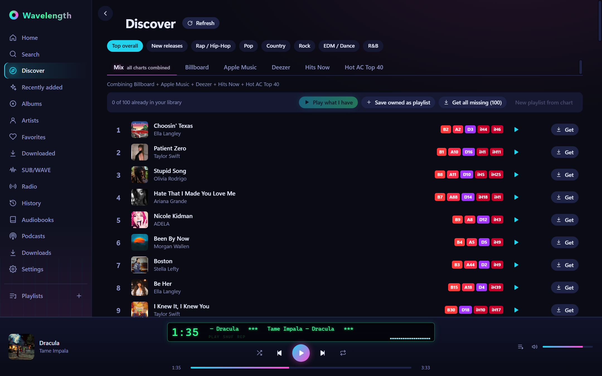
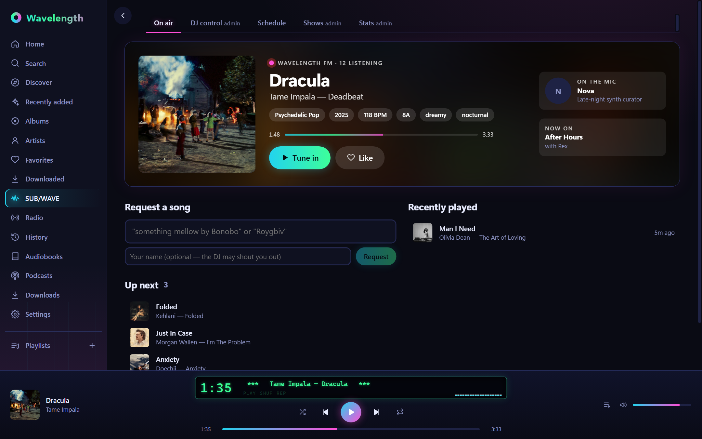
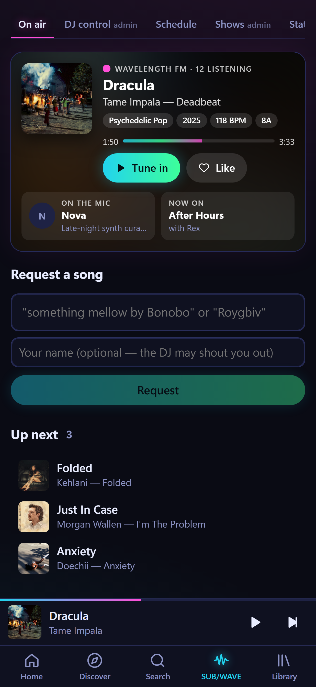
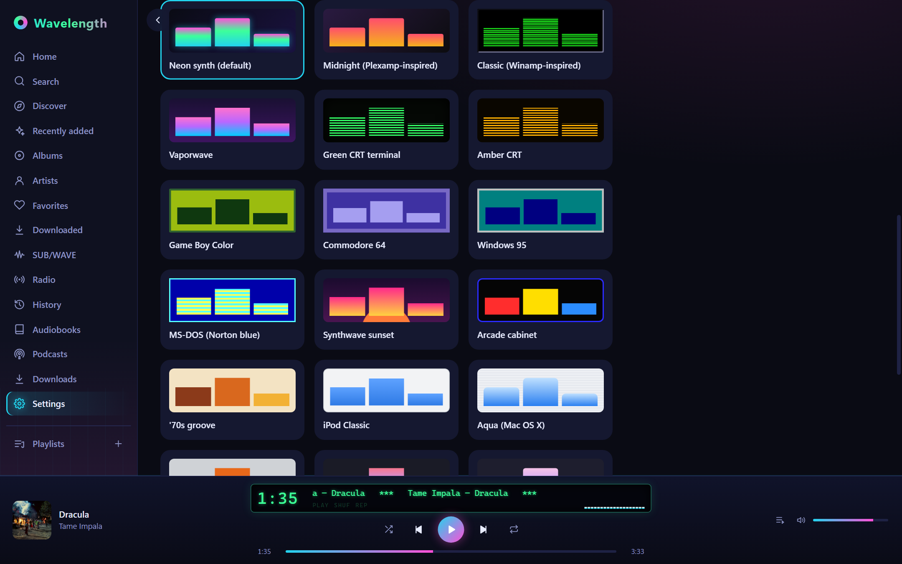

<p align="center">
  
</p>

<p align="center">
  <b>One player for every self-hosted audio source.</b><br>
  Navidrome · Plex · Audiobookshelf · SUB/WAVE · internet radio — with deemix &amp; yt-dlp downloads,<br>
  live charts, offline playback and 62 skins. Windows, Android phones/tablets, and Android TV.
</p>

<p align="center">
  <a href="../../releases/latest"><b>Download the latest release</b></a> ·
  <a href="docs/README.md">Documentation</a> ·
  <a href="docs/BRAND.md">Brand</a> ·
  <a href="CHANGELOG.md">Changelog</a>
</p>

---

<p align="center">
  
</p>

## Why Wavelength

Self-hosted music ends up scattered: albums in Navidrome, more in Plex, audiobooks and podcasts in
Audiobookshelf, a radio station somewhere else, and a downloader in another browser tab. Wavelength
puts all of it behind one player with a Plexamp-style library and a Winamp soul — the LCD, the
spectrum bars, the skins.

| | |
|---|---|
| **One catalog** | Albums and artists from Navidrome and Plex merged into one library. The same album on two servers shows once, with source dots. Search covers every source at once. |
| **Everything that plays** | Music, audiobooks (with resume + progress sync), podcasts, internet radio (50k-station directory), and [SUB/WAVE](https://github.com/perminder-klair/subwave) AI radio. |
| **Discover** | Live charts per genre from Billboard, Apple Music, Deezer, RadioWave and iHeartRadio, combined into a "Mix" — and you pick which charts each genre uses. **Release Radar** finds new albums from the artists *you* play, and with a Hub you can **follow artists** (get notified of their new releases) and get suggestions of who else to follow. 30-second previews; one-click **Get** sends songs to deemix (yt-dlp as backup). |
| **Browse Deezer** | Search Deezer by artist, album, playlist or song, open an artist's full discography or an album's or playlist's tracklist, preview, and send a song, an album, a playlist or a whole discography to deemix. |
| **Playlists everywhere** | Mixed-source playlists, plus two-way sync with Navidrome and Plex (Plexamp) playlists. |
| **SUB/WAVE station control** | On-air view, song requests, likes, queue/cancel songs, DJ controls, a paint-the-hours schedule editor, shows and stats. |
| **Offline** | Download albums and playlists to the device and play with no connection. |
| **Built for every screen** | Desktop, phone (tab bar + mini player), tablets/car head units, and Android TV (D-pad navigation). Native Android media session: steering-wheel, Bluetooth and lock-screen controls. |
| **62 skins** | Neon synth (default), Winamp, Plexamp, Windows 95, MS-DOS, Game Boy Color, C64, CRTs, iPod, Aqua, Walkman, and the Omarchy palettes (Tokyo Night, Catppuccin, Gruvbox, Nord, …), Dracula, Monokai, Solarized, OLED black, High contrast, Sakura, Cyberpunk, neon skins (Outrun, Acid rave, Miami nights, Blacklight UV, Electric, Neon diner, Neon lime, Neon ice), ten laser skins (Laser grid in cyan, magenta, amber, green and violet, Laser show, Red laser, Green laser, Laser harp, Laser tag), eight nuclear skins (Reactor core, Meltdown, Radiation hazard, Fallout shelter, Uranium glass, Nuclear, Radium, Isotope), and holiday skins (Halloween, Thanksgiving, Christmas, July 4th, Valentine's Day) that can switch on by themselves each season. Critter visualizers (a raccoon, shark, alien, grey alien or black or brown bear, playing any of eight acts: DJ, country, rapper, rocker, drums, theremin, synth or accordion) sing along, wear the skin's colours and dress for it: hazmat suits on Nuclear skins, laser visors, glow sticks, 8-bit shades, coder glasses and holiday hats. |

<p align="center">
  
  &nbsp;
  
</p>

<p align="center">
  
</p>

<p align="center">
  
</p>

## Install

Grab the files from the [latest release](../../releases/latest):

| Platform | File | Notes |
|---|---|---|
| Windows 10/11 | `Wavelength_x.y.z_x64-setup.exe` | Installer (recommended). A portable `Wavelength.exe` is attached too. |
| Android phone / tablet / TV | `Wavelength-x.y.z-android.apk` | One APK for arm64 + armv7. Allow "install unknown apps" for your file manager. On Android 17+ tap **Allow** for local-network access, or it can't reach your servers. |

Then open **Settings → Sources** and add your servers. Each source has a **Test connection** button.

After that, Wavelength tells you when a new version is out and installs it for you (**Settings → Updates**).

## Build it yourself

```bash
npm install
npm run tauri dev      # desktop app with hot reload
npm run tauri build    # Windows installer → src-tauri/target/release/bundle/nsis/
```

Android, prerequisites and every known build gotcha are in **[docs/DEVELOPMENT.md](docs/DEVELOPMENT.md)**.

## Documentation

Start at **[docs/README.md](docs/README.md)** — it's a map of the codebase written for whoever picks this up next:

- [Architecture](docs/ARCHITECTURE.md) — how the pieces fit, data flow, where state lives
- [Development](docs/DEVELOPMENT.md) — setup, run, build (desktop + Android), signing
- [Sources & integrations](docs/SOURCES.md) — every server/API Wavelength talks to, and its quirks
- [User guide](docs/USER-GUIDE.md) — browsing Deezer by artist/album/playlist, choosing Discover charts (with screenshots)
- [Adding features](docs/CONTRIBUTING.md) — step-by-step recipes (new source, chart, page, skin…)
- [Troubleshooting](docs/TROUBLESHOOTING.md) — symptoms → causes → fixes we've already hit
- [Releasing](docs/RELEASING.md) — versioning, building, signing, publishing
- [Brand](docs/BRAND.md) — name, logo, colours, type, voice

## License

[MIT](LICENSE). Wavelength is an independent project and isn't affiliated with Navidrome, Plex,
Audiobookshelf, SUB/WAVE, deemix, Deezer, Billboard, Apple, iHeartRadio or RadioWave. Use the download
features only for music you're entitled to.
