# User guide

How to use newer features: browsing Deezer by artist, album and playlist in **Downloads**, choosing which
charts **Discover** shows (both 0.6.0), the **Now Playing visualizers** (including the raccoons), the **equalizer**,
**skins and the Themes tab** (holiday themes, Seasonal and Random daily), **editing your radio stations**, **song titles on radio** and
**searching your playlists**, **profiles with a Wavelength Hub** (signing in, settings sync, managing people) and **in-app updates**. For how they're built, see the
developer notes at the end of each section and [SOURCES.md](SOURCES.md).

---

## Browse Deezer by artist, album and playlist

**Where:** Downloads → **Deezer** tab. You need a deemix server URL in Settings → Downloads → deemix.

Before this, the Deezer tab only listed albums and songs that matched your search. Now you can open
an artist, an album or a playlist and browse the way you would in a streaming app, then send exactly
what you want to deemix.

### 1. Search

Type an artist, album, playlist or song. Results come in four groups: **artists** first, then
**albums** (singles and EPs are tagged), then **playlists**, then **songs**.

  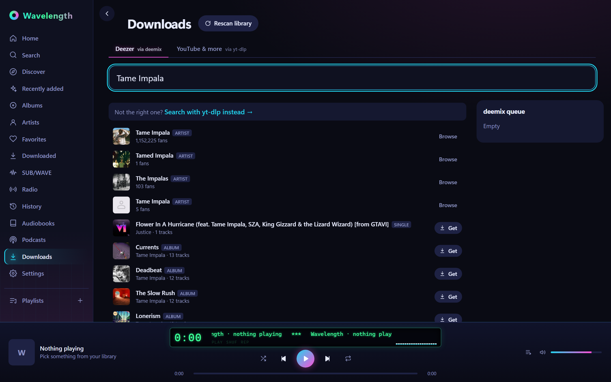

- **Browse** (or clicking an artist's name) opens the artist page.
- Clicking an album or a playlist opens its page.
- On a song row, the artist name and album name are links too.
- **Get** sends that album or song to deemix straight away, as before.

### 2. Artist page

  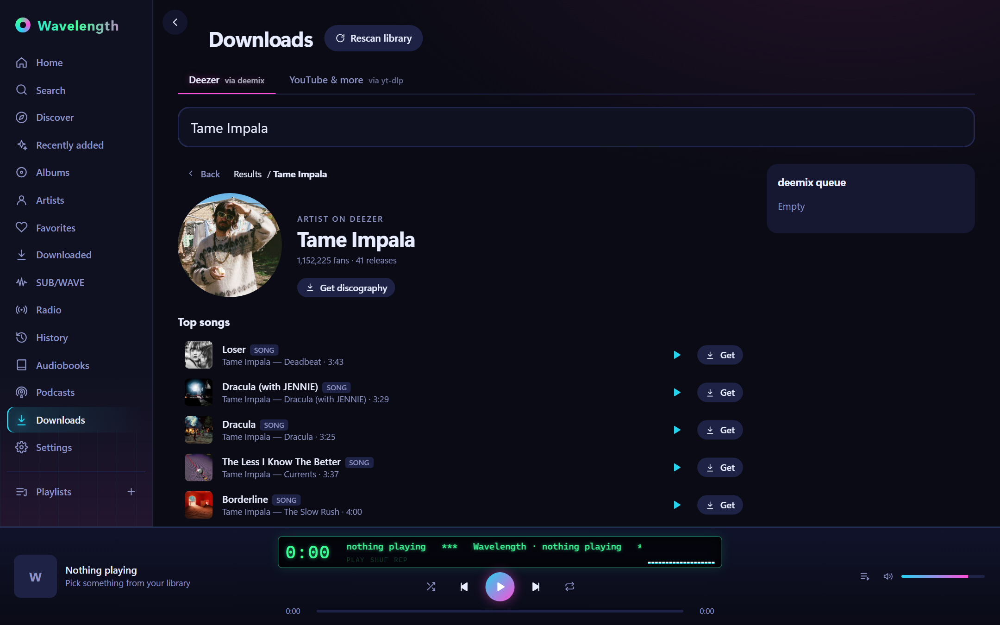

- **Top songs**: the artist's 10 most played songs on Deezer. ▶ plays a 30-second preview and
  **Get** downloads that song.
- **Get discography** sends every release by the artist to deemix. You'll be asked to confirm,
  since that can be a lot of music.

Scroll down for the whole discography, newest first, split into **Albums**, **EPs**, **Singles**
and **Compilations**. Each cover opens the album page, and each has its own **Get** button.
Below that, **Playlists with …** shows public playlists the artist is on, and **Fans also like**
lists related artists so you can keep exploring.

  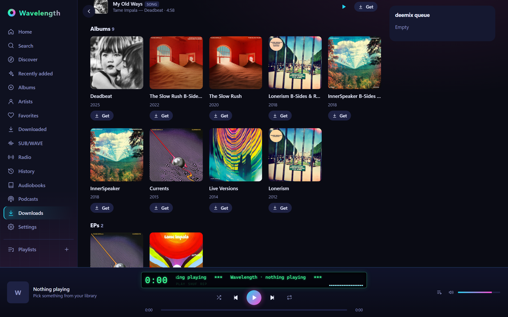

### 3. Album page

  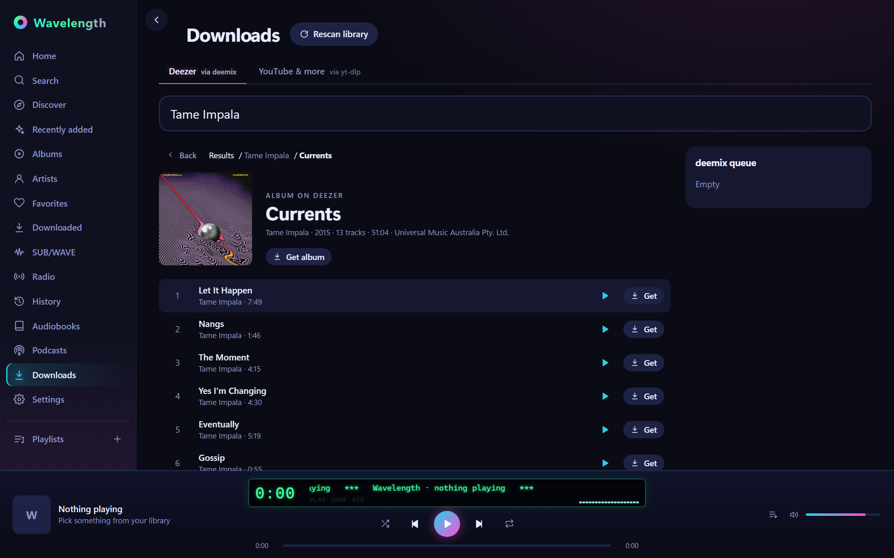

- **Get album** downloads the whole album.
- Or pick songs one by one: each track has ▶ (30-second preview) and **Get**.
- The artist name under the title goes back to the artist page.

### 4. Playlist page

Search for a mood, genre or playlist name (for example *Electronic Hits*) and the matching public
playlists show up, tagged **playlist**, with who made them and how many songs they have.

  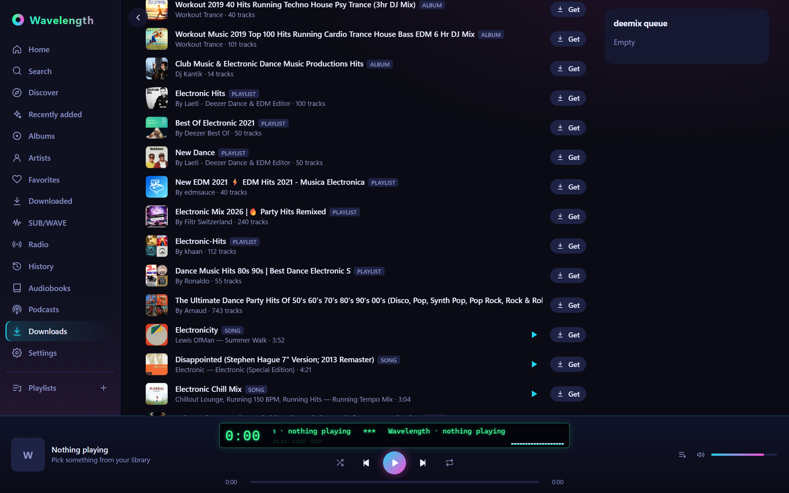

  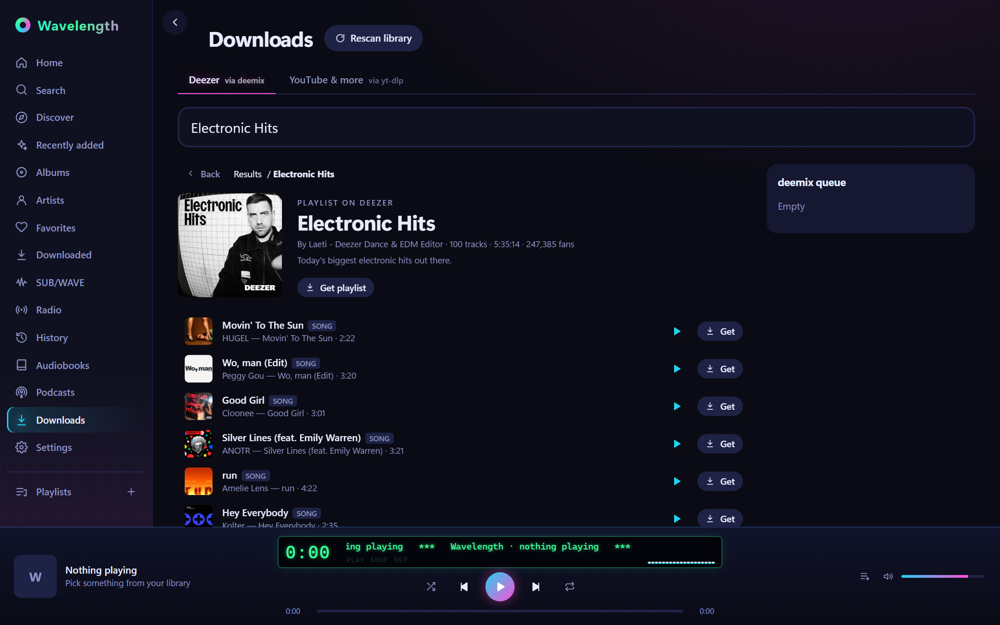

- **Get playlist** sends every song in the playlist to deemix (you'll be asked first if it has more
  than 50 songs). With its default settings, deemix saves them in a folder named after the playlist.
- Or pick songs one by one with ▶ (preview) and **Get**. Each song's artist and album are links.
- Long playlists load in full, up to 2,000 songs.
- Only public playlists can be found; private ones (including your own private Deezer playlists)
  aren't visible to the public API.

### Getting around

- The bar above every page shows where you are, e.g. **Results / Tame Impala / Currents**.
  **Back** goes one step back and **Results** jumps back to your search.
- Typing a new search always takes you back to the results.
- The **deemix queue** on the right keeps updating while you browse, so you can see downloads finish.
- Everything works with a TV remote: titles, links and buttons are all focusable.

> **Developer notes.** Deezer's public API, no login: `GET /artist/<id>`, `/artist/<id>/top`,
> `/artist/<id>/albums`, `/artist/<id>/related`, `/artist/<id>/playlists`, `/album/<id>` and
> `/playlist/<id>` (+ `/playlist/<id>/tracks` paging), wrapped by `getDeezerArtist()`, `getDeezerAlbum()` and
> `getDeezerPlaylist()` in `src/sources/deemix.ts`. The pages live in `src/views/DeezerBrowse.tsx`, and the
> Deezer tab in `src/views/Downloads.tsx` keeps a small stack of opened pages. **Get** on any row
> sends that item's deezer.com link to deemix's `addToQueue`. deemix accepts playlist and artist links
> too (an artist link queues the whole discography).

---

## Choose which charts Discover uses

**Where:** Settings → **Discover charts**, or the **Edit charts** button at the top of Discover.

Each Discover genre (Top overall, Pop, Country …) shows a tab per chart and a **Mix** that combines
them. You can now choose those charts for each genre yourself.

  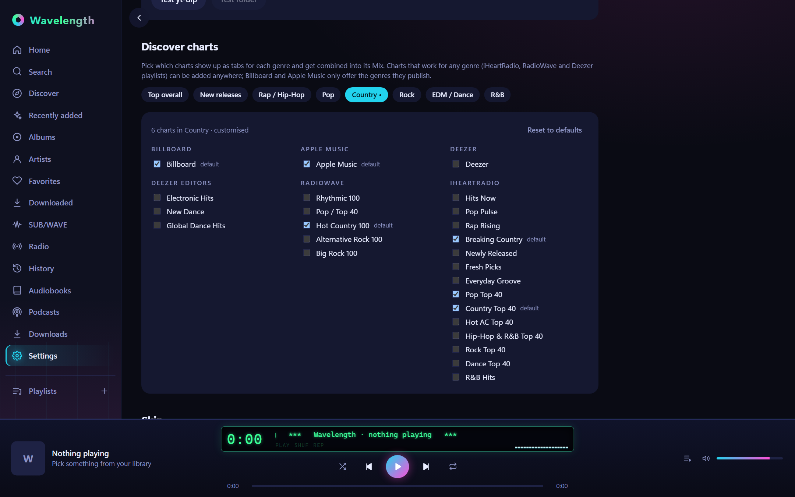

1. Pick a genre from the chips. A genre you've changed has a • after its name.
2. Tick or untick charts. Charts that genre uses out of the box are marked **default**.
3. Discover updates right away: the new charts appear as tabs, and the Mix is rebuilt from them.
4. **Reset to defaults** puts that genre back the way it shipped.

What you can add:

- **iHeartRadio, RadioWave, Deezer editors' playlists and the Deezer global chart** are single fixed
  lists, so you can add them to any genre. In the screenshot, iHeartRadio's *Pop Top 40* has been
  added to Country.
- **Billboard and Apple Music** only appear under genres they actually publish (for example, Billboard
  has no current rap chart).
- Every genre keeps at least one chart, so the last ticked box can't be cleared.

Charts are still checked for freshness: one that hasn't updated recently is skipped with a note,
whether you picked it or not.

A genre you've changed keeps your pick when new charts are added in an update. Tick the new ones here, or
use **Reset to defaults** to get the new default list.

### New releases and genre lists

- **New releases** opens with Spotify's **New Music Friday** and Deezer's **Radar Weekly** (both new every
  Friday), then iHeart's Newly Released and Fresh Picks, with your **Release Radar** above them. No Spotify
  account is needed: Wavelength reads Spotify's public playlist page.
- Each genre has a list from Deezer's genre editors: **Fresh Rap** (daily) under Rap / Hip-Hop, **New Dance**,
  Electronic Hits and Global Dance Hits under EDM / Dance, **Metal Radar** under Rock, **Fresh Pop** under Pop
  and **Fresh R&B** under R&B. Country uses iHeart's Breaking Country and Country Top 40.
- Click a list's tab to see just that list, or **Mix** to combine them.

### Release Radar: follow artists

Signed in to a Hub, Release Radar (top of **New releases**) has a **Following** list: new albums, EPs and
singles from the artists you follow. Press **Follow** on an artist's page (in your library or under
**Downloads → Deezer**), or **Manage → Follow an artist by name**. You get a notification when one of them puts
something out. **Artists you might like** below suggests more: ones like the artists you follow and play, and
ones you play a lot but don't follow yet. **×** hides a suggestion for good. **Artists you play** is the radar
the app works out from your listening, and is the only one without a Hub. **Coming soon** lists releases
they've announced, **Auto** (in Manage) has the Hub fetch an artist's new releases for you as they come out,
and **Weekly Mix** is a new playlist every Friday from new releases and artists you might like. More in
[RELEASE-RADAR.md](RELEASE-RADAR.md).

### Song radio

**Song radio** on Now Playing (and **Artist radio** on a library artist's page) fills your queue with songs
from your own library that sound like the one playing: the artist's best-known songs and those of artists
Deezer lists as related, mixed so the same artist doesn't play twice in a row. The song playing keeps playing;
what comes after it is replaced. It never downloads anything, so the more music you have, the better it gets.

### Charts with a Hub

When you're signed in to a Hub, Discover reads the charts from the Hub instead of every device pulling them
from Billboard, Deezer, Spotify and the rest each time. The Hub fetches the ones people use again every
30 minutes. If a chart service is down or busy, you see the last copy that worked, with a note such as
"couldn't refresh, showing the Hub's copy from Fri 3:10 PM", instead of an error. **Refresh** asks again.

> **Developer notes.** Choices are stored as `discoverCharts` (genre → chart ids) in the settings
> store (`tonearm.settings`). A genre with no entry uses the built-in `BY_GENRE` list.
> `sourcesFor(genre, custom)` in `src/sources/charts.ts` resolves what a genre uses, `chartsFor(genre)`
> says which charts are allowed for it, and `getMix(genre, sources)` mixes whatever list it's given.
> A new chart added to `CHART_LABELS` and `FETCHERS` shows up in the picker automatically.

---

## Now Playing visualizers

Open **Now Playing** (tap the song in the player bar) and **tap the artwork** to switch to the next
visualizer. A label shows each one's name as you go. Keep tapping to cycle through them all and back
to the artwork. Wavelength remembers your pick for next time.

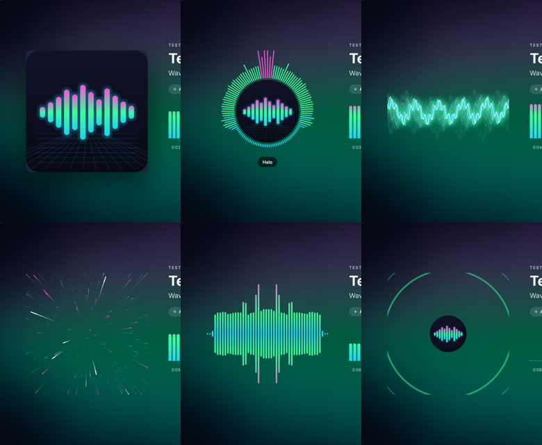

| Visualizer | What it does |
|---|---|
| Artwork | The album cover (the default) |
| Halo | The cover in a circle, with a ring of spectrum bars around it that pulses with the bass |
| Oscilloscope | The live waveform, glowing, with short trails |
| Starfield | Stars fly toward you, faster on louder bass, with an extra push on each beat |
| Mirror spectrum | Spectrum bars mirrored top and bottom, bass in the middle and highs at the edges |
| Pulse rings | A ring ripples out from the cover on every beat |
| Raccoon | A DJ, country, rapper or rocker raccoon playing along (see below) |

Colours come from your skin's visualizer colours, so each skin gives them a different look.

Some radio stations and servers don't let the app read their audio (no CORS headers). On those, the
visualizers still move, but they follow a calm made-up pattern instead of the real music. The small
spectrum under the title does the same.

> **Developer notes.** The visualizers are in `src/components/Scenes.tsx`. `NowPlayingStage` replaces the
> cover in `NowPlaying.tsx`, and the current choice is `npScene` in the settings store. Each scene is a
> `Draw` function that gets a `Frame` (frequency bins, waveform, bass/mid/treble levels, a `beat` flag,
> the skin's `--viz-*` colours and the cover image) and draws on one square canvas every animation frame.
> To add one, write a `Draw`, add its id to `NpScene` (`store/settings.ts`), and add it to `SCENES` and `DRAW`.
> The audio reading (analyser → `freq`, `wave`, `bass`/`mid`/`treble`, `beat`, `transient`, or the calm
> made-up signal) is `createAudioReader()` in `src/player/analysis.ts`, shared by every scene.

### Raccoons

The last visualizer is a raccoon who plays along with the music. There are four to choose from:

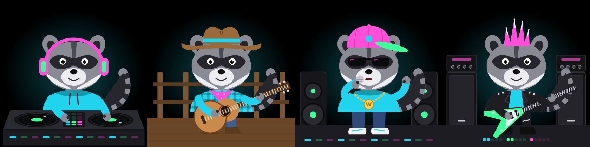

| Raccoon | Look | While the music plays |
|---|---|---|
| **DJ** | Hoodie and headphones, behind two decks | Scratches on sharp hits, rides the mixer, the records spin |
| **Country** | Cowboy hat, plaid shirt, bandana, acoustic guitar, on a porch | Strums on the beat, changes chords, taps his boot |
| **Rapper** | Snapback, shades, gold chain, mic, between two speaker stacks | Raps (his mouth follows the vocals and mids), throws his hand up on the beat, the speaker cones pump with the bass |
| **Rocker** | Spiky mohawk, studded leather jacket, flying-V, in front of two amp stacks | Headbangs hard on the beat, strums on sharp hits, the amp lights follow the bass, mids and highs |

**Switching raccoons.** On the raccoon visualizer, tap **Switch raccoon** in its top-right corner to go to
the next one. Or go to **Settings → Playback → Now Playing visualizer** and pick one; that also switches
Now Playing to the raccoon. Tapping the raccoon itself still moves on to the next visualizer, as on the others.
If you're signed in to a [Wavelength Hub](HUB.md), your pick follows you to your other devices.

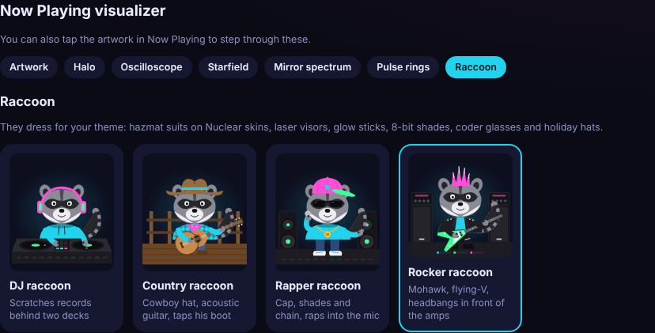

**They dress for your theme.** Fur is always raccoon grey, but their clothes, instruments and lights take
your skin's colours, so every skin dresses them differently. Some groups of skins give them a whole outfit:

| Skin group | Outfit |
|---|---|
| **Nuclear** | A hazmat suit with a hood, respirator, radiation badge and black rubber gloves and boots. Yellow on most nuclear skins, orange on Meltdown, green on Uranium glass and Isotope |
| **Lasers** | A wraparound visor with a laser beam across it that pulses with the bass |
| **Neon** | Glow-stick necklaces and a glow headband that pulse with the bass |
| **Retro** | 8-bit pixel shades |
| **Editor palettes** | Thick-rimmed coder glasses |
| **Holidays** | A hat in place of their own: a witch hat for Halloween, a pilgrim hat for Thanksgiving, a Santa hat for Christmas, an Uncle Sam hat for July 4th and heart boppers for Valentine's Day |

Outfits swap out what they'd clash with: the hazmat hood replaces hats, caps and the mohawk (the DJ keeps
his headphones on over it), and visors and glasses replace the rapper's shades. The outfit follows the skin
on screen, so it changes with Seasonal and Random daily too.

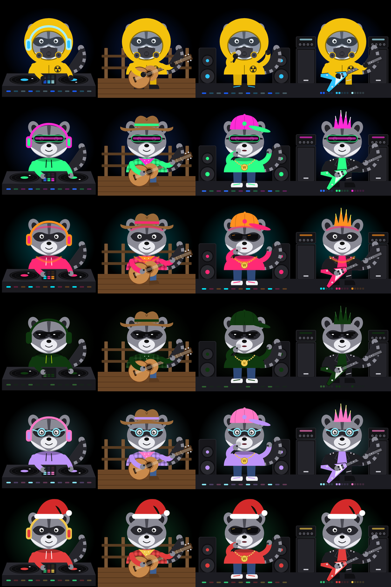

### DJ raccoon

The original raccoon, behind two decks:

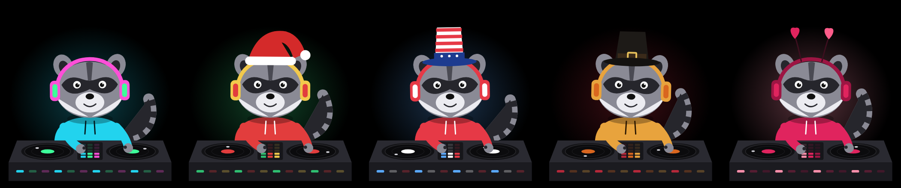

All four raccoons behave the same way around the music:

- **Playing:** the head bobs on each beat (the rocker headbangs harder), and the hands and instrument
  follow the music as in the table above.
- **Paused:** they sway slowly, blink, yawn now and then and set their headwear straight (the DJ his
  headphones, the country raccoon tips his hat, the rapper fixes his cap, the rocker pushes his mohawk up).
  The rapper lowers his mic.
- **Streams the app can't read** (no CORS, see above): they play along to a gentle made-up rhythm instead.

> **Developer notes.** `src/components/raccoon/`. Unlike the other scenes the raccoons are inline SVG, not
> canvas drawings, so the drawings stay editable.
>
> - `rig.ts` (`useRaccoonRig`) is the shared animation: head bob, sway, blink, yawn, the `adjust` part
>   (headwear), tail, backlight and `[data-glow]` pulses. Every frame writes `transform`/`opacity` straight
>   onto named parts (`data-part="head"`, `arm-r`, …), with no React re-render. Each raccoon passes a
>   `frame` callback for its own hands and instrument; `guitar.ts` is the strum/fret/string-buzz shared by
>   the country and rocker raccoons.
> - `parts.tsx` has what they share: the frame and defs, the tail, the head (with the holiday hats and the
>   skin-group outfits) and the body outfits. `DJ.tsx`, `Country.tsx`, `Rapper.tsx` and `Rocker.tsx` draw
>   the rest; `Raccoon.tsx` has the `RACCOONS` list and picks one by `raccoon` in the settings store
>   (`RaccoonKind`, synced to the Hub).
> - Colours are CSS at the end of `styles.css` (`.raccoon .top { fill: var(--accent) }`, …). Hats and
>   outfits are all in the SVG and hidden. Hats show per skin (`:root[data-skin='halloween'] .raccoon .hat-witch`);
>   outfits per skin group, from `data-skin-group` on `<html>`, which `App.tsx` sets from `skinGroup()`
>   (`:root[data-skin-group='nuclear'] .raccoon .outfit-nuclear`). A raccoon's own headwear has
>   `className="own-hat"` and own glasses `own-eyewear`, so outfits can hide them.
> - `still` draws a single (paused) frame, for the Settings cards.

## Equalizer

A 10-band equalizer with presets. There are three ways to open it:

- **Desktop:** the **EQ** button in the player bar, next to the queue button.
- **Now Playing** (phone and desktop): the **EQ** chip under the song title.
- **Settings → Playback**.

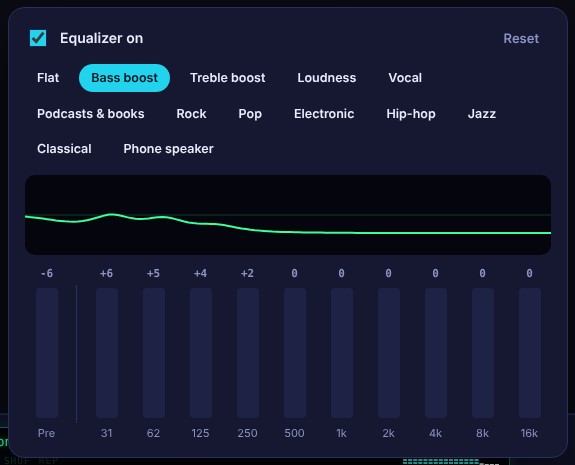

- **Presets.** Tap one to apply it: Flat, Bass boost, Treble boost, Loudness, Vocal, Podcasts & books,
  Rock, Pop, Electronic, Hip-hop, Jazz, Classical and Phone speaker. Picking a preset also turns the EQ on
  and lowers the preamp by the preset's biggest boost, so loud songs don't distort.
- **Sliders.** Each band goes from −12 to +12 dB, and moving one switches the preset to **Custom**.
  Double-click a slider to set it back to 0. **Pre** (preamp) changes the overall level before the bands.
- **Curve.** The green line shows the combined effect across 20 Hz to 20 kHz.
- **On/off.** The checkbox switches the EQ off without losing your settings. **Reset** goes back to Flat.

The EQ applies to everything Wavelength plays: music, radio, podcasts, audiobooks and downloaded songs.
Your settings are saved on this device.

**Phone speaker** is worth trying on Android. It cuts the deep bass a phone speaker can't play anyway
and lifts the mids, so music sounds louder and clearer.

**One limit.** Some radio stations and servers don't let the app process their audio (no CORS headers).
The EQ can't change those streams, and the panel shows a note while one is playing. The same streams
also show the idle visualiser animation.

> **Developer notes.** The bands and presets are in `src/player/eq.ts`, and the filter chain is in
> `ensureGraph()` in `src/player/engine.ts` (preamp → 31 Hz low shelf → 8 peaking bands, Q 1.41 → 16 kHz
> high shelf → analyser). Settings are stored as `eq` in the settings store. `store/player.ts` subscribes
> to them and calls `engine.setEq`, which ramps each gain over about 20 ms so dragging a slider doesn't click.
> The curve comes from `BiquadFilterNode.getFrequencyResponse` on a throwaway `OfflineAudioContext`. To
> add a preset, add an entry to `EQ_PRESETS` (10 gains, low to high).

## Lyrics

In **Now Playing**, the **Lyrics** chip swaps the "Up next" list for the song's lyrics. Synced lyrics follow the
song: the line being sung lights up and stays in the middle, and tapping a line jumps the song there. On a TV
they're shown in big text. Songs with only plain lyrics just scroll; instrumentals say so.

Lyrics come from your **Navidrome** server when it has them (from the files' tags or a `.lrc` file next to the
song, Navidrome 0.53 or newer), otherwise from **LRCLIB** (lrclib.net, free and open, no account). **Kid
profiles** see lyrics with strong words hidden (`f•••`), since clean versions of songs only have the original
words online.

> **Developer notes.** `src/lib/lyrics.ts` (LRC parsing, LRCLIB lookup with a search fallback that prefers synced
> lyrics with a matching length, the kid filter), `NavidromeSource.getLyrics` (OpenSubsonic
> `getLyricsBySongId`), and `src/components/Lyrics.tsx`. Lyrics are cached per song for the session.

## Sleep timer

**Now Playing → Sleep** stops playback after 15, 30 or 45 minutes, 1 hour, 1½ hours, or at the end of the
current song (or audiobook file). Timed sleeps fade out over the last 20 seconds. The chip shows the time left;
tap it again to change it or **Turn off**. The timer belongs to this device and is forgotten on restart.

## Volume levelling, gapless and crossfade

**Settings → Playback → Volume levelling and crossfade**:

- **ReplayGain** plays every song at about the same loudness, from the loudness tags in your files (Navidrome
  passes them on; tag your library with a tool like beets, foobar2000 or MusicBrainz Picard if it has none).
  **Track** levels each song on its own, good for shuffle and playlists; **Album** keeps an album's quiet and
  loud songs as they were meant. Songs without tags are turned down 6 dB so they sit near the tagged ones.
  **Boost** raises everything that's levelled; Wavelength never lets a song clip past its peak.
- **Gapless.** Near the end of a song, the next one is loaded ahead, so live albums and DJ mixes play straight
  through without a gap. This is always on.
- **Crossfade** (1–12 seconds) fades the next song in over the end of this one.

Levelling, gapless and crossfade are for music. Radio, audiobooks and podcasts play as they are, and songs
from a server that doesn't let the app process its audio (the same ones the EQ can't reach) play without
crossfade. These settings sync between your devices with a Hub.

## Skins and themes

**Settings → Themes** changes the app's colours and chrome. Tap a card to switch; the choice is saved on this
device and applies straight away. The visualizers and the LCD follow the skin's colours too.
Every skin works on Windows, Android phones and tablets, and Android TV.

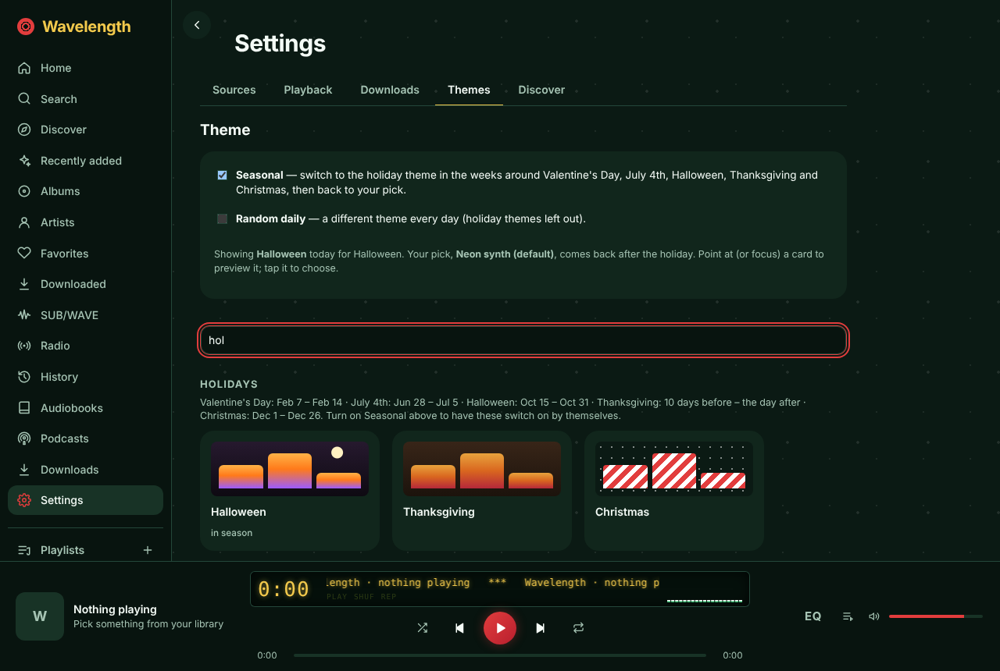

- **Groups.** Skins are grouped as Classic, Retro, Neon, Lasers, Nuclear, Editor palettes, Holidays and Accessibility.
- **Search.** Type in the box to filter by name or group (for example "neon", "laser", "nuclear" or "light").
- **Live preview.** Point at a card (or move to it with the D-pad on TV) and the whole app shows that skin
  until you move away. Tap it to keep it.
- **Seasonal.** In the weeks around each holiday, the app switches to that holiday's skin by itself, then
  goes back to your pick afterwards. Your pick isn't changed. The windows are:

  | Holiday skin | When Seasonal shows it |
  | --- | --- |
  | Valentine's Day (rose and blush, a light skin) | Feb 7 – Feb 14 |
  | July 4th (navy, red and white, with fireworks) | Jun 28 – Jul 5 |
  | Halloween (pumpkin orange and witchy purple) | Oct 15 – Oct 31 |
  | Thanksgiving (harvest gold, cranberry, warm wood) | 10 days before US Thanksgiving to the day after |
  | Christmas (pine green, berry red, gold, a little snow) | Dec 1 – Dec 26 |

- **Random daily.** A different skin every day (holiday skins are left out). Picking a card by hand
  turns Random daily off. If Seasonal is on too, a holiday wins.
- The note under the switches says which skin you're seeing today and why.

You can also pick a holiday skin by hand at any time of year.

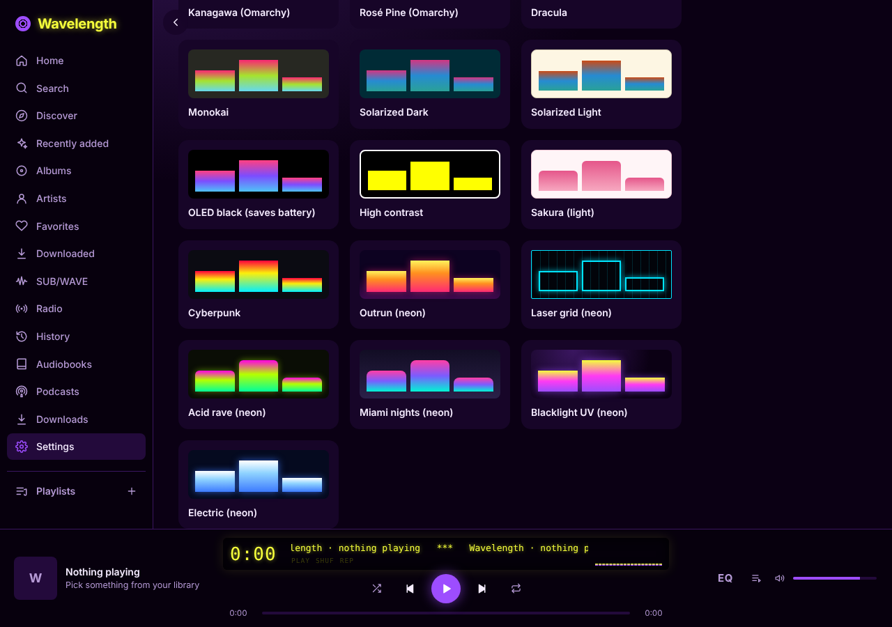

**Neon skins.** For a brighter, glowing look, try one of these alongside the default Neon synth, Vaporwave,
Synthwave sunset and Cyberpunk:

| Skin | Look |
| --- | --- |
| **Outrun** | Hot pink and orange chrome-sunset gradients over a faint purple laser grid. |
| **Laser grid** | Black with a cyan grid; cards, buttons and icons are glowing cyan outlines. |
| **Acid rave** | Toxic lime green with UV magenta, rounded and loud. |
| **Miami nights** | Flamingo pink and teal neon-sign glow on deep purple. |
| **Blacklight UV** | Deep violet with highlighter yellow and pink, like a blacklight poster. |
| **Electric** | Arc-welder blue and violet with a white-hot glow. |
| **Neon diner** | Cherry red and teal, like a roadside diner sign. |
| **Neon lime** | Electric lime and orange on charcoal. |
| **Neon ice** | Cold white-blue tubes on navy. |

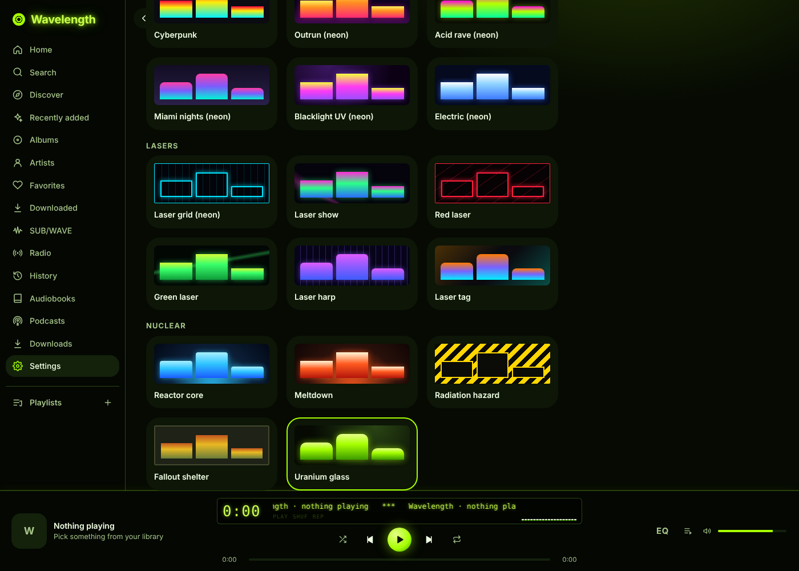

**Laser skins.** Under **Lasers**, next to Laser grid:

| Skin | Look |
| --- | --- |
| **Laser grid magenta / amber / green / violet** | Laser grid's glowing outlines on a black grid, in hot magenta, amber, phosphor green or ultraviolet. |
| **Laser show** | Blue, green and magenta beams fanning up through haze; rainbow buttons and progress bar. |
| **Red laser** | Crimson outlines and diagonal beams on black, square corners, like targeting sights. |
| **Green laser** | A green beam cutting through fog, with lime highlights. |
| **Laser harp** | Vertical violet and blue light strings over deep indigo, rounded and soft. |
| **Laser tag** | A blacklit arena: team orange against team cyan. |

**Nuclear skins.** Under **Nuclear**:

| Skin | Look |
| --- | --- |
| **Cherenkov (reactor core)** | Cherenkov blue glowing up from the bottom of the screen, like a cooling pool. |
| **Meltdown** | A molten core: white-hot through orange to scorched red. |
| **Radiation hazard** | Warning yellow on black, square and bold, with hazard-tape stripes on the player bar. |
| **Fallout shelter** | Olive drab, civil-defence yellow and rust, with a green Geiger-counter LCD. |
| **Uranium glass** | Vaseline-glass green fluorescing under UV, with big round corners. |
| **Nuclear** | Toxic green and hazard yellow glow. |
| **Radium** | Glow-in-the-dark watch-dial green on black. |
| **Isotope** | Plutonium violet with a hazard-yellow edge on cards and the player bar. |

All of these are part of the **Random daily** rotation. They aren't holiday skins, so **Seasonal** never picks them.

**Other skins worth knowing.** **OLED black** uses true black so OLED phone screens switch those pixels off,
which saves battery. **High contrast** is yellow on black with thick outlines and strong focus rings, for low
vision or bright sunlight. **Sakura**, **Solarized Light** and **Valentine's Day** are light skins.

> **Developer notes.** A skin is a `:root[data-skin='…']` block of CSS variables in `src/styles.css` plus a
> `.skin-card.<id> .skin-preview` rule for its picker card, and an entry in `SKINS` (`store/settings.ts`)
> with its `group` (one of `SKIN_GROUPS`). Recipe: [CONTRIBUTING.md](CONTRIBUTING.md#add-a-skin). Skin rules
> must sit at the top level of `styles.css`; one inside a `@media (max-width: 760px)` block only applies at
> phone width, which is what broke seven skins on Windows in 0.7.0.
>
> The saved `skin` is what the user picked. What's on screen is worked out in `App.tsx`:
> `useUi.previewSkin` (hover preview, never saved) if set, else `activeSkin()` from `src/lib/seasons.ts`,
> which applies Seasonal (`seasonal`, holiday windows in `SEASONS`) and Random daily (`randomDaily`,
> a hash of the local date). `App` re-checks every 10 minutes while either mode is on, so it rolls over at
> midnight. Everything uses the device's local date; nothing needs a server.

## Smart playlists

**Playlists → Smart playlists** are rules instead of a list of songs: genres, your star rating, ♥ only, not
played in N days, added in the last N days, a range of years, and how many songs at most. Press play and
Wavelength picks matching songs from your Navidrome library at random, so the playlist changes as you add, rate
and play music. **Save copy** saves today's songs as an ordinary playlist on your server, for other apps. The
rules follow you to every device with a Hub. Genres match your tags, so tidy genres help (below).

## Library care

**Albums → Library care** (on a phone, Library → Library care) has two lists:

- **Duplicates:** albums your server has more than once, counting editions like "Deluxe" or "25th Anniversary"
  as the same album, with the most complete copy first. Explicit and clean versions don't count, nor does the
  same album on two different servers. Hub admins can **Delete** the extra copies; they go to the Hub's trash
  for 30 days.
- **Missing albums:** for the 40 artists you have the most albums by, the studio albums Deezer lists that you
  don't have, with preview and **Get** / **Request**. Live albums, compilations and remix albums are left out.

## Deleting several albums at once

Hub admins get a **Select** button on **Albums**. Tap albums to tick them (or **Select all**, which ticks every
album the filter shows), then **Delete selected**. Wavelength lists what it's about to delete and asks first.
The files go to the Hub's trash, and **Settings → Server → Deleted albums** can put them back for 30 days. Only
copies on a Navidrome server can be deleted this way. Press **Done** to go back to opening albums.

## Searching your playlists

When you have lots of playlists, use the search box at the top of **Playlists**. Type part of a playlist's
name and only the matching ones stay on the page. For Wavelength playlists it also looks inside them: type a
song, artist or album and you get every playlist that has it, with the card showing the song that matched
(for example *Has Dreams · Fleetwood Mac*). Navidrome and Plex playlists are matched by name only. Press
**Esc** to clear the search.

The **+ Playlist** menu works the same way: start typing in its box and the list narrows to playlists whose
name matches, so you can click the one you want. Press **Enter** instead to make a new playlist with that name.

> **Developer notes:** `playlistMatch()` in `src/views/Playlists.tsx` does the matching (case-insensitive
> substring on the name, then the title, artist and album of a Wavelength playlist's tracks). Server
> playlists only carry a name and track count in `useServerPlaylists`, so searching their songs would mean
> fetching every playlist; that's left out on purpose. The **+ Playlist** filter is in
> `src/components/AddToPlaylist.tsx`.

## Import a playlist

**Playlists → Import** brings a playlist over from somewhere else. Paste a link, or choose a file:

- **Deezer** playlist or album links.
- **Spotify** public playlist or album links. Spotify only shows its first 100 songs or so without signing
  in, so for longer playlists export a CSV at [exportify.app](https://exportify.app) and import the file.
- **YouTube Music** or YouTube playlist links. Your Hub reads these with its yt-dlp (nothing is downloaded),
  so you need to be signed in to a Hub.
- **CSV** files (Exportify, TuneMyMusic, Soundiiz or any sheet with title and artist columns), **M3U**
  playlists, and **text** files with one *Artist - Title* per line.

Wavelength looks each song up in your library and shows what it found. **Save playlist** makes a Wavelength
playlist of the songs you have, in order (rename it first if you like). **Get missing** (or **Request
missing**, for people who ask the admin for music) sends the rest to deemix, or to yt-dlp for songs Deezer
doesn't have; each song also has its own **Get** / **Request** button. On a kid profile, songs that aren't
for kids are left out.

> **Developer notes:** parsing and fetching are in `src/lib/playlistImport.ts`, the page is
> `src/views/ImportPlaylist.tsx`, and getting a missing song is shared with Discover in `src/lib/getSong.ts`.
> YouTube goes through the Hub's `POST /api/import/youtube`; Spotify's embed page and Deezer's API go through
> `/api/fetch` in a browser.

## Control your other devices

Signed in to a Hub, the **Devices** button in the player (and on Now Playing) lists your other devices that
have Wavelength open: what each is playing, with play/pause, next, previous and volume for it. **Continue
there** moves what you're playing to that device, picking up at the same spot, and pauses it here; **Play
here** does the opposite. Only your own devices show up. To keep a device out of the list, turn off
**Settings → Account → Let my other devices see and control this one** on it.

## Listen together

With a Hub, the **party** button by the volume (and on Now Playing) starts a listening party: everyone who
joins hears the same song at the same moment on their own device, wherever they are. Start one, and others
see it under the same button with **Join**. As the host you play music as usual. Guests' **+ Queue** and
**Next** on any song add it to the party (you can turn that off), and you can let guests skip and pause too.
**Leave** or **End party** when you're done.

## Scrobbling

**Settings → Account → Scrobbling** (with a Hub) sends every song you play to
[ListenBrainz](https://listenbrainz.org) and, if your Hub admin has set it up, Last.fm. For ListenBrainz paste
your user token from listenbrainz.org/settings; for Last.fm enter your username and password once (the Hub
keeps only the session Last.fm gives back). Plays from all your devices are sent, about once a minute, and ones
made offline go when the device reaches the Hub again. Radio, audiobooks and podcasts aren't sent. If a
service stops accepting your login, the row says so: disconnect and connect again.

## Rewind

**History → Rewind** (with a Hub) is your year in music, or any month of it: minutes listened, plays, top
artists, songs and albums, your most played song and when you first played it, new artists you found, your
busiest day and longest streak, and when you listen most. **Play your top songs**, **Save as playlist**, or
**Share as a picture** (a card in your skin's colours; on a phone it opens the share sheet). It counts music
from every device you're signed in on, not radio, audiobooks or podcasts, and starts from the history your
Hub already has.

## Following downloads

**Downloads → deemix queue** shows everything deemix has, as it happens:

- **Downloading · 5 of 12 songs**, with a bar, and **Waiting · 3 in line** for the ones behind it.
- **Done, but 2 of 12 songs failed**: press **Why?** to see which songs and deemix's reason (for example "Not
  available at the chosen quality").
- **Stuck · no progress for 20 min**, in red, when deemix has stopped moving. **Cancel** it (or **Retry**) and the
  rest carry on. If that doesn't help, restart deemix.
- **Clean versions held by your Hub** wait at the top until deemix is free, saying what they're waiting for. You
  can cancel them there.
- **Clear finished** tidies deemix's list.

Inbox shows the same for requests, including the ones Release Radar gets automatically: a bar, the songs that
couldn't be got and why. A request deemix lost (its list was cleared, or it restarted) says so after an hour, and
**Retry** sends it again. In **Inbox → Clean versions**, an album deemix no longer has says **Not in deemix's
queue any more** and can be sent again, and the bar at the top shows how busy deemix is.

> **Developer notes.** `src/lib/deemixQueue.ts` (reading the queue, stuck detection, Cancel / Retry), `src/components/DeemixQueue.tsx`,
> and on the Hub `hub/src/deemixQueue.ts`. Without a Hub, the app reads deemix itself with the same rules.

## Containers (Hub admins)

If your Hub is set up for it, **Settings → Server → Containers** lists the household's other services, like
Navidrome and slskd, and whether each is running. **Start**, **Stop** and **Restart** do what they say, and
**Logs** shows what the container printed lately, handy when something stops working. Only the containers the
Hub was told about show up. Setting it up is in `docs/HUB.md`, "Docker control".

## Settings tabs

Settings is split into tabs: **Account** (Wavelength Hub sign-in), **Users** and **Server** (Hub admins only), **Sources** (servers), **Playback** (equalizer), **Downloads** (deemix and
yt-dlp), **Themes**, **Discover** (charts) and **Updates**. Links elsewhere open the right tab: **Edit charts** on
Discover opens Discover, and the Settings link in Downloads opens Downloads.

> **Developer notes.** `src/views/Settings.tsx`, one component per tab. The route can name a tab:
> `go({ view: 'settings', tab: 'themes' })` (`SettingsTab` in `store/ui.ts`).

## Editing your radio stations

**Radio → Your stations** lists the stations on your Navidrome and SUB/WAVE servers. Tap **Edit** next to
the heading to change them:

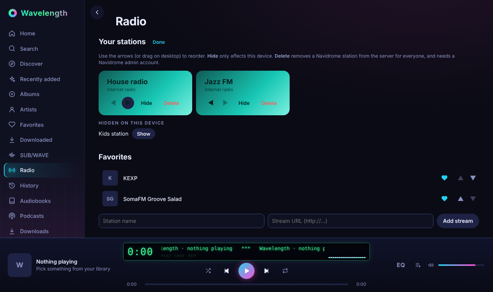

- **Reorder** with the ◀ ▶ arrows, or drag a station onto another on desktop.
- **Hide** removes a station from the row on this device only. Hidden stations are listed under the row
  while editing, each with **Show** to bring it back.
- **Delete** (Navidrome stations only) removes the station from the Navidrome server for everyone. Navidrome
  only lets admin accounts do this; if your account isn't an admin you'll get an error, and you can hide it instead.
- Tap **Done** when you're finished.

Your **Favorites** (stations you hearted, and streams you added by URL) have ▲ ▼ arrows to reorder them,
and the heart removes one.

> **Developer notes.** `src/views/Radio.tsx`. Hidden stations and the order are `hiddenStations` and
> `stationOrder` in the settings store, keyed `<sourceId>:<stationId>` because ids are only unique per
> server. Stations the order doesn't know yet go at the end. Delete calls `deleteStation` on the source
> (`deleteInternetRadioStation` in `sources/navidrome.ts`); Navidrome enforces the admin check. When the
> Wavelength Hub arrives (see [USERS-AND-ADMIN.md](USERS-AND-ADMIN.md)) the hidden list and order are
> meant to sync per user; today they're per device.

## Song titles on radio

While a station plays, the player shows the song it's on instead of just the station's name, wherever the
station tells us:

1. **The station's now-playing page** (SUB/WAVE, AzuraCast, Icecast's status page), which can also bring
   cover art.
2. **The title inside the stream.** Most Shoutcast and Icecast stations send the current song inside the
   audio stream itself, even when they have no now-playing page. The desktop and Android apps read it
   straight from the station. In a **browser**, the page isn't allowed to, so it asks your **Wavelength Hub**
   instead: sign in to a Hub to get titles there.

The title is checked every 15 seconds, so a new song can take that long to appear.

**Still only the station name?** Then the station doesn't send song titles at all. That's common for DJ mix
and "sessions" stations, which play one long mix rather than separate songs. Nothing in the stream says
what's playing, so the only way to name the song is to recognise the audio, like Shazam does.

> **Developer notes.** `watchNowPlaying` in `store/player.ts` tries the now-playing page, then
> `streamTitle()` in `sources/radio.ts`, and keeps using whichever gave a title first. The ICY parser is
> `lib/icy.ts` (apps) and `hub/src/radio.ts` (Hub, `GET /api/radio/now-playing`); `hub/test/radio.test.ts`
> checks they agree. HLS (`.m3u8`) streams carry no ICY titles and are skipped. A title equal to the
> station's own name is ignored.

### Get the song you hear

When a station's title reads like "Artist - Song", **Now Playing** shows a button for it. If the song is in
your library, it says **Queue from library** and plays it after the station. If not, it says **Get this song**,
which sends it to deemix (or yt-dlp when Deezer doesn't have it) or, without Autodownload, requests it, like
**Get** in Discover.

### Stations for you

Above the directory, **Radio → Stations for you** lists popular stations in the three genres you have the most
music in (from your Navidrome library's genre counts, so tidy genres help). It shows when you're not searching.

## Profiles with a Wavelength Hub

If your household runs a [Wavelength Hub](HUB.md), everyone gets their own profile. Without one, nothing
changes: Wavelength works on its own, as before.

### Signing in

**Settings → Account**: type the Hub's address (e.g. `https://hub.example.com`) and press **Connect**.

- **Sign in with a code** is the easy way, and the only comfortable one on a TV. Wavelength shows a code and
  a QR code. Scan it with your phone (or open the address shown and type the code), sign in there with single
  sign-on (tinyauth) or your Hub password, and press **Allow**. The TV signs itself in a moment later.
- **Sign in with a password** signs in with your Hub username and password directly.
- **I have an invite** makes your account from an invite link an admin sent you, and signs this device in.
- On a brand-new Hub, the Account tab offers **Set up this Hub** instead: that creates the first admin (you).

Once you're signed in, your settings, your Wavelength playlists and your play history follow you to every
device, and stay yours on a shared one: when someone else signs in there, they see their own playlists and
history, and yours come back when you sign in again. The playlists already on a device become the first
person's to sign in on it.

**In a browser:** open your Hub's address (e.g. `https://hub.example.com`) in any browser and you get
Wavelength itself, already pointed at that Hub: sign in and go. Offline downloads and yt-dlp on the device
need the app; everything else works. See [HUB.md → In a browser](HUB.md#in-a-browser) for what your music
servers need.

**Own Navidrome accounts (admins):** under **Settings → Server → Navidrome accounts**, add your Navidrome
address and its admin login once. Then **Make account** gives anyone their own Navidrome account (named
after their Hub username, with a long random password), or **Use their login** saves one they already have.
Their devices get it in Settings → Sources when they sign in, so favorites, play counts and playlists are
each person's own. The admin login stays on the Hub; it also starts the scans after downloads. Kids' devices
never get their Navidrome password: they reach Navidrome through the Hub, which plays them nothing explicit
or flagged. Turn on **Send everyone through the Hub** to do the same for everybody (the Hub has to be able
to reach Navidrome, and music then travels through it).

**Listening now (admins):** **Settings → Server** lists who is playing what, on which device. Devices report
it every minute while playing; the Hub only keeps it in memory.

**Settings → Server** (admins) shows how the Hub is doing: version, how long it's been running, free space
on the music and data disks (and whether the music folder is writable), yt-dlp's version, how many people
and devices there are and how many requests are waiting. **Download backup** saves a copy of the Hub's
database; keep the Hub's `secret.key` with it. **Restore a backup…** puts one back: the Hub checks it,
restarts, and keeps the database it replaced on the server just in case.

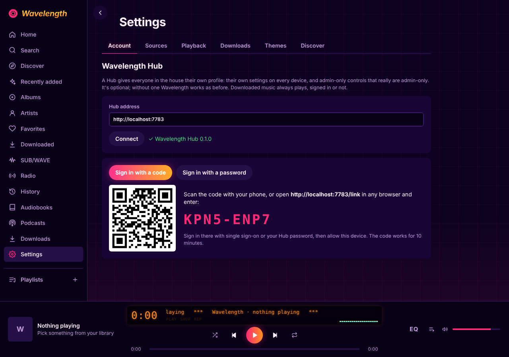

### What follows you between devices

Once you're signed in, your **theme** (and Seasonal / Random daily), **equalizer**, **volume levelling and crossfade**, **Now Playing scene** and **raccoon**,
**radio stations** (favorites, hidden and order) and **Discover chart picks** sync to your profile. Change the
skin on the TV and your phone has it next time it checks in (at start, when the window gets focus, and every
few minutes; **Sync now** does it at once). Each setting syncs on its own, so changing the EQ on one device and
the skin on another never overwrite each other. Changes made with no connection are kept and sent later.

Server logins your admin keeps on the Hub arrive too: Plex, Audiobookshelf and SUB/WAVE show up in
Settings → Sources marked **from your Hub**, and people allowed to download can use the Hub's deemix and
yt-dlp from Downloads (on Android too). Your own Navidrome login arrives too once an admin has set one up for you; downloaded music stays on each device. **Downloaded music always
plays**, signed in or not, with or without the Hub.

### Server logins on the Hub (admins)

- **Settings → Sources → Move to Hub** puts a Plex, Audiobookshelf or SUB/WAVE server (and its login) on the
  Hub. It keeps its place in the list and its downloads on this device. Servers you add while signed in go
  to the Hub straight away.
- **Edit** a Hub server to change it for everyone, and to pick **who can use it**: Everyone, Admins only, or
  People I choose. **Own login** gives someone their own Plex token or Audiobookshelf key.
- **Settings → Downloads → Move to Hub** hands deemix (with its ARL) and yt-dlp to the Hub. From then on the
  Hub does the downloading: deemix with the ARL it keeps, and yt-dlp straight into a folder inside its music
  folder (pick the folder there; no network-share login). It works from any device, phones and TVs included.
  Change the settings there and press **Save to Hub**.
- SUB/WAVE DJ controls, the schedule and shows go through the Hub too, which keeps the SUB/WAVE admin login.
  No device is sent that login or the deemix ARL, not even yours.
- Members and kids never get SUB/WAVE admin controls. Downloads are for admins and people with
  **Autodownload**; everyone else sees "Your Hub admin looks after downloads".

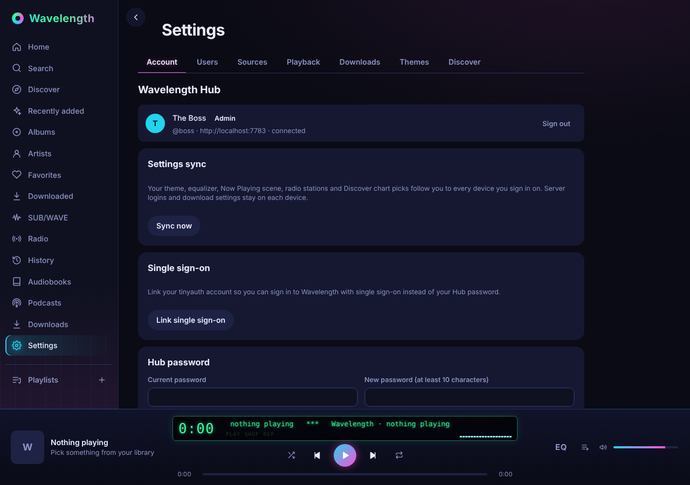

### Linking single sign-on to your account

If you've been signing in with a Hub password and want to use tinyauth instead, link the two once. Either:

- **From the app:** Settings → Account → **Link single sign-on**. Open the link it shows (or scan its QR code)
  in a browser, sign in to tinyauth, press **Link**, then press **Done** in the app.
- **From the browser:** start **Sign in with a code** and choose single sign-on. If tinyauth knows you but no
  Wavelength account is linked yet, the page asks for your Wavelength username and Hub password once, links
  them, and carries on signing in the device.

After that, single sign-on is enough; your Hub password keeps working too. **Unlink** is in the same place
(only if you have a Hub password, so you can't lock yourself out).

### Your devices

Settings → Account lists every device signed in to your profile. **Sign out** next to one (a lost phone, an old
TV) and it's signed out at once.

### Two-step sign-in

Settings → Account → **Two-step sign-in** adds a code from an authenticator app (Google Authenticator, 1Password,
Aegis…) to signing in with your Hub password. Scan the QR code, type the 6-digit code to turn it on, and keep the
10 **recovery codes** it shows somewhere safe: each one works once in place of a code if you lose your phone.
From then on, signing in with a password (in the app, or on `/link` in a browser) asks for the code too.
Single sign-on through tinyauth is left to tinyauth. Turning it off takes your password and a code. An admin can
**Reset 2-step** for someone who lost both their phone and their recovery codes, and the Users tab marks admins
without it.

### More than one person on a device

A TV or a shared tablet can keep everyone signed in. Settings → Account → **People on this device → + Add
someone** signs in another person, and their name then switches to them in a tap, with their own settings,
playlists, requests and Inbox. **Ask for a PIN before switching to me** keeps the others out of your profile by
accident (it's checked on this device only). Leaving a kid profile takes the grown-up PIN. **✕** signs someone
out of this device.

### Managing people (admins)

Admins get a **Users** tab:

- **Add someone**: username, display name, role, and a Hub password and/or their tinyauth username.
- **Invite someone**: pick a role (and Autodownload for a member) and get a link and QR code to send. They
  open it in a browser, or paste it under **Settings → Account → I have an invite** (or as the Hub address),
  and choose their own username and password. Each link works once and stops working after the days you pick.
- **Role**: Admin, Member or Kid. Changes apply straight away, no re-login.
- **Autodownload** (members only): lets them download without your approval. Without it, their **Get** buttons say **Request** and you approve in the Inbox. Kids can never have it.
- **Set password**, **SSO** (link or unlink their tinyauth username), **Turn off** (signs out all their devices), **Delete**.
- **Parents** (on a kid's row): the grown-ups whose approval that kid's requests need, besides the admins. A
  parent sees the kid's requests in **Inbox → To approve** and can approve or reject them (Soulseek picks and
  clearing the list stay with admins), and gets the kid's **weekly report** each Monday: songs, minutes, days
  and top artists. Kids without parents have their report sent to the admins.
- **Reset 2-step**: turns off someone's two-step sign-in.
- **Signed-in devices**: everyone's devices, with **Sign out**.
- **Activity**: recent sign-ins and admin changes.

The Hub refuses every one of these actions from a non-admin, so hiding the tab isn't what protects them.

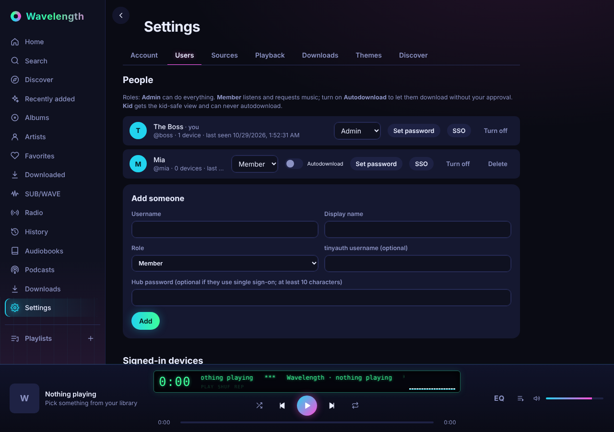

### Requesting music

Signed in to a Hub without **Autodownload**, the **Get** buttons in Downloads, Discover and Release Radar say
**Request** instead. Search Deezer in **Downloads** as usual, or paste a YouTube, SoundCloud or Bandcamp link
under **Not on Deezer?**. Your requests and their answers are in **Inbox → My requests** (and in the side
panel of Downloads): *Waiting*, *Downloading*, *Adding to your library*, *Ready*, *Already in the library*,
*Not this time* (with the admin's reason) or *Download failed*. You can cancel one that's still waiting.
When it's **Ready**, the Inbox badge lights up and **Play** finds it in your library and plays it.

**Notifications:** while Wavelength is in the background, a request that's ready or was turned down, something
shared with you, and (admins) a new request also pop up as a system notification. Turn them off for one
device under **Settings → Account → Notifications**. On Android they come while the app is open or playing in
the background; in a browser, allow notifications for the page when asked.

**While Wavelength is closed:** once an admin has set up push notifications (**Settings → Server → Push
notifications**: `https://ntfy.sh`, or your own ntfy server), **Settings → Account → Notifications → When
Wavelength is closed → Turn on** gives you a private topic. Install the free **ntfy** app, then tap **Subscribe in
ntfy** (or scan the code), and **Send a test**. Everything the Hub would notify you about then also arrives through
ntfy, on Android, iPhone or a computer. **New topic** cuts off anyone else who subscribed to the old one.

**Admins:** add a Navidrome admin login under **Settings → Server → Library updates** and the Hub asks
Navidrome to scan as soon as a download finishes (requests and your own downloads), so new music shows up
in a minute instead of at Navidrome's next scheduled scan. **Scan now** starts one by hand.

**Admins** see a number on **Inbox** when something waits. **Inbox → To approve** lists who asked for what,
with their note:

- **Approve**: the Hub downloads it, Deezer links with deemix and anything else with yt-dlp, straight into
  the music folder. If the download can't start it shows *Download failed* with the reason and **Retry**.
- **Already have**: nothing to download; they're told it's in the library.
- **Reject**: asks for a reason, which they see.
- **Soulseek…** (when your Hub has slskd): searches Soulseek for it; **Use this** on a folder downloads that
  and approves the request. It shows *Ready* once the files are in and Navidrome has scanned.

Admins and people with Autodownload skip the queue: their **Get** downloads straight away.

### Soulseek

With slskd added to your Hub (**Settings → Downloads → Soulseek**, admins: slskd's address and an API key),
**Downloads** gets a **Soulseek** tab for admins and people with Autodownload. Search for an artist and album;
results come in over a few seconds, grouped by folder (usually one album each), with the best matches from
people with a free slot first. Each shows how many songs, the format (FLAC or MP3 and its bitrate), the size
and whether you'd have to wait. Tap a folder to see its songs, **Download** to get it. **In slskd** below shows
how downloads are going. slskd saves into its own downloads folder, so point that at a folder inside your
music library (e.g. `/music/slskd`) and Navidrome picks the music up.

### Kid profiles

Someone with the **Kid** role gets a simpler Wavelength: a shorter menu with bigger buttons, **Ask for music**
instead of Downloads, and **Me** instead of Settings. Admins set each kid's **bedtime** and **minutes a day**
under **Settings → Users → Kid profiles**, along with one **grown-up PIN** for the household.

- At bedtime, or once today's minutes are used up, the music stops and a "Time for bed" screen covers the
  app. Minutes add up across all the kid's devices, and bedtime uses the device's clock, so it works offline.
- **A grown-up can unlock** on that screen: the PIN gives 30 more minutes.
- **Me** shows how long they've listened today. **Sign out** (to switch profile) needs the PIN.

### Kid-safe music

On a **Kid** profile, Wavelength hides anything marked explicit and anything an admin hid from kids: in
albums, artists, search, playlists, favorites, Discover, Release Radar and Deezer browsing. The player won't
play it either, even from a shared playlist. Explicit and clean songs and albums carry an **E** or **C**
badge for everyone; that comes from your files' tags (Navidrome reads them) or from Deezer.

**Admins** get a **Kids** button on every song row, album and artist: **Hide this … from kids**, or **OK for
kids** for something marked explicit that's fine. It applies on every kid's device. **Settings → Users →
Kid-safe music** lists everything flagged, with **Remove**.

A song or album is marked for **the version you're looking at**. On an album page with the **Explicit** /
**Clean** switch, flip to the version first: **OK for kids** on the clean version doesn't let the explicit one
through, and hiding the explicit one doesn't hide the clean one. **Hide every version of this … from kids**
covers both. A song tagged explicit in its file stays hidden even inside a "(Clean)" album, unless you let that
song through.

> **After updating to 0.17.2:** earlier versions saved **OK for kids** under the explicit album's name even when
> you set it on the clean version, and song marks applied to both versions. When the Hub updates, every **OK
> for kids** on a song or album moves to the clean version, so explicit music is hidden again. If you really
> meant to let an explicit song or album through, mark it again. **Hide** marks on songs keep covering every
> version. The audit log records the change (`kids.flagsRepaired`).

**Files without the explicit tag, and Plex.** Under **Settings → Users → Kid-safe music**, **Check my
library** looks each album up on Deezer and records on your Hub which albums and songs are explicit. Your
files aren't changed. It takes a few minutes for a big library, can be stopped, and **Check new albums** later
only looks up albums it hasn't seen. Albums Deezer doesn't have stay as they are, so flag those by hand if
needed. When Deezer has a clean version of an explicit album, the album page shows **Get clean version**
(**Request clean version** for people without Autodownload).

**Getting the clean versions in one go.** **Inbox → Clean versions** lists every explicit album the library
check found a clean version of (the summary under **Library check** links to it). Each row has a **play**
button that previews the clean album's 30-second clips, and **Download** (or **Request**). Tick albums, or
**Select all**, and press **Download selected**, or **Download all** for the lot. Each row shows where it is:
**Queued**, **Downloading 40%**, **Downloaded**, **Failed** (with **Retry**), or **In your library** when you
already have a clean copy. Albums already in your library or already sent are skipped, and Wavelength remembers
what it sent on this device, so you won't download one twice. The tab shows up once the check has found at
least one clean version, for anyone who can download or request music (not on kid profiles).

**Where clean versions go.** Deezer gives a clean album the same name as the explicit one, so deemix would
normally save it to the same folder and skip every song as already there. When your Hub runs deemix, Wavelength
saves each clean version to its own folder instead, named like the explicit one with **(Clean)** on the end
(*Rihanna - Loud (Clean)*), and your explicit copy stays where it is. To do that, the Hub waits until deemix
has nothing else to do (the row says **Waiting for deemix**), adds " (Clean)" to deemix's album folder name
while that one album starts, then puts deemix's setting back. With a music folder on the Hub, the songs' album
tag gets " (Clean)" too, so Navidrome shows the two versions as separate albums, the album page gets its
Explicit / Clean switch, and kid profiles play the clean one. **Get clean version** on an album page works the
same way. If deemix runs on your device instead of the Hub, clean versions go wherever deemix's own settings
put them.

So that new downloads carry the tag, open deemix, go to **Settings → Tags** and tick **Explicit lyrics**.

**Which Deezer album counts as the clean version.** The library check only offers a Deezer album that Deezer
marks as edited, or whose songs are all not explicit and include the edited versions of the explicit album's
explicit songs. Up to 0.17.1 it took any album with the same name that Deezer didn't call explicit, so some
"clean versions" weren't clean. In **Inbox → Clean versions**, admins can press **Check clean versions** to
fix that: it checks every clean version on offer on Deezer and drops the ones that aren't (they leave the list),
then goes through the clean copies already in your library and lists any to look at, either because songs in
them are tagged explicit or because they came from one of those wrong albums. Tick them (or **Select all**) and
**Delete selected** (to the Hub's trash for 30 days; the explicit albums stay) or **Hide selected from kids**.

**Explicit and clean versions.** When your library has both versions of an album (for example *Loud* and
*Loud (Clean)*; it's the name that says which is the clean version, not the files' tags), its page has an **Explicit** / **Clean** switch, and **Get
clean version** goes away. Under **Settings → Playback → Explicit and clean versions**, **Prefer clean** or
**Prefer explicit** shows only that version in album lists and opens albums on it (**Show both** is the
default). It follows you to your other devices. Kid profiles always get the clean version.

Flags match by artist and title, so a song is hidden however a kid reaches it. Kids' devices reach Navidrome
through the Hub without ever getting the Navidrome password, and the Hub refuses to stream them anything
explicit or flagged, so another app wouldn't get around it either.

### Fixing tags (admins)

On a Navidrome album's page, **Edit tags** shows the album's tags as they are in the files: album, album
artist, year and genre for the whole album, and disc, number, title and artist per song. Type over anything,
or press **Find on Deezer and MusicBrainz** and **Use this** on the right match to fill everything in, then
check it and **Save**. Your Hub writes the tags into the files (the audio isn't touched) and Navidrome rescans
a minute later. **Undo** puts them back; older saves can be undone under **Settings → Server → Tag edits**.

The artist, album artist and genre boxes suggest the names already in your library as you type, so you can
pick the existing spelling instead of making a new one.

**Edit artist**, on an artist's page, changes an artist in every song on all their albums. **Credited as** is
how the files name them now, **Change to** is the new name. To merge two spellings ("Beatles" and "The
Beatles"), open one and change it to the other. It can also set one genre for all their songs. With **Also
where they're credited with others** on, "Artist feat. Someone" and "Someone & Artist" change too. Every song
that will change is listed first, by album; untick an album to leave it alone. **Undo** works as for albums.

Your Hub needs your music at `/music`, read-write, and the Navidrome admin login (Settings → Server).

### Tidying genres (admins)

New music often comes in with messy genres: one album says "Hip Hop", the next "Trap", another "Rap/Hip Hop". Your
Hub keeps one genre per kind of music instead: **Rap; Hip-Hop** for rap, **Pop** for pop, **Electronic** for EDM,
house and techno, and so on.

- **New downloads** get the tidy genre before they show up in your library. Turn this off under **Settings →
  Server → Genres** if you'd rather not.
- **Review library genres** (same place) lists the albums already in your library whose genre isn't tidy, with
  what it would become. Change the suggestion if you like, then **Apply** one album, tick some and **Apply
  selected**, or **Apply all**. **Undo** puts them back (also later, under **Tag edits**). **Keep** leaves an album
  as it is.
- **Genres without a rule** are ones your Hub doesn't know yet, like "Afrobeats" or "Christmas". Type or pick what
  each becomes and **Save rule**, or **Keep** it as a genre of its own. New downloads follow the rule from then on.
- **Rules** shows what becomes what. Remove one with ×, add your own, or **Reset to defaults**.

Once a week the Hub looks over the library's genres by itself. When it finds albums or genres that need
tidying that it hasn't told you about, admins get one **Genres to tidy** notification; clicking it opens the
review.

It needs the same setup as fixing tags: your music at `/music`, read-write, and the Navidrome admin login.

### Deleting an album (admins)

**Delete album** on a Navidrome album's page removes it from your server. The files aren't deleted straight
away: they move to a hidden folder in your music library that Navidrome skips, and **Settings → Server →
Deleted albums** has **Put back** for 30 days. After that, or with **Remove now**, they're gone for good.

### Changing cover art (admins)

Admins can give any album or artist a better picture, for everyone on your Hub. Open the album or artist and
press **Change cover** (albums) or **Change picture** (artists).

- Wavelength looks it up on **Deezer**, **Apple Music** and **MusicBrainz's Cover Art Archive** (and
  **fanart.tv**, if your Hub has a fanart.tv key). Each result says where it's from. Click one to use it.
- Not the right album? Change the artist or album in the search boxes and press **Search**. The picture is
  still saved for the album you opened.
- **Upload a picture** from your computer or phone, or paste an image link and press **Use link**.
- **Use the server's picture** goes back to the art from Navidrome or Plex.

The new picture shows everywhere in Wavelength on every device, the browser included: album and artist
pages, the grids, song lists, the player, Now Playing and your phone's lock screen. Your music files aren't
changed, so other apps keep showing the old art.

### Sharing with each other

**Share** sends something to one person on your Hub, or to **Everyone**, with an optional note. It's on
playlists (yours and Navidrome/Plex ones), albums, artists, radio stations, every song's row, and **Favorites
→ Share favorites**.

What you're sent is in **Inbox → Shared with you**, with who sent it. **Play** finds the songs in *your*
library (by title and artist, since everyone's servers and logins differ) and plays them; **Save as playlist**
keeps them as a Wavelength playlist, and it tells you how many it couldn't find. A station plays straight
away, and an artist opens a search. **✕** takes it off your list. **You shared** lists what you've sent, with
**Unshare**.

### Household playlists

**Playlists → Household** holds playlists the whole house adds to ("Saturday cleaning", "Road trip"). **Start
it** with a name and everyone (except kid profiles) is told. On one, **+ What's playing** and **+ From my
playlist…** add songs, and **Add to household…** on any of your playlists adds all of it. Each song shows who
added it. **Play** finds the songs in *your* library, like a share does, and lists the ones you don't have. Anyone
can reorder; a song can be taken off by whoever added it, whoever started the playlist, or an admin, and only
those last two can rename or delete it.

### Your month in music

On the 1st of each month the Hub sends everyone a short "Your October in music" notification (minutes, songs,
most-played artist). Tap it to open **Rewind**.

> **Developer notes.** Requests: `hub/src/routes/requests.ts`; sharing: `hub/src/routes/shares.ts`; the app
> side is `src/lib/inbox.ts` (badge counts, `requestMusic`, share snapshots; cover links carrying a login are
> left out), `src/components/ShareButton.tsx` and `src/views/Inbox.tsx`.

> **Developer notes.** `src/views/HubSettings.tsx` (Account and Users tabs), `src/sources/hub.ts` (typed API
> client), `src/store/hub.ts` (signed-in profile, persisted as `tonearm.hub`; `useCan(perm)` is true for
> everything when no Hub is signed in), `src/lib/hubSync.ts` (settings sync: per-key last-writer-wins with
> change times in `tonearm.hubStamps`, pushed 2 s after a change). Add a setting to sync by adding its
> `useSettings` key to `SYNCED`. The Hub side is documented in [HUB.md](HUB.md).

## Listening with the screen off (Android)

Music keeps playing when you lock your phone or switch to another app, and moves on to the next song as
usual. While something is playing, Wavelength shows a playback notification with previous, play/pause and
next; the same controls appear on the lock screen, in your car and on Bluetooth headphones. Unplugging
headphones (or a Bluetooth headset disconnecting) pauses the music instead of switching to the speaker.

If the music still stops a few minutes after you lock the phone, the phone's battery saver is closing
Wavelength. Open **Settings → Apps → Wavelength → Battery** and choose **Unrestricted** (on Samsung, also take
Wavelength off the **Sleeping apps** and **Deep sleeping apps** lists). Keep Wavelength's notifications
allowed: Android needs the playback notification to keep a music app running. Swiping the notification away
pauses the music.

### Android Auto

Plug the phone into the car (or use wireless Android Auto) and Wavelength shows up with the other music apps:
**Playlists** (yours and your server's), **Recently added**, **Favorites** (with **Liked songs**) and **Radio**,
with covers. Pick something to play it; the car's search box and "Hey Google, play *something* on Wavelength"
work too. Kid profiles only see what's allowed for kids. Wavelength needs to be open on the phone (it can be
in the background); if it isn't, the car says so and Wavelength tries to open itself.

### Home-screen widget

Long-press the home screen → **Widgets** → **Wavelength**: the song that's playing with its cover, and previous,
play/pause and next. With nothing playing, tapping it opens Wavelength.

> **For developers:** see `src-tauri/gen/android` in [ARCHITECTURE.md](ARCHITECTURE.md) §5 (`PlaybackHost`,
> `MediaPlaybackService`, `PlaybackPolicy`). Android Auto: `MediaPlaybackService` is a
> `MediaBrowserServiceCompat`; `MediaBridge.browse` asks the page (`src/lib/carBrowse.ts`) for each folder, and
> `ArtProvider` serves the covers as `content://` links. Who may browse: `CarAccess.kt`. The widget is
> `NowPlayingWidget.kt`. The Android workflow (`.github/workflows/android.yml`) builds one ABI and runs the Kotlin
> unit tests on every pull request that touches `src-tauri`.

## Updates

The Windows and Android apps check GitHub for a newer Wavelength on launch and every 6 hours. When there is
one, a bar appears at the top of the page: **Install update**, **What's new** (opens **Settings → Updates**
with the release notes) or **✕** to hide it until the next launch.

**Settings → Updates** shows the version you're on, when it last checked, and the newer release if there is
one. **Check now** checks straight away.

- **Windows (installed with the setup exe):** **Install update** downloads the new setup exe and runs it with
  just a progress bar. It closes Wavelength, installs over it and opens it again.
- **Windows (portable `Wavelength.exe`):** the new `Wavelength.exe` replaces the old one in the same folder
  and restarts. The folder has to be writable (not `C:\Program Files`).
- **Android, Android TV:** the APK downloads, then Android's own install prompt appears; tap **Install** (or
  **Update**). The first time, Android asks you to allow **Install unknown apps** for Wavelength: the button
  says **Allow installs from Wavelength** and opens that switch; turn it on, come back and tap **Install
  update** again. Your settings, downloads and sign-ins are kept.

Options:

- **Check for updates automatically** (on by default). Off: only **Check now** checks.
- **Include pre-releases** (off by default). Pre-releases are test builds published before a release; turn
  this on to get them early.

Nothing is installed without you pressing **Install update**. A release published in the last half hour may
not show yet: its files are still being built.

**The first update-capable version has to be installed by hand** (download it from the
[releases page](https://github.com/Spacegoose02/wavelength/releases) as before). Older versions don't know
how to check. Every version after that can update itself.

> **Developer notes.** `src/lib/updates.ts` (store `useUpdates`, `pickUpdate`, `startUpdateChecks`, called in
> `App.tsx`), `src/components/Updates.tsx` (banner and the Updates tab), `src-tauri/src/update.rs` and
> `src-tauri/gen/android/.../UpdateBridge.kt`. The options are `updates` in the settings store (per device, not
> synced through the Hub). Releases come from the GitHub API through Rust (`update_releases`; GitHub wants a
> User-Agent). The newest non-draft release with a plain `vX.Y.Z` tag that's newer than the app's version and
> has a file for this install wins: `_x64-setup.exe` for installed Windows, `Wavelength.exe` for portable
> (decided by whether `uninstall.exe` sits next to the exe), `-android.apk` on Android. Downloads only accept
> URLs under this repo's `releases/download/`, go to `<app cache>/updates/`, and are cleared on the next launch.
> Windows runs the NSIS installer with `/P /R` (passive, restart afterwards). Android checks
> `canRequestPackageInstalls()` before downloading (granting it can restart the app) and opens the APK through
> the existing `FileProvider` with `ACTION_VIEW`; Android itself refuses an APK signed with another key. Dev
> builds (`npm run tauri dev`) never check.
