# User guide

How to use newer features: browsing Deezer by artist, album and playlist in **Downloads**, choosing which
charts **Discover** shows (both 0.6.0), the **Now Playing visualizers** (including the raccoons, shark, aliens, bears, moose, turtle, elephant, tiger and lion), the **equalizer**,
**skins and the Themes tab** (holiday themes, Seasonal and Random daily), **editing your radio stations**, **song titles on radio** and
**searching your playlists**, **Popular**, **Appears On** and **Browse releases** on artist pages, **profiles with a Wavelength Hub** (signing in, settings sync, managing people), the **AI DJ** and **in-app updates**. For how they're built, see the
developer notes at the end of each section and [SOURCES.md](SOURCES.md).

---

## Browse Deezer by artist, album and playlist

**Where:** Downloads → **Deezer** tab. You need a deemix server URL in Settings → Downloads → deemix.

Before this, the Deezer tab only listed albums and songs that matched your search. Now you can open
an artist, an album or a playlist and browse the way you would in a streaming app, then send exactly
what you want to deemix.

### 1. Search

Type an artist, album, playlist or song. Results come in four groups: **artists** first, then
**albums** (singles and EPs are tagged), then **playlists**, then **songs**.

  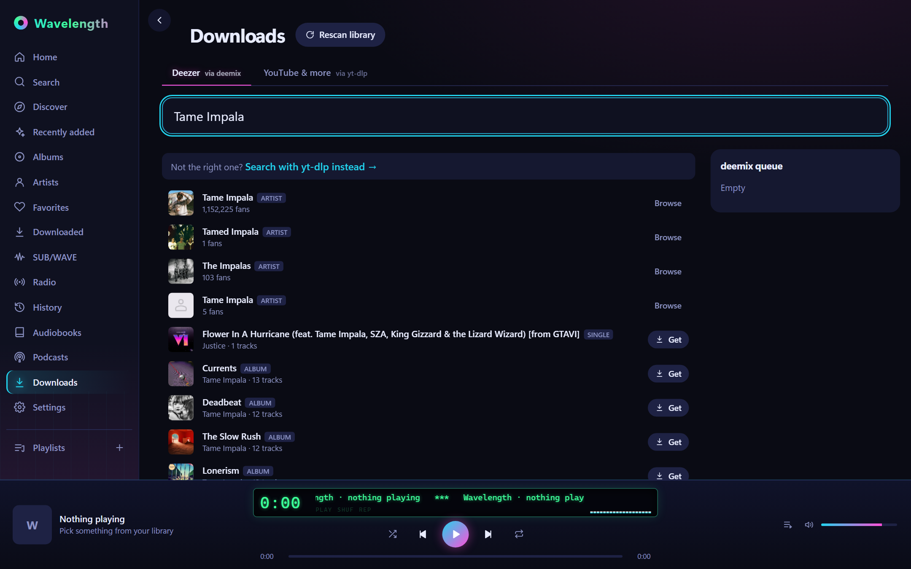

- **Browse** (or clicking an artist's name) opens the artist page.
- Clicking an album or a playlist opens its page.
- On a song row, the artist name and album name are links too.
- **Get** sends that album or song to deemix straight away, as before.

### 2. Artist page

  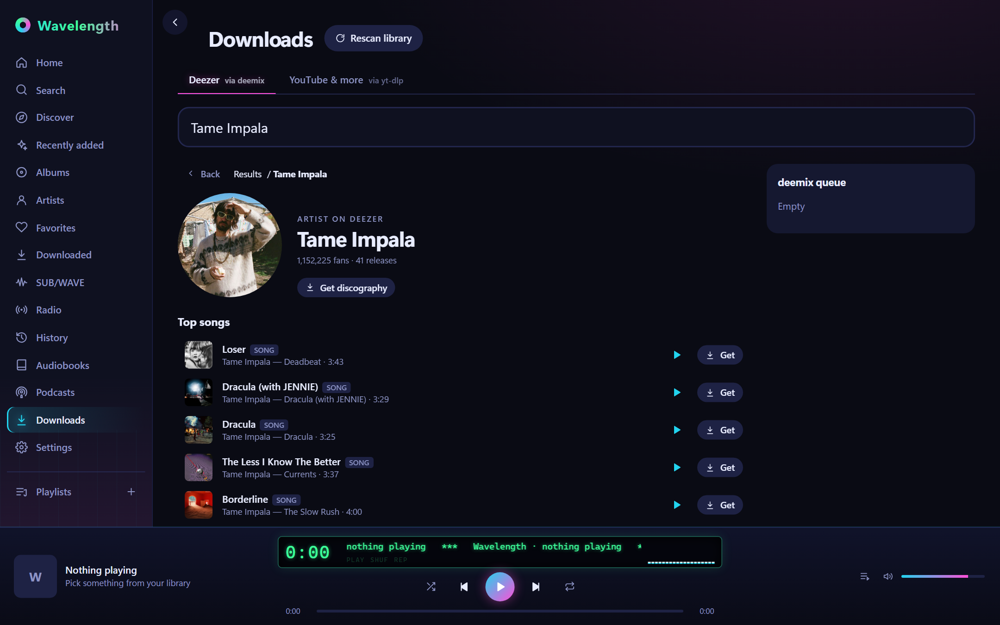

- **Top songs**: the artist's 10 most played songs on Deezer. ▶ plays a 30-second preview and
  **Get** downloads that song.
- **Get discography** sends every release by the artist to deemix. You'll be asked to confirm,
  since that can be a lot of music.
- Releases you already have say **✓ In library** instead of **Get**, and **Not in library** hides them. The
  same page opens from **Browse releases** on an artist in your library: see
  [Browse an artist's releases](#browse-an-artists-releases).

Scroll down for the whole discography, newest first, split into **Albums**, **EPs**, **Singles**
and **Compilations**. Each cover opens the album page, and each has its own **Get** button.
Below that, **Playlists with …** shows public playlists the artist is on, and **Fans also like**
lists related artists so you can keep exploring.

  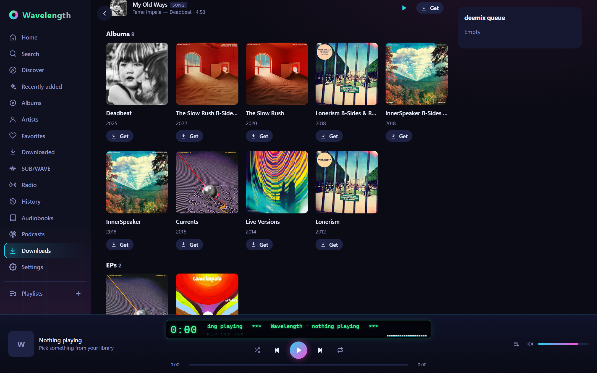

### 3. Album page

  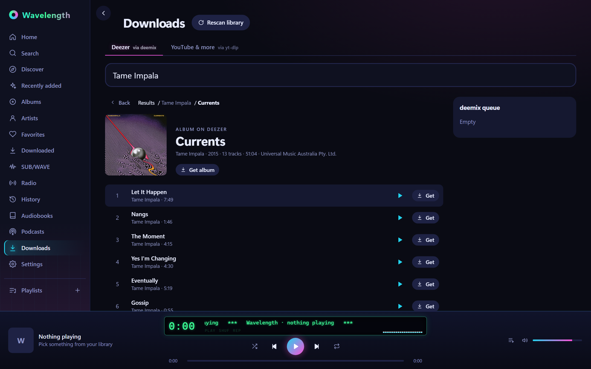

- **Get album** downloads the whole album.
- Or pick songs one by one: each track has ▶ (30-second preview) and **Get**.
- The artist name under the title goes back to the artist page.

### 4. Playlist page

Search for a mood, genre or playlist name (for example *Electronic Hits*) and the matching public
playlists show up, tagged **playlist**, with who made them and how many songs they have.

  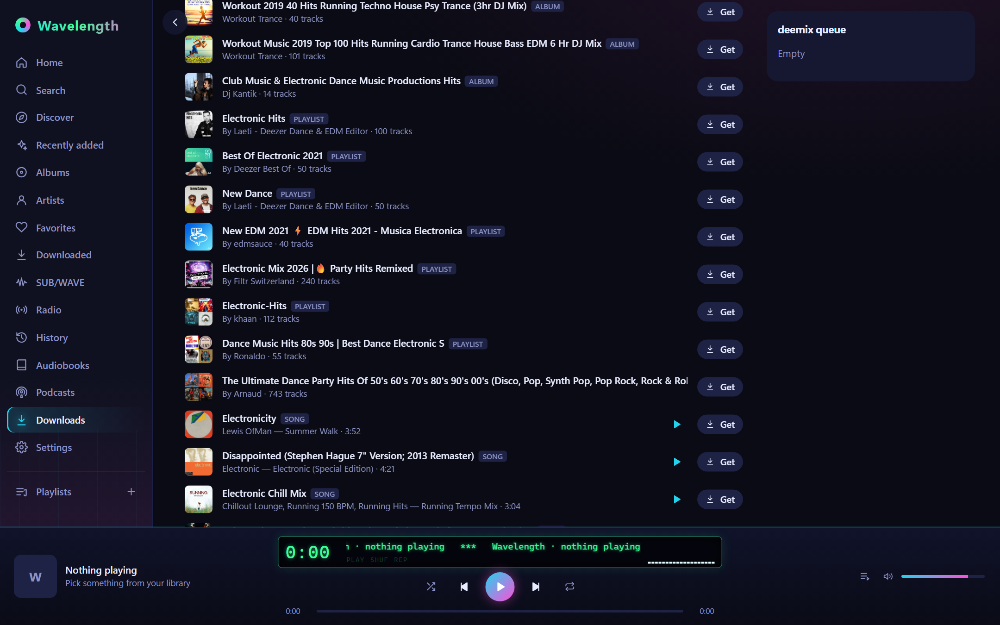

  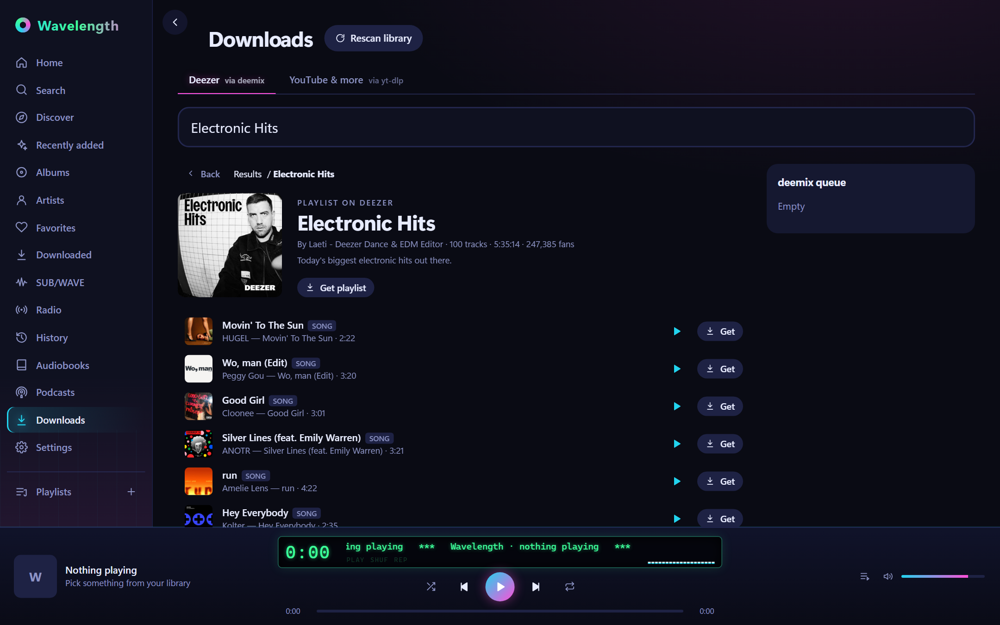

- **Get playlist** sends every song in the playlist to deemix (you'll be asked first if it has more
  than 50 songs). With its default settings, deemix saves them in a folder named after the playlist.
- Or pick songs one by one with ▶ (preview) and **Get**. Each song's artist and album are links.
- Long playlists load in full, up to 2,000 songs.
- Only public playlists can be found; private ones (including your own private Deezer playlists)
  aren't visible to the public API.

### Explicit or clean

Deezer often has an explicit and a clean release with the same name and cover (*I Am Not A Human Being*
twice, say). To tell them apart:

- Songs and albums show **E** (explicit) or **C** (clean) before the name, in search results, on artist
  pages, in the discography grid and on album pages. Grid cards also say **Explicit** or **Clean** next to
  the year, and long names show on two lines, so "Tha Carter IV (Edited Version)" isn't cut off.
- **Clean only**, above search results and on artist pages, hides explicit songs and albums, so what's left
  under a name is the clean version; it says how many it hid. **All** shows everything again. It starts on
  for people who prefer clean versions (Settings → Playback) and on kid profiles.
- A release is clean when its name says "(Clean)", "(Edited)" or "(Censored)", when Deezer marks its lyrics
  as edited, or when Deezer marks it not explicit and the same list has an explicit release with the same
  name by the same artist. A release that was never explicit gets no badge, and Clean only keeps it.
- Nothing clean left under a name? Deezer may not have a clean version of it. The library check (Inbox →
  Clean versions) looks for one too.

### Getting around

- The bar above every page shows where you are, e.g. **Results / Tame Impala / Currents**.
  **Back** goes one step back and **Results** jumps back to your search.
- Typing a new search always takes you back to the results.
- The **deemix queue** on the right keeps updating while you browse, so you can see downloads finish.
- Everything works with a TV remote: titles, links and buttons are all focusable.

> **Developer notes.** Deezer's public API, no login: `GET /artist/<id>`, `/artist/<id>/top`,
> `/artist/<id>/albums`, `/artist/<id>/related`, `/artist/<id>/playlists`, `/album/<id>` and
> `/playlist/<id>` (+ `/playlist/<id>/tracks` paging), wrapped by `getDeezerArtist()`, `getDeezerAlbum()` and
> `getDeezerPlaylist()` in `src/sources/deemix.ts`. The pages live in `src/views/DeezerBrowse.tsx`, and the
> Deezer tab in `src/views/Downloads.tsx` keeps a small stack of opened pages. **Get** on any row
> sends that item's deezer.com link to deemix's `addToQueue`. deemix accepts playlist and artist links
> too (an artist link queues the whole discography).
>
> The E / C badges and **Clean only** come from `src/lib/deezerVersions.ts`: Deezer's `explicit_lyrics`,
> `explicit_content_lyrics` (3 = edited, on search results and album pages; artist discographies leave it out),
> the name ("(Clean)" via `CLEAN_MARK`), and pairing releases by artist + `cleanTitle()` within one list.

---

## Choose which charts Discover uses

**Where:** Settings → **Discover charts**, or the **Edit charts** button at the top of Discover.

Each Discover genre (Top overall, Pop, Country …) shows a tab per chart and a **Mix** that combines
them. You can now choose those charts for each genre yourself.

  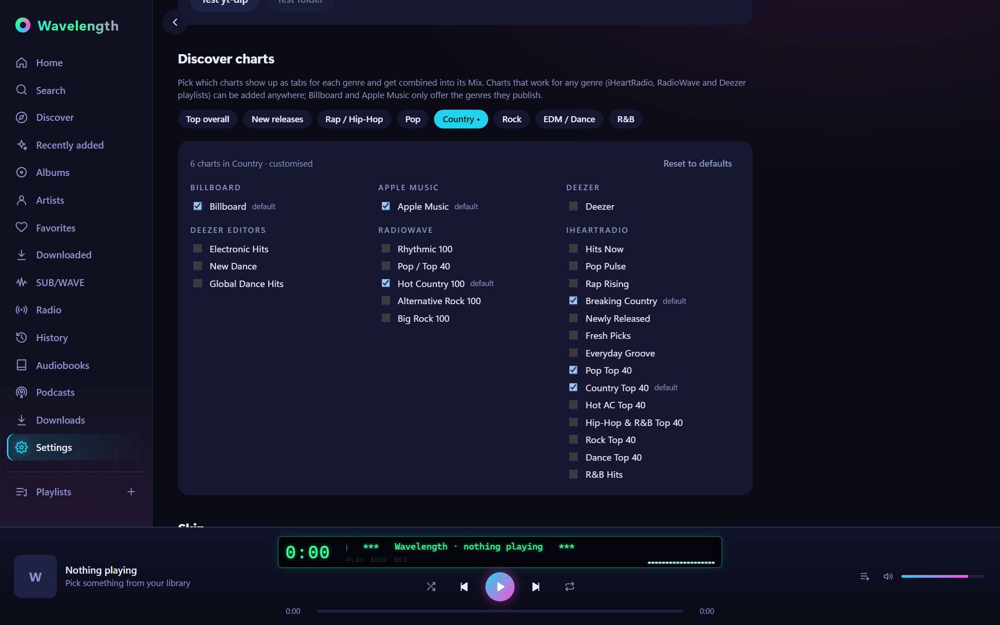

1. Pick a genre from the chips. A genre you've changed has a • after its name.
2. Tick or untick charts. Charts that genre uses out of the box are marked **default**.
3. Discover updates right away: the new charts appear as tabs, and the Mix is rebuilt from them.
4. **Reset to defaults** puts that genre back the way it shipped.

What you can add:

- **iHeartRadio, RadioWave, Deezer editors' playlists and the Deezer global chart** are single fixed
  lists, so you can add them to any genre. In the screenshot, iHeartRadio's *Pop Top 40* has been
  added to Country.
- **Billboard and Apple Music** only appear under genres they actually publish (for example, Billboard
  has no current rap chart).
- Every genre keeps at least one chart, so the last ticked box can't be cleared.

Charts are still checked for freshness: one that hasn't updated recently is skipped with a note,
whether you picked it or not.

A genre you've changed keeps your pick when new charts are added in an update. Tick the new ones here, or
use **Reset to defaults** to get the new default list.

### New releases and genre lists

- **New releases** opens with Spotify's **New Music Friday** and Deezer's **Radar Weekly** (both new every
  Friday), then iHeart's Newly Released and Fresh Picks, with your **Release Radar** above them. No Spotify
  account is needed: Wavelength reads Spotify's public playlist page.
- Each genre has a list from Deezer's genre editors: **Fresh Rap** (daily) under Rap / Hip-Hop, **New Dance**,
  Electronic Hits and Global Dance Hits under EDM / Dance, **Metal Radar** under Rock, **Fresh Pop** under Pop
  and **Fresh R&B** under R&B. Country uses iHeart's Breaking Country and Country Top 40.
- Click a list's tab to see just that list, or **Mix** to combine them.

- **Alternative** combines RadioWave's Alternative Rock 100 and Apple Music's most played alternative and indie
  songs. Add more under **Edit charts**.

### Using a chart

Each song on a chart has:

- **Its movement** under the rank: **▲3** (up three since last week), **▼2**, **NEW** (wasn't on it last
  week) or **=**. The line above the list says which day it's compared with. Next to the artist, **5 wks** means
  five weeks in a row on this chart. Movement starts the day after you first open a chart. With a Hub, everyone
  in the house shares one history, so it's there sooner; without one, each device keeps its own.
- **The artist's name** opens their page in your library, or their Deezer releases when you don't have them.
- On hover (desktop): **Song radio** (or **Artist radio**) and **Follow**, which adds the artist to Release Radar.
- **×** (Not interested) hides the song from Discover on every chart. **Undo** brings it straight back, and
  **Show N you're not interested in** lists the hidden ones with **Show again**. With a Hub, the list follows you
  to your other devices.

Above the list, **All / Don't have / Have** shows every song, only the ones your library is missing (a shopping
list for **Get all missing**), or only the ones you can play now. Discover remembers your pick.

**Get all missing** asks once, in the bar ("Send 12 songs to deemix? Yes / Cancel"), then works in the
background: a progress bar shows how far it got, and it keeps going if you open another page. **Stop** stops
it after the song in progress. A song that couldn't be sent shows why on its row, with **Retry** and **Use
yt-dlp**. Songs you already sent stay marked **Queued** or **Requested** when you come back, under any genre.

### For you

Signed in to a Hub, each genre has a **For you** tab: the genre's combined chart, only the songs close to what
you play, best match first. Each says why: **You play Drake**, **You follow SZA** or **Like Drake** (Deezer
lists the artist as related to one you play a lot). It uses your plays from the last six months, so it gets
better the more you listen. With no plays yet it says so.

### Release Radar: follow artists
### Release Radar: follow artists

Signed in to a Hub, Release Radar (top of **New releases**) has a **Following** list: new albums, EPs and
singles from the artists you follow. Press **Follow** on an artist's page (in your library or under
**Downloads → Deezer**), or **Manage → Follow an artist by name**. You get a notification when one of them puts
something out. **Artists you might like** below suggests more: ones like the artists you follow and play, and
ones you play a lot but don't follow yet. **×** hides a suggestion for good. **Artists you play** is the radar
the app works out from your listening, and is the only one without a Hub. **Coming soon** lists releases
they've announced, **Auto** (in Manage) has the Hub fetch an artist's new releases for you as they come out,
and **Weekly Mix** is a new playlist every Friday from new releases and artists you might like. More in
[RELEASE-RADAR.md](RELEASE-RADAR.md).

### Song radio

**Song radio** on Now Playing (and **Artist radio** on a library artist's page) fills your queue with songs
from your own library that sound like the one playing: the artist's best-known songs and those of artists
Deezer lists as related, mixed so the same artist doesn't play twice in a row. The song playing keeps playing;
what comes after it is replaced. It never downloads anything, so the more music you have, the better it gets.

### Charts with a Hub

When you're signed in to a Hub, Discover reads the charts from the Hub instead of every device pulling them
from Billboard, Deezer, Spotify and the rest each time. The Hub fetches the ones people use again every
30 minutes. If a chart service is down or busy, you see the last copy that worked, with a note such as
"couldn't refresh, showing the Hub's copy from Fri 3:10 PM", instead of an error. **Refresh** asks again.

The Hub also checks which chart songs your library has, all at once, so "Checking your library…" finishes in a
moment instead of counting up song by song. That needs the Navidrome scan login under **Settings → Server →
Library updates**; without it, or for songs on a Plex server, each device checks itself as before.

Above the charts under every genre except New releases, **New from artists you follow** shows the newest
releases from the artists you follow (with a Hub and at least one follow). **See all in Release Radar** opens
New releases.

> **Developer notes.** Choices are stored as `discoverCharts` (genre → chart ids) in the settings
> store (`tonearm.settings`). A genre with no entry uses the built-in `BY_GENRE` list.
> `sourcesFor(genre, custom)` in `src/sources/charts.ts` resolves what a genre uses, `chartsFor(genre)`
> says which charts are allowed for it, and `getMix(genre, sources)` mixes whatever list it's given.
> A new chart added to `CHART_LABELS` and `FETCHERS` shows up in the picker automatically.
>
> Movement is `lib/chartMoves.ts` (the Hub's `hub/src/chartHistory.ts`, or `tonearm.chartHistory` in
> localStorage without one), keyed by `chartKey()`. The Hub's library check is `lib/discoverMatch.ts` →
> `POST /api/discover/match` (`hub/src/libraryIndex.ts`), For you is `POST /api/discover/foryou`
> (`hub/src/forYou.ts`), Get all missing is `lib/chartGets.ts`, and Not interested is `discoverHidden` in the
> settings store (synced like `discoverCharts`). Songs are matched across charts with `songKey()`.

---

## The song menu

Right-click any song in a list (on a phone or tablet, press and hold) for everything you can do with it in one
place: **Play**, **Play next**, **Add to queue**, **Add to playlist…**, **Song radio**, **Sounds like this** (with
sound-alike analysis on the Hub), **Go to artist**, **Go to album**, **Share** and **Copy song name**. Esc or a click
outside closes it.

## Browse by genre and decade

**Browse** (in the sidebar, and under Library on the phone) shows your music by genre and by decade.

- **Decades**: 60s, 70s, 80s and so on, with how many albums each has.
- **Genres**: every genre in your library, most albums first, with its sub-genres on the tile (Trap, Drill and Boom
  Bap on Rap / Hip-Hop; House, Techno and Drum & Bass on Electronic). Tap a sub-genre to go straight to it.
  **Find a genre** searches sub-genres too.
- Open one to see its **Artists** and **Albums**, sorted by newest, oldest, A to Z, artist or recently added.
  Chips narrow it down: a sub-genre, or a decade ("90s Electronic"). In a decade, chips show its genres.
  **Shuffle** plays a random mix of songs from 25 of its albums; **Play** plays the first 25 in order.

Sub-genres come from your genre tags. A genre whose albums all also have a bigger genre counts as its sub-genre, so a
Hub that tidies genres (see "Tidying genres") gives you sub-genres by itself. Genres that always come together, like
"Rap" and "Hip-Hop" from **Rap; Hip-Hop**, show as one.

**Albums** and **Artists** have the same filters at the top: a genre (sub-genres indented under their genre), a
decade or **Pick years…** for a from–to range, and a sort (Albums: A to Z, artist, newest, oldest, recently added;
Artists: A to Z or most albums). **Clear** takes the filters off. They stay put while you open an album and come
back. An artist is in a genre or decade when one of their albums is.

## The sidebar

Pages are grouped: Home, Search and the AI DJ at the top, then **Your library** (Recently added, Browse, Albums, Artists,
Favorites, Downloaded, History, Audiobooks, Podcasts), **Explore** (Discover, Radio, SUB/WAVE), and Downloads,
Inbox and Settings. Click a section's heading to fold it; it stays folded on this device, and the page you're on
still shows.

## Playlist folders and pins

On a Wavelength playlist's page, **Move to folder** puts it in a folder (type a new name or pick one), and **Pin**
puts it at the top of the sidebar and the Playlists page. Folders fold open in the sidebar. The Playlists page sorts by
**Recently changed**, **Name** or **Most songs**. With a Hub, folders and pins follow you to every device.

## Now Playing buttons

Now Playing shows **Add to playlist**, **Lyrics**, **Cast** and **DJ mode**. **More** shows the rest (Song radio,
Sounds like this, Sing, Video, Credits, Listen together, Devices, EQ, Sleep), and stays open next time if you leave it
open. A running sleep timer or Sing mode always shows.

## Finding a setting

Type in **Search settings…** at the top of Settings ("crossfade", "kokoro", "backup") and pick the section to
jump to it. Personal tabs come first; the Hub's own settings (My family, Users, Server, AI DJ, Features) follow
under **Hub admin**, for admins and family managers.

## Getting to the song, artist and album from Now Playing and song lists

In **Now Playing**, the album name above the song, the song title and the artist under it are links:

- **Album name** opens the album's page.
- **Song title** opens the album's page scrolled to the song, which flashes so you can spot it.
- **Artist** opens the artist's page.
- In **Up next**, a song's artist opens that artist's page too; the rest of the row still plays the song.

**Up next** under the controls lists the whole rest of the queue (it scrolls), and **Played** the songs before this
one; tap a song to play it. The arrow folds the list away (it starts folded on phones) and the app remembers your
choice. In DJ mode the last row says DJ Trash Panda adds more before the songs run out.

Now Playing closes as the page opens, and **Back** goes to the page you were on before Now Playing.
For "Artist A feat. Artist B", the link goes to the first artist that's in your library. Live radio,
audiobooks, podcasts and Deezer previews have no library page, so they show plain text.

Song lists work the same way: in search results, playlists, favorites, history and the other lists that show
"Artist — Album" under a song, the artist opens the artist's page and the album opens the album scrolled to the
song. On an album page, the artist under each song is a link too.

## About the artist, song credits and tour dates

At the bottom of an artist page, **About** tells the artist's story (from Wikipedia), where and when they
started, the members of a band (past members greyed), and links to their website and socials (from
MusicBrainz). In Now Playing, **Credits** shows who wrote, produced, mixed and played on the song, when
MusicBrainz knows. Both need no setup and are kept on the device for a week. An admin can turn them off with
**Artist bios and credits** in **Settings → Features**.

**On tour** lists upcoming shows with a **Tickets** link, when a Hub admin turns on **Tour dates** in
**Settings → Features** and pastes a free Ticketmaster key (from developer.ticketmaster.com) or a Bandsintown
app ID there. The key stays on the Hub.

## Popular songs (artist pages)

At the top of an artist page, above the albums, **Popular** lists the artist's best-known songs, the way Spotify
does, but only the ones you have, so every row plays. Five show at first; **Show more** opens up to ten. **Play**
plays them all in order and **Shuffle** mixes them. Click (or tap, on a phone) a row to play from that song.

  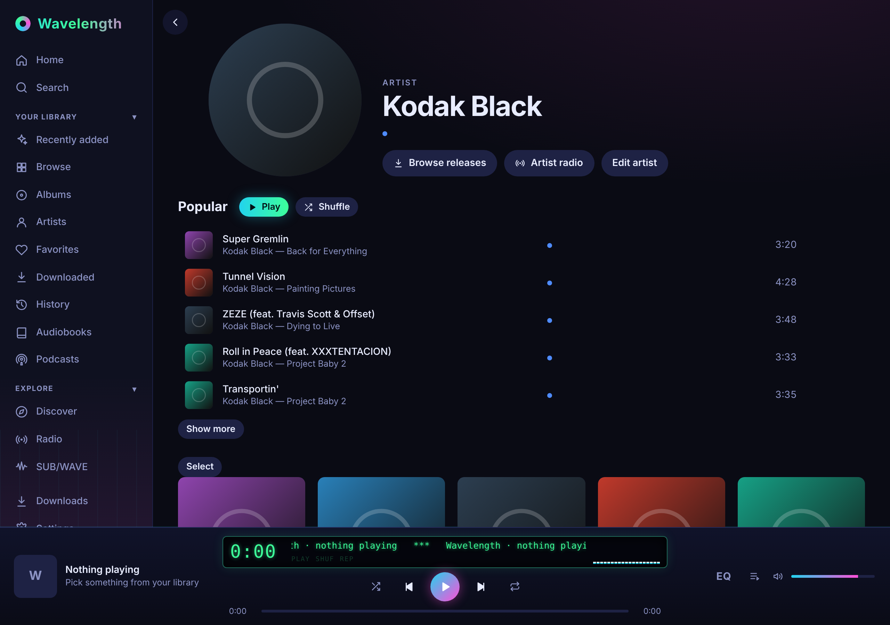

The order comes from Deezer's top tracks for the artist, and each one is looked up in your Navidrome and Plex
libraries. When Deezer doesn't know the artist, or none of its list is in your library, Navidrome's own top songs
(from Last.fm, if the server has a Last.fm key) are used. A song you have twice, or in Explicit and Clean, shows
once. Songs on your **Don't play** list and songs hidden from a kid profile are left out, and the section isn't
shown at all when nothing matches, or on "Various Artists". The list is kept for half an hour, so going back to the
page is instant.

> **Developer notes.** `src/lib/popularSongs.ts`: `popularSongs(name)` asks Deezer for the same-name artist
> (`sameNameArtists`, so a wrong artist's hits never show), takes their top 25 (`popularCandidates`, one per title),
> and finds each with `findInLibrary` (lib/match.ts, as Song radio does) four at a time, stopping at ten;
> `uniqueSongs` drops repeats. The fallback is `MusicSource.getTopSongs`, which `NavidromeSource` answers with
> Subsonic `getTopSongs`. `src/components/PopularSongs.tsx` renders it with `TrackList` above the album grid in
> `ArtistView` (src/views/Library.tsx). Tests in `src/test/popularSongs.test.ts`.

## Appears On (artist pages)

Under an artist's albums, **Appears On** lists albums by other artists in your library that the artist is
featured on, the way Spotify does. Open Future's page and you'll see Drake's album with *Life Is Good* on it, for
example. Click an album to open it.

An album counts when one of its songs credits the artist but someone else is the album artist:

- as a track artist: "Drake feat. Future", "Drake & Future", "Metro Boomin, Future", or the separate artist
  credits newer Navidrome versions (0.55 and up) keep for each song, or
- in the song title: "Life Is Good (feat. Future)", "Wants and Needs [with Lil Baby]", "Song ft. Future".

The whole name has to match, so "Futuristic" or a song called *Back to the Future* doesn't put an album there.
Albums already shown as the artist's own aren't repeated. Compilations ("Various Artists") count too.

Kid profiles only see albums that are fine for kids, and with **Clean** (or **Explicit**) picked as your version,
the other version of an album is hidden, the same as everywhere else. The section is left off when there's
nothing to show.

> **Developer notes.** `src/lib/appearsOn.ts` decides which songs count (`creditsOf`, `isCredited`,
> `appearsOnSongs`; tests in `src/test/appearsOn.test.ts`). `NavidromeSource.getAppearsOn` asks Navidrome's
> Subsonic `search3` for up to 1500 songs matching the artist's name, keeps the ones that credit the artist on
> another artist's album (OpenSubsonic `artists`, `albumArtists` and `displayAlbumArtist` when the server sends
> them), and returns one album per album id. `useAppearsOn` in `src/views/Library.tsx` runs it for each Navidrome
> copy of the artist after their own albums load, swaps in the catalog's album so versions and other servers'
> copies work, and filters with `useHidden` and `useVersionHidden`. Plex, Audiobookshelf and SUB/WAVE don't
> implement it, so an artist only on Plex has no Appears On.

## Browse an artist's releases

Every artist page in your library has two things for getting more of their music:

- **The newest release banner**, under the artist's name: their newest album, EP or single on Deezer, e.g.
  **New release · Tha Carter VI · single · Oct 24, 2026**. It says **New release** for the first 6 weeks (the
  same window as Release Radar) and **Latest release** after that. ▶ plays a 30-second preview, **Get** sends it
  to deemix (**Request** asks your Hub admin, without Autodownload), and **✓ In library** opens it when you
  already have it. When Deezer lists something announced but not out yet, the banner adds **Coming soon:
  Title, out Mar 14**. Click the cover or title to open the release.
- **Browse releases**, next to Follow: the artist's whole Deezer discography, the same page as
  **Downloads → Deezer** (top songs, Albums, EPs, Singles, Compilations, E / C badges and **Clean only**).
  Releases you already have say **✓ In library** instead of **Get**, the header counts them, and
  **Not in library** hides them so only what you could still get is left. Covers open the album page with its
  tracklist, where you can get single songs. **Back** walks back through what you opened, then to the artist.

Deezer has to have an artist with exactly the artist's name (case and accents don't matter). Deezer often has
several artists with the same name (there are a dozen "Drake"s, most of them small uploads with a compilation or
two), so Wavelength checks which one has the albums in your library and uses that one. With none of your albums
to go on, it's the one with the most fans. If you follow the artist, the one you follow is used, as long as it
has your albums.

When Wavelength isn't sure it found the right artist (none of their albums are in your library, or several
same-name artists are close on fans and you have nothing of theirs yet), the banner stays hidden rather than
show someone else's release, and **Browse releases** says so and lists the other artists with that name to pick
from. When there's no exact match at all, **Browse releases** shows the closest Deezer artists to pick from, and
the banner stays hidden. **Various Artists** has neither.

**Browse releases** shows when you can get music: with deemix set up in **Settings → Downloads** (yours or the
Hub's) and Autodownload, or with **Request**. The banner shows either way; without a way to get music it just
has the preview.

**Kid profiles** see only releases that are fine for kids in both: the banner shows the newest one they may
have (skipping an explicit single, say), Browse releases starts on **Clean only**, and explicit releases, songs
and related artists stay hidden even with **All** picked. With **Clean** (or **Explicit**) picked as your version
in **Settings → Playback**, the banner shows that version when the release has both.

The same **✓ In library** marks and **Not in library** switch are on artist pages under **Downloads → Deezer**.
A release counts as in your library when an album there has the same artist and name, ignoring extras like
"(Deluxe)" or "[2015 Remaster]". Versions count separately: having the explicit album doesn't mark the clean
release as in your library.

> **Developer notes.** `src/components/ArtistNews.tsx` has the banner (`ArtistNews`, shown only when the lookup is
> `sure`), `useDeezerArtist()` and `useCanGet()`. `useDeezerArtist()` takes the followed artist if it has your
> albums, else the same-name candidates from `deezerArtistsNamed()` in `src/sources/releaseRadar.ts` (a 25-result
> name search, most fans first, kept for the session; `findDeezerArtist()`, its top pick, is what Release Radar's
> "artists you play" uses), and picks one with `matchArtist()` in `src/lib/artistMatch.ts`: the discographies of
> the top three are checked against your albums by that artist (`ownedIndex()`), most matches wins, and it's
> `sure` when one matched, or, with nothing to check, when the top artist is alone or has 10× the next one's fans.
> Tests in `src/test/artistMatch.test.ts`. The Hub's name lookup for following (`resolve()` in `hub/src/radar.ts`)
> and the AI DJ's artist lookup also take the same-name artist with the most fans (`sameNameArtist()`). `src/views/ArtistReleases.tsx`
> is the **Browse releases** page (route `artistReleases`, optionally with a release open on top). It reuses
> `DeezerArtist`, `DeezerAlbum` and `useDeezerBrowse()` (the browse stack, Get / Request and Clean only, shared with
> Downloads → Deezer) from `src/views/DeezerBrowse.tsx`. `src/lib/artistReleases.ts` has `ownedIndex()` (Deezer
> release → library album, keyed by `versionKey` and version-aware) and `newestRelease()` (latest out, whether it's
> within `WINDOW_DAYS`, the next announced one, kid filter and preferred version); tests in
> `src/test/artistReleases.test.ts`. The discography call (`/artist/<id>/albums`) is shared by the banner and the
> page and kept 10 minutes (`getDeezerReleases()` in `src/sources/deemix.ts`), so opening an artist costs two Deezer
> calls the first time (the name search and the discography), plus up to two more discographies when several
> same-name artists have to be checked against your library.

## Now Playing visualizers

Open **Now Playing** (tap the song in the player bar) and **tap the artwork** to switch to the next
visualizer. A label shows each one's name as you go. Keep tapping to cycle through them all and back
to the artwork. Wavelength remembers your pick for next time.

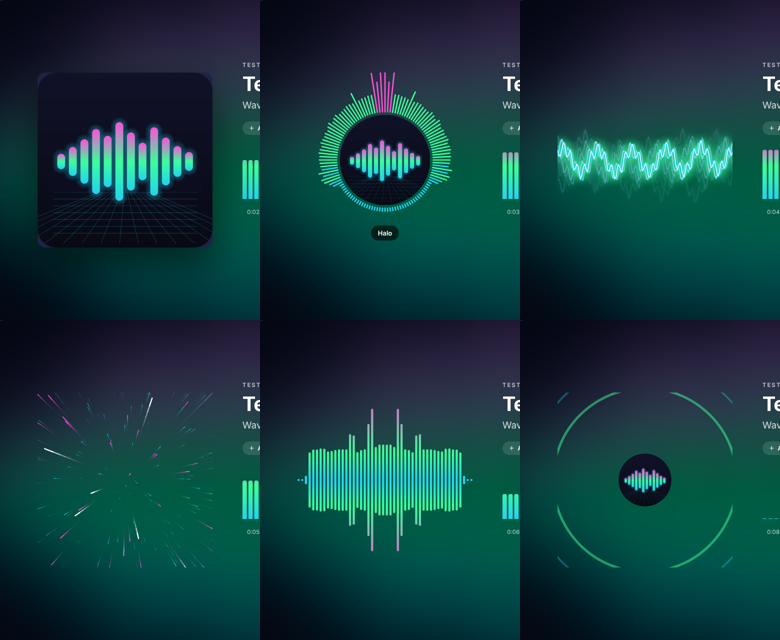

| Visualizer | What it does |
|---|---|
| Artwork | The album cover (the default) |
| Halo | The cover in a circle, with a ring of spectrum bars around it that pulses with the bass |
| Oscilloscope | The live waveform, glowing, with short trails |
| Starfield | Stars fly toward you, faster on louder bass, with an extra push on each beat |
| Mirror spectrum | Spectrum bars mirrored top and bottom, bass in the middle and highs at the edges |
| Pulse rings | A ring ripples out from the cover on every beat |
| Critters | A raccoon (DJ, country, rapper or rocker), a drummer shark, a theremin alien, a grey alien, a black or brown bear, a moose, a turtle, an elephant, a tiger or a lion playing along (see below) |

Colours come from your skin's visualizer colours, so each skin gives them a different look.

Some radio stations and servers don't let the app read their audio (no CORS headers). On those, the
visualizers still move, but they follow a calm made-up pattern instead of the real music. The small
spectrum under the title does the same.

> **Developer notes.** The visualizers are in `src/components/Scenes.tsx`. `NowPlayingStage` replaces the
> cover in `NowPlaying.tsx`, and the current choice is `npScene` in the settings store. Each scene is a
> `Draw` function that gets a `Frame` (frequency bins, waveform, bass/mid/treble levels, a `beat` flag,
> the skin's `--viz-*` colours and the cover image) and draws on one square canvas every animation frame.
> To add one, write a `Draw`, add its id to `NpScene` (`store/settings.ts`), and add it to `SCENES` and `DRAW`.
> The audio reading (analyser → `freq`, `wave`, `bass`/`mid`/`treble`, `beat`, `transient`, or the calm
> made-up signal) is `createAudioReader()` in `src/player/analysis.ts`, shared by every scene.

### Critters

The last visualizer is a critter who plays along with the music. You pick **who** plays and **what** they
play, and any critter can play any act: 11 critters × 8 acts, as a boy or a girl. A rocker shark, a DJ bear and a country grey
alien are all possible.

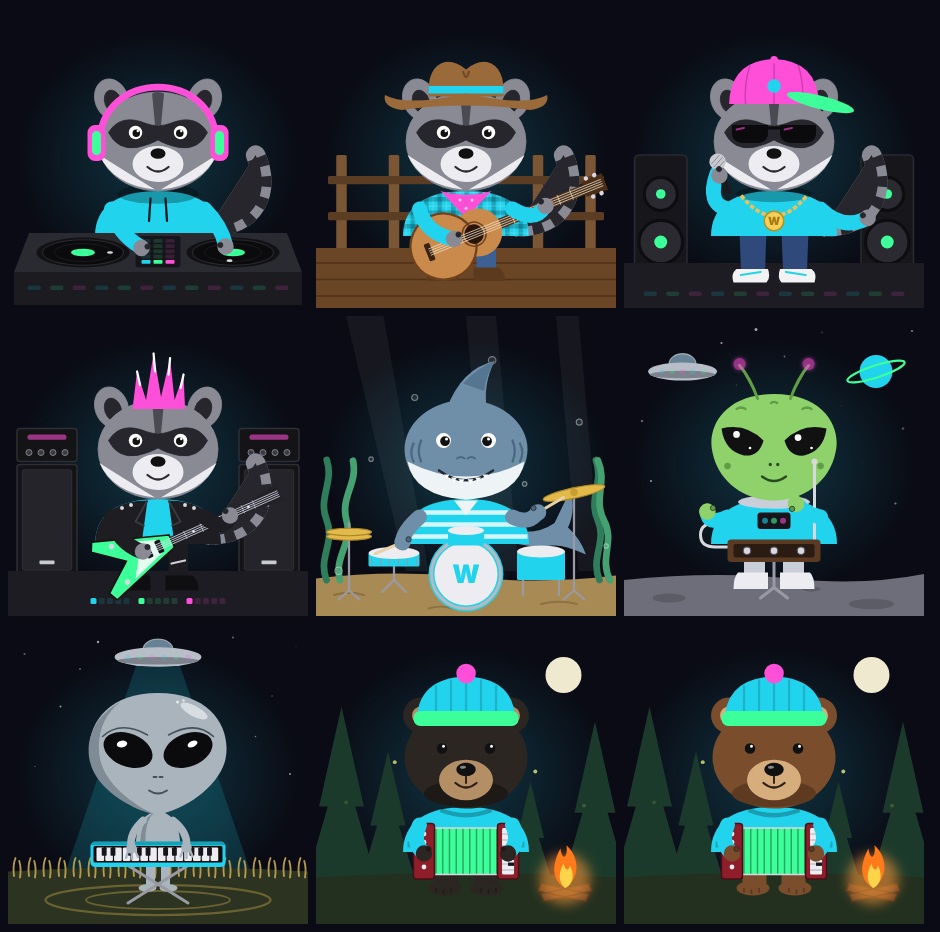

| Critter | Look |
|---|---|
| **Raccoon** | Grey fur, a black mask and a striped tail |
| **Shark** | Blue-grey with a dorsal fin, gills, a white jaw and a toothy grin; no legs, but a tail end with two fins and a tail fin on the ground (the fin tucks under hats) |
| **Alien** | Slim and green, with big black eyes and glowing antennae that pulse with the bass |
| **Gray alien** | The classic grey: a big bulb head tapering to a pointed chin, huge black eyes and a slim body |
| **Black bear** / **Brown bear** | Round ears and a pale muzzle, in black or brown fur |
| **Moose** | Dark brown with a big droopy muzzle, a fur bell under the chin, long ears, pale stockings and hooves, and wide flat antlers that stick out either side of any hat (and tuck under the hazmat hood) |
| **Turtle** | Sea-green with a soft mint muzzle, big blue eyes, rosy cheeks and a wide smile, carrying a high domed shell whose rim shows round any outfit |
| **Elephant** | A soft grey calf with big round pink-lined ears that stick out either side of any hat and flap to the beat, and a short trunk curling up to one side |
| **Tiger** | An orange cub with bold black stripes, white cheeks, green eyes, a pink nose and a striped tail |
| **Lion** | A golden cub in a russet mane (the girl is a lioness, without one), with a cream muzzle and a tufted tail |

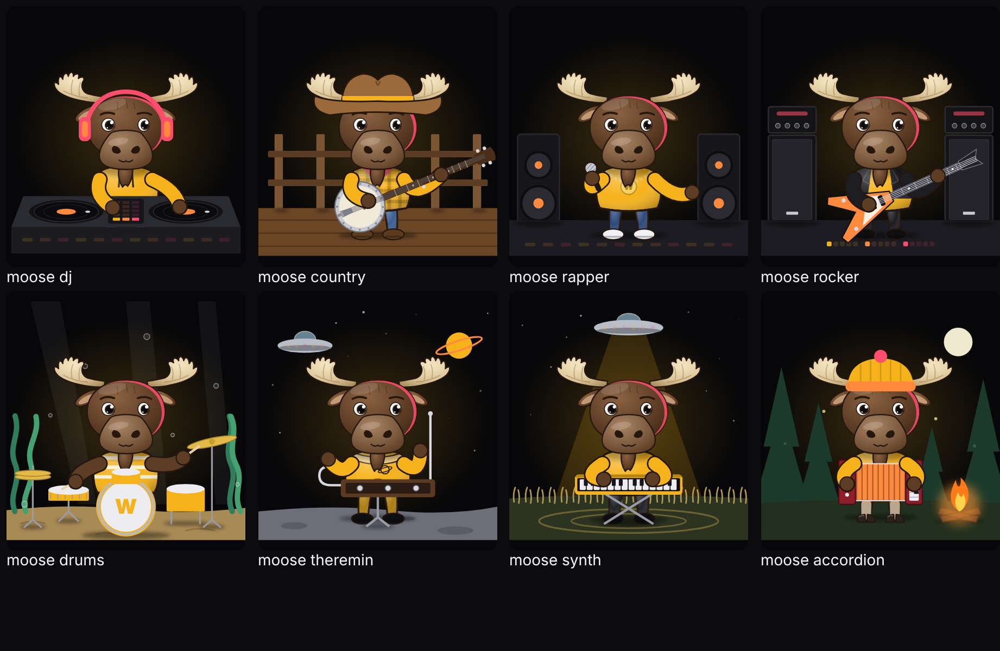

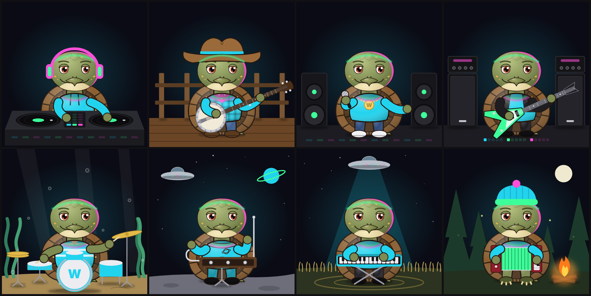

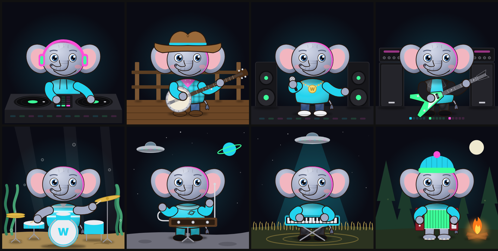

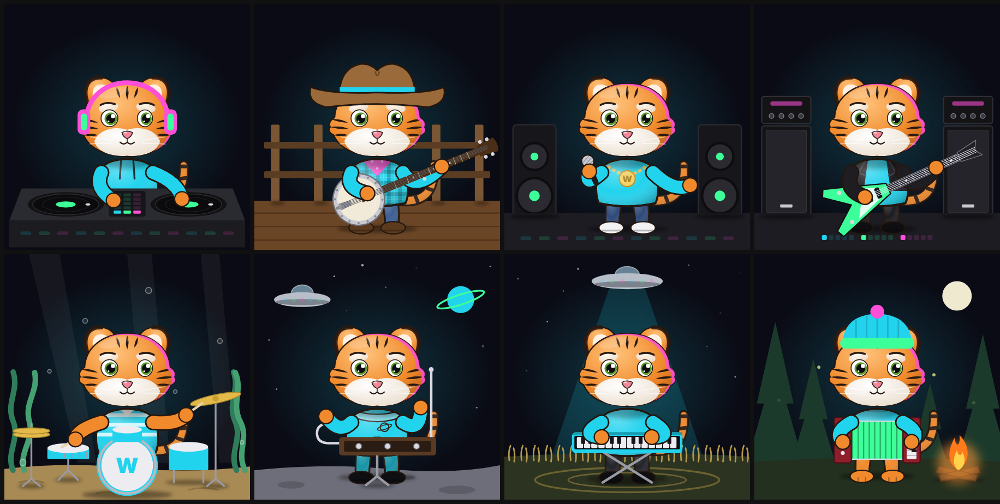

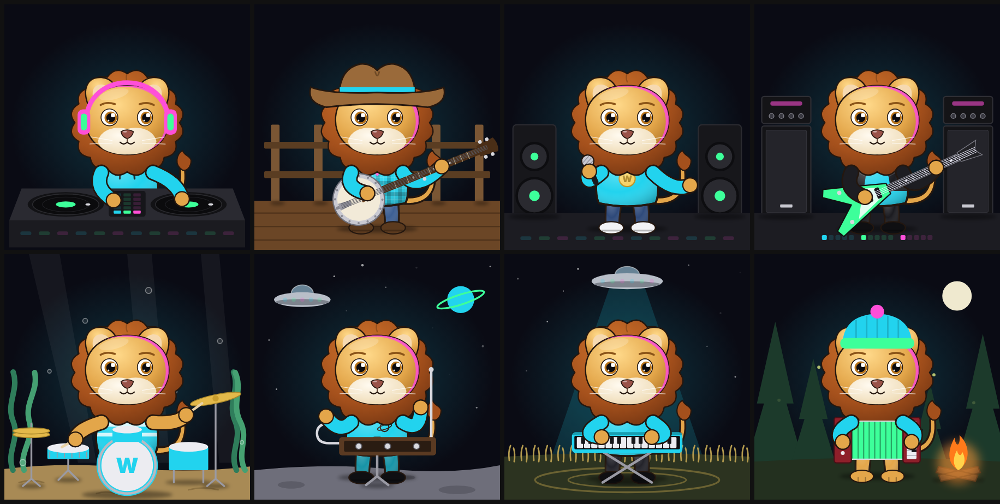

| Act | Scene and outfit | While the music plays |
|---|---|---|
| **DJ** | Hoodie and headphones, behind two decks | Scratches on sharp hits, rides the mixer, the records spin |
| **Country** | Cowboy hat, plaid shirt, bandana, five-string banjo, on a porch | Strums on the beat, changes chords, taps a boot |
| **Rapper** | Gold chain and mic, no hat, between two speaker stacks | Throws a hand up on the beat, the speaker cones pump with the bass |
| **Rocker** | Studded leather jacket, flying-V, in front of two amp stacks | Headbangs hard on the beat, strums on sharp hits, the amp lights follow the bass, mids and highs |
| **Drummer** | Striped sailor tee, behind a drum kit on the sea floor | Hits the snare on the beat, crashes the cymbal on sharp hits, the kick drum thumps, bubbles rise faster with the bass and the seaweed sways |
| **Theremin** | Space-age tunic with a belt and planet badge, on the moon under a hovering UFO | One hand rises over the volume loop with the bass, the other moves toward the pitch antenna with the highs, glowing sound waves pour off the antenna, the UFO lights chase on the beat |
| **Synth** | Turtleneck, a synth on an X stand in a crop circle, under a saucer's tractor beam | The keys light up with the music, one hand hops on the beat, the other glides along the keys with the highs, the beam brightens with the bass |
| **Accordion** | A beanie with a pom-pom and a sweater, by a campfire in the pines | The bellows pump faster with the bass and puff out on the beat, the campfire flares with the bass, fireflies blink with the highs |

**They sing along.** Every critter's mouth opens when someone sings (or raps) and closes when they stop.
It listens for the lead voice the way you would: sound in the voice range that sits in the centre of the
stereo mix and is tonal rather than noisy, so drum hits and guitars panned to the sides don't move it.
When the song has **synced lyrics** (the same ones the [Lyrics](#lyrics) chip shows, from your Navidrome
server or LRCLIB), the mouth also stays shut through intros, solos and gaps between lines, and opens more
readily during a line, so it keeps up with a singer in a busy mix. On radio stations and servers the app
can't read (no CORS, see above), and on **mono** songs (old recordings, mono streams), where there's no
"centre" to listen to, it mouths along in time with the words of each line, or chatters gently if there
are no synced lyrics. A centred instrument with the same range as a
voice (a synth lead, say) can still open it in songs without synced lyrics. Mono songs without synced
lyrics move the mouth with the music rather than the voice.

**A new look.** The critters' faces are drawn like vinyl toys: big round heads with soft shading, a dark
outline, big eyes with coloured irises and highlights, and a rim of stage light along one edge that takes your
skin's colours. Their bodies match: the raccoon short and chunky with a big striped tail, the bears in puffy
jackets, the shark one slim torpedo with its fins for arms, the aliens spindly and hovering, the moose deep-chested on long legs, the turtle round and stumpy under its shell, the elephant chunky on thick legs with toenails, and the tiger and lion sturdy with long curling tails.

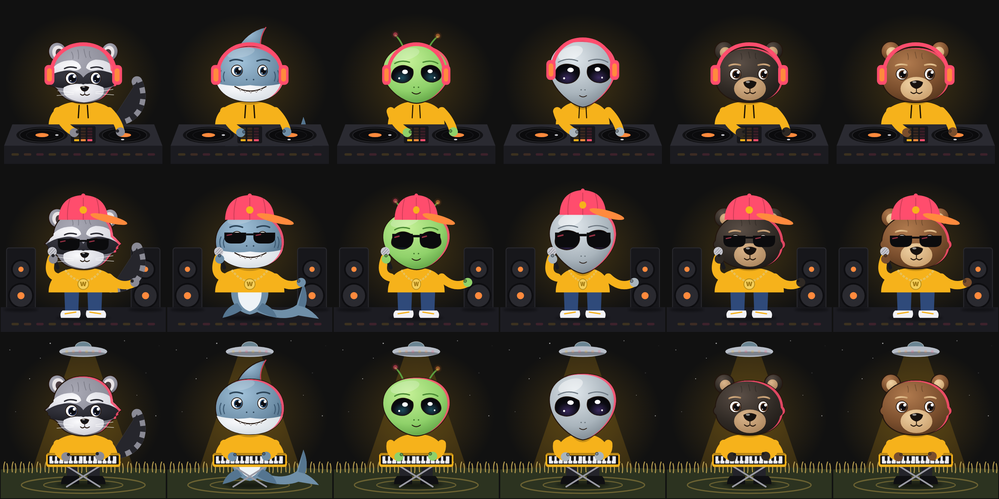

**Their faces act.** The mouth takes one of six shapes as they sing: closed, a wide-open *ah*, a round *oh*, a
wide *ee*, lips pressed together for *m*, *b* and *p*, and an open grin when they belt a big note. With synced
lyrics the shapes follow the words of the line (each syllable's vowel, spelled rather than pronounced, so it's
close but not perfect); without them it's a rough guess from the sound of the voice, which reads as singing even
when the vowel is wrong. The brows lift on a crescendo or a long held note, the eyes squint on high notes, and they
blink now and then on the beat. Each critter has its own touches: the shark sings with rows of teeth, the
raccoon's whiskers twitch and its lip curls over a fang on a big drum hit, the alien's antennae glow brighter and
bigger with a high voice, both aliens' eye shines widen on loud notes, and the bears' and moose's ears flick.

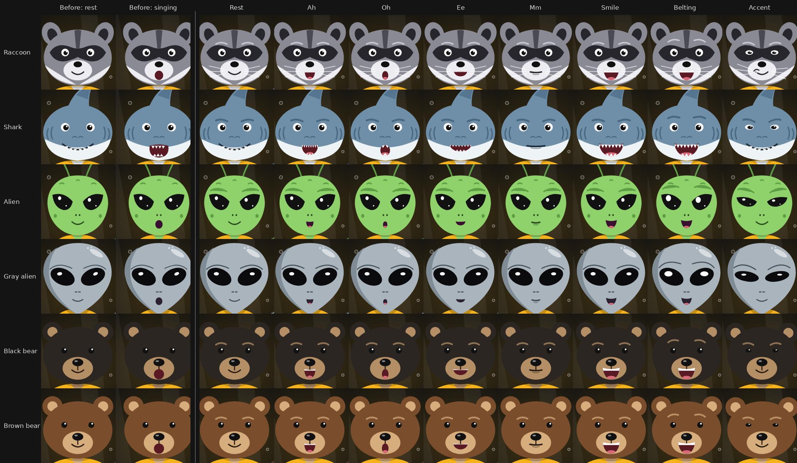

**Tuning the mouths.** If a mouth opens on the drums, misses quiet singing, or moves a moment before or after
the words, tap **Tune mouth** (under Switch act) to open the tuner beside the critter, or go to **Settings →
Playback → Critter mouths**, which has a live critter next to it. Play a song with clear singing and watch the
graph: the filled shape is the mouth, the line is what the voice detector hears, the band along the bottom marks
sung lyric lines, and the ticks at the top are drum hits. The line under it says what the mouth is following
right now (the voice, the lyrics' syllables, or nothing) and whether the song is mono.

| Setting | What it does | Move it when |
|---|---|---|
| **This song → Lyrics timing** | Moves the synced lyrics for the song that's playing, and is remembered for that song. **Mouth is late / Mouth is early** nudge it by a tenth of a second | The mouth starts before or after the words in one song |
| **Sensitivity** | How far below the song's loudest singing the mouth still opens | Raise it if the mouth stays shut on quiet verses |
| **Center** | How much of the sound must sit in the middle of the mix, where lead vocals usually are | Raise it if guitars or keys open the mouth; lower it for busy mixes |
| **Noise rejection** | How noisy (drums, hi-hats, hiss) a sound can be and still count as voice | Lower it if hi-hats flap the mouth; raise it for shouted or breathy vocals |
| **Voice range** | The pitches that count as voice | Raise *from* for bass-heavy songs; lower *to* to ignore cymbals |
| **Ignore after a drum hit** | How long the mouth can't open after a kick or snare | Raise it if the mouth snaps on every beat |
| **Keep the mouth shut between sung lines** | Uses synced lyrics to keep it shut in intros, solos and gaps | Turn off if a song's lyrics are badly timed |
| **On mono songs, mouth the lyrics** | Follows the words of each line on mono songs, where the voice can't be picked out | Turn off to follow the music instead |
| **All songs' lyrics timing** | Moves every song's lyrics | Mouths are early or late on most songs |
| **Syllable length** | How long each syllable lasts when mouthing the lyrics | Lower for fast rap, higher for ballads |
| **Opens / Closes / Widest** | How fast the mouth opens and closes, and how wide | To taste: snappier or smoother |

**Reset to defaults** puts everything back (song timings stay). Your tuning follows you to your other devices
with a Hub. A Hub admin can turn the tuner off in **Settings → Features**, which puts everyone back on the
defaults.

**Switching.** On the critter visualizer, tap **Switch critter** in its top-right corner for the next critter
(keeping the act), or **Switch act** under it for the next act (keeping the critter). Or go to **Settings →
Playback → Now Playing visualizer**: the **Critters** cards show each critter in your current act, and the
**Act** cards show your current critter in each act. Picking either also switches Now Playing to the
critter. The **Boy** / **Girl** switch above the cards picks the look for every critter: girls get eyelashes
and a bow in your skin's accent colour instead of the act's hat. The accordion player keeps her beanie and wears
the bow on it in another colour, and the DJ keeps her headphones. Girls wear their own outfit in each act: a
cowgirl denim fringe skirt, a pleated mini (Rapper), a pink tutu (Rocker), a sailor dress (Drummer), a space dress
(Theremin) and dresses for the DJ, synth and accordion. Tapping the critter itself still moves on to the next visualizer, as on the others. If you're
signed in to a [Wavelength Hub](HUB.md), your picks follow you to your other devices. A pick from before
0.17.9 carries over: the DJ raccoon stays the DJ raccoon, the shark keeps drumming, and so on.

**They dress for your theme.** Fur and skin keep their colours (raccoon grey, shark blue-grey, alien green, grey alien grey, bear black or brown, moose brown, turtle sea-green, elephant grey, tiger orange, lion gold),
but their clothes, instruments and lights take your skin's colours, so every skin dresses them differently.
Some groups of skins give them a whole outfit:

| Skin group | Outfit |
|---|---|
| **Nuclear** | A hazmat suit with a hood, respirator, radiation badge and black rubber gloves and boots. Yellow on most nuclear skins, orange on Meltdown, green on Uranium glass and Isotope |
| **Lasers** | A wraparound visor with a laser beam across it that pulses with the bass |
| **Neon** | Glow-stick necklaces and a glow headband that pulse with the bass |
| **Retro** | 8-bit pixel shades |
| **Holidays** | A hat in place of their own: a witch hat for Halloween, a pilgrim hat for Thanksgiving, a Santa hat for Christmas, an Uncle Sam hat for July 4th and heart boppers for Valentine's Day |

Outfits swap out what they'd clash with: the hazmat hood and holiday hats replace the act's hat
or beanie (the DJ keeps the headphones on over the hood). The alien's antennae and the shark's fin poke out from under any hat. The outfit follows the skin on screen, so it changes with Seasonal
and Random daily too.

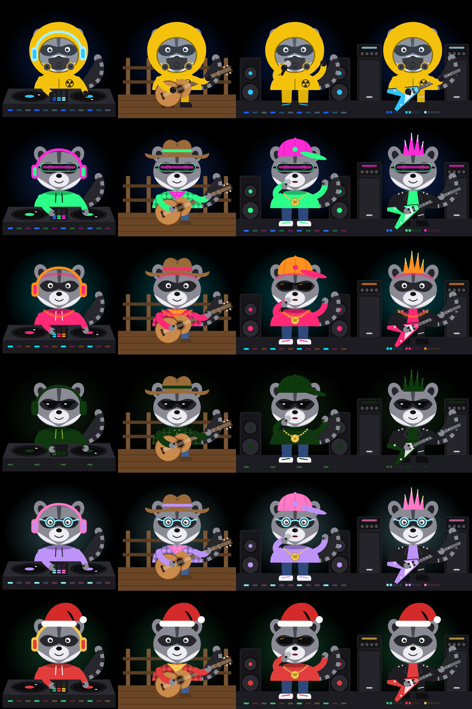

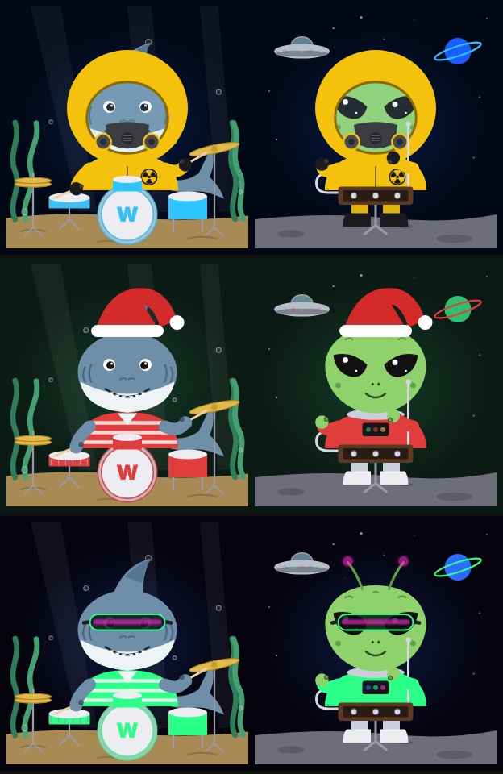

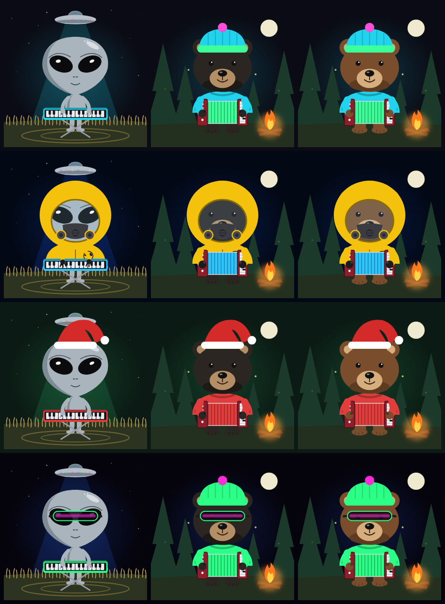

### DJ raccoon

The original critter, behind two decks:

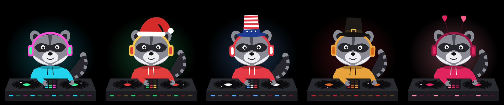

All the critters behave the same way around the music:

- **Playing:** the head bobs on each beat (the rocker headbangs harder), the face sings along with the
  vocals (mouth shapes, brows and eyes, above), and the hands and instrument follow the music as in the act
  table above. After a few bars they find the song's tempo and keep it, so the bob, a side-to-side sway, the
  tail and the bouncing ears stay steady even where the beat is quiet, and the guitar hand strums in time
  (down on the beat, up between; a quick four-stroke roll on the banjo).
- **Showing off:** when a new song starts, or in an instrumental break after a sung line (with synced lyrics),
  each act does its flourish, at most once every 12 seconds: the country critter spins the banjo and tips the hat,
  the DJ double-scratches with a hand in the air, the rapper throws the hype hand high, the rocker does a
  windmill strum, the drummer plays a fill into the crash, the theremin player swoops up the antenna, the synth
  player runs a glissando down the keys, and the accordion player gives the bellows one long stretch.
- Everyone casts a soft shadow on the floor, and so do the stands, amps, speakers and drum kit.
- **Paused:** they sway slowly, blink, yawn now and then and set their headwear straight (the DJ the
  headphones, the country act tips the hat, the
  accordion player pulls the beanie straight). The rapper lowers the mic, the drummer rests the sticks, the
  theremin hands drop, the synth hands rest on the keys and the bellows breathe slowly.
- **Streams the app can't read** (no CORS, see above): they play along to a gentle made-up rhythm instead.

> **Developer notes.** `src/components/critters/`. Unlike the other scenes the critters are inline SVG, not
> canvas drawings, so the drawings stay editable. To add a critter or an act, see
> [CONTRIBUTING.md](CONTRIBUTING.md#add-a-critter-an-act-or-an-outfit).
>
> - A critter is a **species** (who) playing an **act** (what). `species.tsx` has `SPECIES`: each is a
>   `Face` (and maybe a `Tail`), plus skin colours in CSS (`--skin`, `--skin-dark` on `.species-<id>`) for
>   hands and bare arms. `Critter.tsx` has `ACTS`: each act component (`DJ.tsx`, `Country.tsx`,
>   `Rapper.tsx`, `Rocker.tsx`, `Drums.tsx`, `Theremin.tsx`, `Synth.tsx`, `Accordion.tsx`) draws the
>   scene, clothes, headwear, instrument and hands, and puts `species.Face` in `Head` and `species.Tail`
>   behind the body. So every species can play every act with no per-pair drawing.
> - The picks are `critter` (`Species`) and `act` (`Act`) in the settings store, both synced to the Hub.
>   Before 0.17.9 there was one `raccoon` pick; the store's v2 migration turns it into the pair
>   (`critterFromOldPick`). The scene id is still `raccoon`.
> - `rig.ts` (`useCritterRig`) is the shared animation: head bob, sway, blink, singing, yawn, the `adjust`
>   part (headwear), tail, backlight and `[data-glow]` pulses. Every frame writes `transform`/`opacity`
>   straight onto named parts (`data-part="head"`, `arm-r`, …), with no React re-render. The mouth (`yawn`)
>   follows `player/singing.ts`: the vocal detector in `player/voice.ts` (centre-channel, tonal and
>   drum-hit rejection on mid/side spectra the engine taps with `engine.voiceTaps()`), gated by the
>   song's synced lyrics (`lib/singAlong.ts`: sung spans per line, syllable pacing when the audio can't be
>   read). The steady beat is `player/tempo.ts` (`createTempo`): gaps between the analyser's bass hits,
>   folded into 0.4–0.8 s and voted into 10 ms bins, give the period; hits near the grid nudge its phase and
>   build confidence; `locked` above half. The rig passes it as `tempo` (`phase`, `index`, `bpm`, `on`,
>   `locked`) and, once locked, drives `bob`, the sway and the tail from it. `flourish.ts` decides when an
>   act shows off (a new song; 2.5 s into a loud gap after a sung line; 12 s cooldown) and the rig passes
>   `flourish`, 0 or 0..1 through it; each act's `frame` draws its own with `windUp` (a dip back, then the
>   move) or `swell` (out and back). `Shadow` in `parts.tsx` is a blurred contact shadow (`critter-soft`).
>   The face's acting is `face.ts` (`createFace`): from the mouth's open amount, the shape the
>   singing suggests (`singingReading.shape`: the lyric syllable via `player/visemes.ts`, or a vowel guessed
>   from three formant bands of the centre spectrum) and the band's loudness, it picks the mouth shape
>   (held at least 80 ms), the brow lift, the squint, an accent pulse and beat blinks. The rig shows that
>   shape's `[data-mouth]` child of `yawn` and writes CSS transforms on `brow-l` / `brow-r`, `whisker-l` /
>   `whisker-r`, `snarl`, `ear-l` / `ear-r`, `[data-shine]` and `[data-voice-glow]`, each about its own box
>   (`transform-box: fill-box` in `styles.css`). Each act passes a `frame` callback for its own hands and instrument;
>   `guitar.ts` is the strum/fret/string-buzz shared by the country and rocker acts.
> - `parts.tsx` has what they share: the frame and defs, the raccoon face and tail, the head (with the
>   holiday hats and the skin-group outfits), the body outfits and `Arm` (which can hold a drumstick).
>   `Mouth` (the six mouth shapes, drawn in their own frame around the mouth's centre and top, with tongue
>   and a band of teeth or the shark's rows) and `Brows` (a left brow and its mirror).
>   Every face is drawn on the same skeleton (head centred on 200,178, eyes on y 166, mouth on y 212,
>   shoulders at 138,268 and 262,268, tail root at 268,292), so every act, the rig and every outfit fit
>   every species.
> - Colours are CSS at the end of `styles.css` (`.critter .top { fill: var(--accent) }`, …). Hats and
>   outfits are all in the SVG and hidden. Hats show per skin (`:root[data-skin='halloween'] .critter .hat-witch`);
>   outfits per skin group, from `data-skin-group` on `<html>`, which `App.tsx` sets from `skinGroup()`
>   (`:root[data-skin-group='nuclear'] .critter .outfit-nuclear`). A critter's own headwear has
>   `className="own-hat"` and own glasses `own-eyewear`, so outfits can hide them.
> - `still` draws a single (paused) frame, for the Settings cards.

## Equalizer

A 10-band equalizer with presets. There are three ways to open it:

- **Desktop:** the **EQ** button in the player bar, next to the queue button.
- **Now Playing** (phone and desktop): the **EQ** chip under the song title.
- **Settings → Playback**.

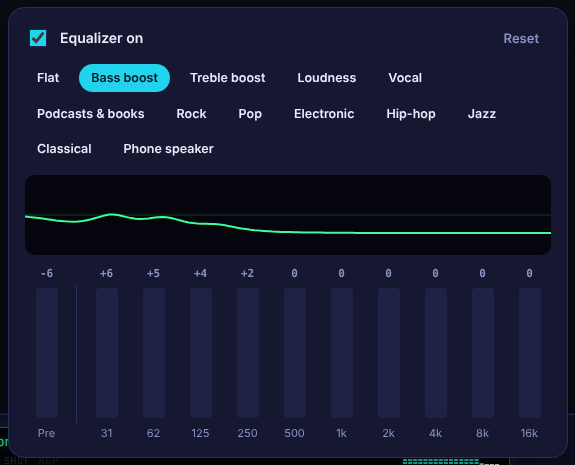

- **Presets.** Tap one to apply it: Flat, Bass boost, Treble boost, Loudness, Vocal, Podcasts & books,
  Rock, Pop, Electronic, Hip-hop, Jazz, Classical and Phone speaker. Picking a preset also turns the EQ on
  and lowers the preamp by the preset's biggest boost, so loud songs don't distort.
- **Sliders.** Each band goes from −12 to +12 dB, and moving one switches the preset to **Custom**.
  Double-click a slider to set it back to 0. **Pre** (preamp) changes the overall level before the bands.
- **Curve.** The green line shows the combined effect across 20 Hz to 20 kHz.
- **On/off.** The checkbox switches the EQ off without losing your settings. **Reset** goes back to Flat.

The EQ applies to everything Wavelength plays: music, radio, podcasts, audiobooks and downloaded songs.
Your settings are saved on this device.

**Phone speaker** is worth trying on Android. It cuts the deep bass a phone speaker can't play anyway
and lifts the mids, so music sounds louder and clearer.

**One limit.** Some radio stations and servers don't let the app process their audio (no CORS headers).
The EQ can't change those streams, and the panel shows a note while one is playing. The same streams
also show the idle visualiser animation.

> **Developer notes.** The bands and presets are in `src/player/eq.ts`, and the filter chain is in
> `ensureGraph()` in `src/player/engine.ts` (preamp → 31 Hz low shelf → 8 peaking bands, Q 1.41 → 16 kHz
> high shelf → analyser). Settings are stored as `eq` in the settings store. `store/player.ts` subscribes
> to them and calls `engine.setEq`, which ramps each gain over about 20 ms so dragging a slider doesn't click.
> The curve comes from `BiquadFilterNode.getFrequencyResponse` on a throwaway `OfflineAudioContext`. To
> add a preset, add an entry to `EQ_PRESETS` (10 gains, low to high).

## Lyrics

In **Now Playing**, the **Lyrics** chip swaps the "Up next" list for the song's lyrics. Synced lyrics follow the
song: the line being sung lights up and stays in the middle, and tapping a line jumps the song there. On a TV
they're shown in big text. Songs with only plain lyrics just scroll; instrumentals say so.

Lyrics come from your **Navidrome** server when it has them (from the files' tags or a `.lrc` file next to the
song, Navidrome 0.53 or newer), otherwise from **LRCLIB** (lrclib.net, free and open, no account). **Kid
profiles** see lyrics with strong words hidden (`f•••`), since clean versions of songs only have the original
words online.

LRCLIB often has several entries for a song, including instrumental or karaoke uploads filed under the same
name, so Wavelength looks a few ways (the exact song, a search by name and artist, a search by the first-listed
artist, a free-text search) and takes an entry with words over one marked instrumental. A song only shows
"Instrumental" when its name says so or every matching entry is marked that way. Version notes like
"(2011 Remaster)", "- Radio Edit" or "(feat. …)" are left off when searching. When the only match is a different
length (a live take, say), you get its words without the karaoke timing.

> **Developer notes.** `src/lib/lyrics.ts` (LRC parsing, the LRCLIB lookup: `cleanTitle` and `artistVariants`
> build the queries, every reply is pooled, entries with words and a matching name win, then a length within
> 10 s, then synced; an unreachable LRCLIB throws so the miss isn't cached; the kid filter), `NavidromeSource.getLyrics` (OpenSubsonic
> `getLyricsBySongId`), and `src/components/Lyrics.tsx`. Lyrics are cached per song for the session. The
> [critters](#critters) look up the playing song's lyrics too (same cache) while their scene is on screen,
> to know when someone is singing (`src/lib/singAlong.ts`).

### Translate lyrics

With a Hub whose AI DJ is set up, the lyrics have two buttons at the top:

- **In English** (your device's language) puts a translation under each line. It follows the song like the lyrics do.
- **In Latin letters** (only for lyrics written in another script: Japanese, Korean, Chinese, Russian, Arabic…)
  writes each line the way it's pronounced, so you can sing along.

Press the button again to hide it. The translation comes from the AI DJ's model (or Ollama, for free, when the Hub
uses it), so it may not be exact. It's made once per song and language for the whole house: the next person who
asks gets it straight away, without another call. Each call counts toward your AI DJ allowance. A Hub admin can
turn it off in **Settings → Features → Translate lyrics**.

### Sing mode

**Sing** next to **Lyrics** in Now Playing turns the singer down and opens the lyrics, karaoke style. The slider
above the lyrics sets how far down the voice goes. It works by taking out what's in the middle of the stereo
picture in the voice's range, so it's best on studio recordings with the singer in the centre; bass and drums
stay, wide guitars and backing vocals mostly stay, and a song in mono loses its whole middle. It can't reach a
song playing on a speaker (casting) or from a server that blocks the equalizer. The critters sing less too,
since they listen for the same voice. Admins can turn it off in **Settings → Features**.

## Music videos

With a Hub where **Music videos** is on (**Settings → Features**; off for kid profiles unless an admin ticks
**Kids**), Now Playing shows **Video** when the song has an official video on YouTube. The Hub's yt-dlp finds it
(skipping lyric videos, live versions and covers), and it plays in a YouTube player that doesn't set cookies.
The music pauses while you watch and carries on from the same spot when you close it.

## Discord status

In the desktop app, **Settings → Playback → Discord status** shows **Listening to** the song and artist on your
Discord profile while music plays, with a progress bar and the cover when it's a public one. It clears when you
pause. Discord has to be open on the same computer. Discord needs an Application ID for the name it shows: make
one at discord.com/developers/applications (**New Application**, call it *Wavelength*) and paste its
**Application ID** into the setting. Admins can turn the feature off in **Settings → Features**.

## Sleep timer

**Now Playing → Sleep** stops playback after 15, 30 or 45 minutes, 1 hour, 1½ hours, or at the end of the
current song (or audiobook file). Timed sleeps fade out over the last 20 seconds. The chip shows the time left;
tap it again to change it or **Turn off**. The timer belongs to this device and is forgotten on restart.
With an audiobook or podcast that has chapters, **End of this chapter** stops when the chapter playing ends.

## Wake-up alarm

**Settings → Playback → Wake-up alarm** wakes you with music. Pick the time, the days (none means once), and what
plays: your liked songs, where you left off, DJ mode, the daylist or another mix, a playlist or a radio station. It
starts quiet and comes up to your volume over the **Fade in** time. A banner offers **Snooze** (9 minutes),
**I'm up** (keep the music) and **Stop**. If what you picked has nothing to play, it plays your liked songs.

- **Android:** the phone wakes Wavelength for it even when it's closed and the phone is locked, and shows an alarm
  icon in the status bar. It's set again after the phone restarts. If Android says exact alarms aren't allowed,
  turn on **Alarms & reminders** for Wavelength in Android's app settings.
- **Computers:** Wavelength has to be running (it can wait in the tray) and the computer awake.

The alarm belongs to this device.

> **Developer notes.** `lib/alarm.ts` (schedule, fire, fade-in, snooze), `lib/alarmTime.ts` (next time, pure,
> tested in `test/alarm.test.ts`). Android: `AlarmBridge.kt` sets an `AlarmManager.setAlarmClock` alarm whose
> PendingIntent opens `MainActivity` over the lock screen; MainActivity sends `alarm` through `MediaBridge` and the
> page runs `alarmDue()`. `AlarmBootReceiver` restores it after a reboot. The page also checks every 15 s, and
> `firedFor` makes sure it goes off once.

## Pick up where you left off

Close Wavelength (or let Android close it in the background) and the next time it opens, the queue, the song and
the spot in it are back, paused. Press play to carry on; nothing loads until you do. Audiobooks reopen on
Audiobookshelf at the spot it has saved, which may be further on if you listened on another device. It's kept per
device and per profile for 30 days. Turn it off in **Settings → Playback → Pick up where you left off**.

> **Developer notes.** `lib/resume.ts` saves `{ queue, index, at }` to `localStorage` on every change of song and
> every 10 s while playing (stream links that the server regenerates, and listening sessions, are left out:
> `lib/resumeQueue.ts`). `restoreQueue()` in `store/player.ts` puts it back and holds a `pendingResume` that
> `toggle()` runs.

## Streaming quality

**Settings → Playback → Streaming quality** sets how big songs from Navidrome are, separately **On Wi-Fi** and
**On mobile data**: **Original** (the file as it is; FLAC is about 35 MB a song), **High** (320 kbps), **Normal**
(160 kbps) or **Data saver** (96 kbps). Navidrome converts each song as it plays, to Opus (MP3 on a Mac or iPhone).
Downloads, bit-perfect output and speakers always get the original. Android tells Wavelength when it's on mobile
data; computers count as Wi-Fi. Plex streams are always the original.

## Audiobooks and podcasts

**Audiobooks** sorts by **Recently added** (the default), **Recently played**, **Title**, **Author**, **Series**,
**Newest published**, **Longest** or **Shortest**, and the chips show **All**, **Not started**, **In progress** or
**Finished**. The filter box also finds a series or narrator. **Continue listening** shows the book you're in first.

**Podcasts** sorts shows by **New episodes** (the default: shows with the latest episode first), **Recently added**,
**Recently played**, **Title**, **Author** or **Most episodes**. A show's episodes sort **Newest**, **Oldest**
(handy for a show you listen to from the start; **Play** then plays on in that order), **Unplayed first**,
**Shortest** or **Longest**. Each choice is remembered on this device.

While a book or episode plays, Now Playing and the player bar swap shuffle and repeat for **−15** and **+30**
(seconds back and on, across a book's files too), and add:

- **Speed** (0.75× to 3×, voices keep their pitch), remembered for each book and each show. A book or show you
  haven't set starts at the last speed you picked.
- **Chapters** from Audiobookshelf, with the one playing marked; tap one to go there.
- **Sleep**, with **End of this chapter**.

The lock screen's and headphones' skip buttons jump 15 and 30 seconds too.

## Volume levelling, gapless and crossfade

**Settings → Playback → Volume levelling and crossfade**:

- **ReplayGain** plays every song at about the same loudness, from the loudness tags in your files (Navidrome
  passes them on; tag your library with a tool like beets, foobar2000 or MusicBrainz Picard if it has none).
  **Track** levels each song on its own, good for shuffle and playlists; **Album** keeps an album's quiet and
  loud songs as they were meant. Songs without tags are turned down 6 dB so they sit near the tagged ones.
  **Boost** raises everything that's levelled; Wavelength never lets a song clip past its peak.
- **Gapless.** Near the end of a song, the next one is loaded ahead, so live albums and DJ mixes play straight
  through without a gap. This is always on.
- **Crossfade** (1–12 seconds) fades the next song in over the end of this one.

Levelling, gapless and crossfade are for music. Radio, audiobooks and podcasts play as they are, and songs
from a server that doesn't let the app process its audio (the same ones the EQ can't reach) play without
crossfade. These settings sync between your devices with a Hub.

### AutoMix

**Settings → Playback → AutoMix** blends songs the way a DJ would instead of one fixed crossfade:

- The next song on the **same album**, straight after this one, follows with no fade, so live albums and segues
  stay as recorded.
- With [sound-alike analysis](#sounds-like-this-and-sonic-journeys) on the Hub, two songs at **close tempos**
  (within 8%, or at half or double time) blend over 8 beats starting on a beat, and the next song is nudged to the
  same tempo for the blend (without changing its pitch), then eased back to its own.
- Otherwise the fade is longer between calm songs and shorter between energetic ones, or the Crossfade length
  above (6 seconds when it's off) for songs the Hub hasn't analysed.

Fades use equal-power curves now, so there's no dip in the middle. Like crossfade, AutoMix needs a server that
allows it (CORS) and isn't used during a listening party or the sleep timer's last song.
### Bit-perfect output (Windows)

**Settings → Playback → Bit-perfect output** plays songs straight to your sound card in WASAPI exclusive mode,
at each file's own sample rate and bit depth, without Windows' mixer resampling them. The setting shows what
the device is getting (for example *96000 Hz · 24-bit*). While it's on, other apps can't play sound, and the
equalizer, ReplayGain, crossfade, sing mode, the critters and visualizers are off. The volume slider at the top
is bit-perfect; below it the sound is turned down digitally. It plays FLAC, ALAC, WAV, AIFF, MP3, AAC and Ogg
Vorbis (not Opus). Casting takes over while a speaker plays and hands back afterwards. Admins can turn the
feature off in **Settings → Features**.

## Skins and themes

**Settings → Themes** changes the app's colours and chrome. Tap a card to switch; the choice is saved on this
device and applies straight away. The visualizers and the LCD follow the skin's colours too.
Every skin works on Windows, Android phones and tablets, and Android TV.

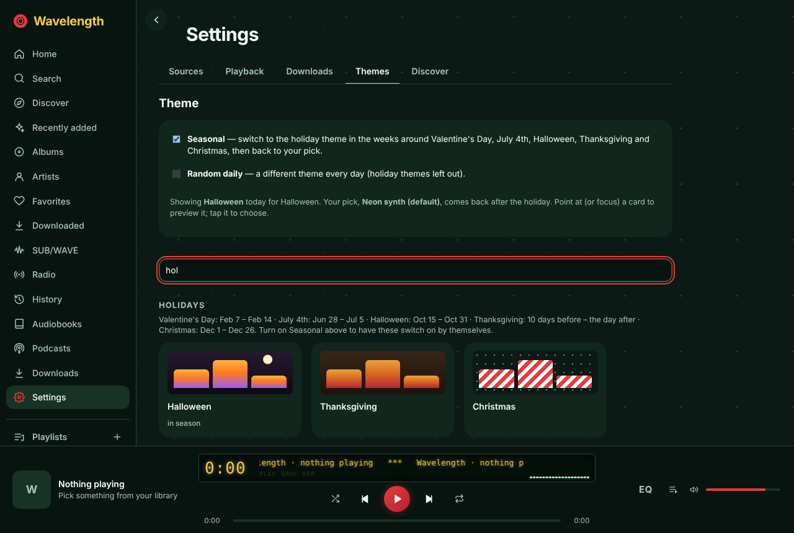

- **Groups.** Skins are grouped as Classic, Retro, Neon, Lasers, Nuclear, Editor palettes, Holidays and Accessibility.
- **Search.** Type in the box to filter by name or group (for example "neon", "laser", "nuclear" or "light").
- **Live preview.** Point at a card (or move to it with the D-pad on TV) and the whole app shows that skin
  until you move away. Tap it to keep it.
- **Seasonal.** In the weeks around each holiday, the app switches to that holiday's skin by itself, then
  goes back to your pick afterwards. Your pick isn't changed. The windows are:

  | Holiday skin | When Seasonal shows it |
  | --- | --- |
  | Valentine's Day (rose and blush, a light skin) | Feb 7 – Feb 14 |
  | July 4th (navy, red and white, with fireworks) | Jun 28 – Jul 5 |
  | Halloween (pumpkin orange and witchy purple) | Oct 15 – Oct 31 |
  | Thanksgiving (harvest gold, cranberry, warm wood) | 10 days before US Thanksgiving to the day after |
  | Christmas (pine green, berry red, gold, a little snow) | Dec 1 – Dec 26 |

- **Random daily.** A different skin every day (holiday skins are left out). Picking a card by hand
  turns Random daily off. If Seasonal is on too, a holiday wins.
- The note under the switches says which skin you're seeing today and why.

You can also pick a holiday skin by hand at any time of year.

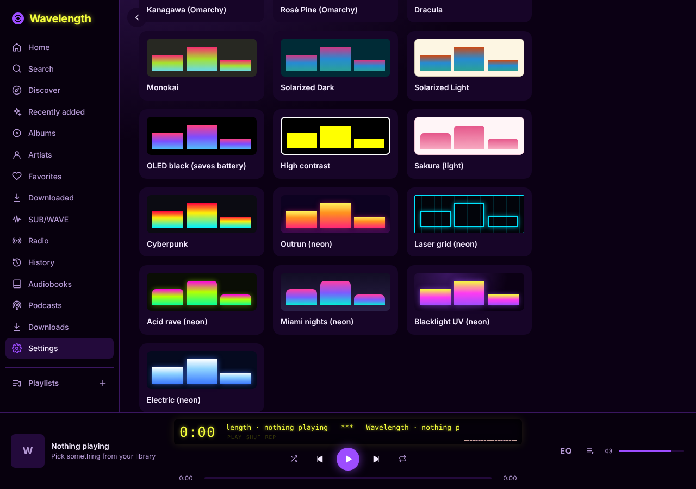

**Neon skins.** For a brighter, glowing look, try one of these alongside the default Neon synth, Vaporwave,
Synthwave sunset and Cyberpunk:

| Skin | Look |
| --- | --- |
| **Outrun** | Hot pink and orange chrome-sunset gradients over a faint purple laser grid. |
| **Laser grid** | Black with a cyan grid; cards, buttons and icons are glowing cyan outlines. |
| **Acid rave** | Toxic lime green with UV magenta, rounded and loud. |
| **Miami nights** | Flamingo pink and teal neon-sign glow on deep purple. |
| **Blacklight UV** | Deep violet with highlighter yellow and pink, like a blacklight poster. |
| **Electric** | Arc-welder blue and violet with a white-hot glow. |
| **Neon diner** | Cherry red and teal, like a roadside diner sign. |
| **Neon lime** | Electric lime and orange on charcoal. |
| **Neon ice** | Cold white-blue tubes on navy. |

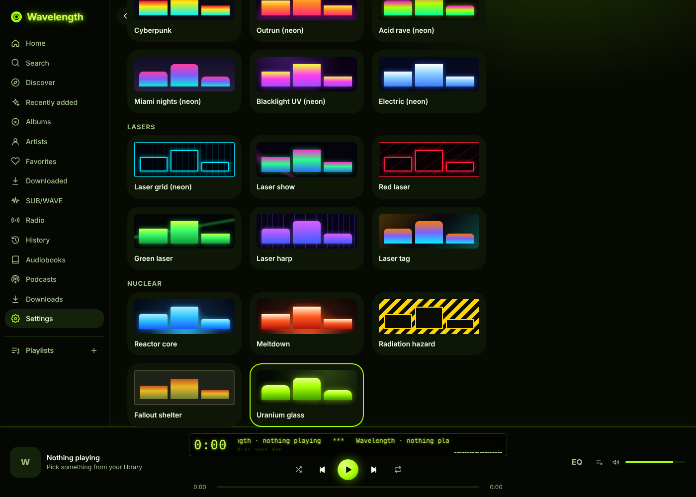

**Laser skins.** Under **Lasers**, next to Laser grid:

| Skin | Look |
| --- | --- |
| **Laser grid magenta / amber / green / violet** | Laser grid's glowing outlines on a black grid, in hot magenta, amber, phosphor green or ultraviolet. |
| **Laser show** | Blue, green and magenta beams fanning up through haze; rainbow buttons and progress bar. |
| **Red laser** | Crimson outlines and diagonal beams on black, square corners, like targeting sights. |
| **Green laser** | A green beam cutting through fog, with lime highlights. |
| **Laser harp** | Vertical violet and blue light strings over deep indigo, rounded and soft. |
| **Laser tag** | A blacklit arena: team orange against team cyan. |

**Nuclear skins.** Under **Nuclear**:

| Skin | Look |
| --- | --- |
| **Cherenkov (reactor core)** | Cherenkov blue glowing up from the bottom of the screen, like a cooling pool. |
| **Meltdown** | A molten core: white-hot through orange to scorched red. |
| **Radiation hazard** | Warning yellow on black, square and bold, with hazard-tape stripes on the player bar. |
| **Fallout shelter** | Olive drab, civil-defence yellow and rust, with a green Geiger-counter LCD. |
| **Uranium glass** | Vaseline-glass green fluorescing under UV, with big round corners. |
| **Nuclear** | Toxic green and hazard yellow glow. |
| **Radium** | Glow-in-the-dark watch-dial green on black. |
| **Isotope** | Plutonium violet with a hazard-yellow edge on cards and the player bar. |

All of these are part of the **Random daily** rotation. They aren't holiday skins, so **Seasonal** never picks them.

**Other skins worth knowing.** **OLED black** uses true black so OLED phone screens switch those pixels off,
which saves battery. **High contrast** is yellow on black with thick outlines and strong focus rings, for low
vision or bright sunlight. **Sakura**, **Solarized Light** and **Valentine's Day** are light skins.

> **Developer notes.** A skin is a `:root[data-skin='…']` block of CSS variables in `src/styles.css` plus a
> `.skin-card.<id> .skin-preview` rule for its picker card, and an entry in `SKINS` (`store/settings.ts`)
> with its `group` (one of `SKIN_GROUPS`). Recipe: [CONTRIBUTING.md](CONTRIBUTING.md#add-a-skin). Skin rules
> must sit at the top level of `styles.css`; one inside a `@media (max-width: 760px)` block only applies at
> phone width, which is what broke seven skins on Windows in 0.7.0.
>
> The saved `skin` is what the user picked. What's on screen is worked out in `App.tsx`:
> `useUi.previewSkin` (hover preview, never saved) if set, else `activeSkin()` from `src/lib/seasons.ts`,
> which applies Seasonal (`seasonal`, holiday windows in `SEASONS`) and Random daily (`randomDaily`,
> a hash of the local date). `App` re-checks every 10 minutes while either mode is on, so it rolls over at
> midnight. Everything uses the device's local date; nothing needs a server.

## Sounds like this and sonic journeys

When a Hub admin turns on **Sound-alike analysis** (Settings → Features), the Hub listens to every song in your
Navidrome library once and measures how it sounds: tempo, key, energy, brightness and timbre. Then Now Playing
has two more buttons:

- **≈ Sounds like this** keeps the song playing and queues up songs from your library that *sound* like it,
  not just songs by related artists (that's **Song radio**). At most three by any one artist.
- **↝ Journey to…** asks where you want to end up, then queues 20 songs that move step by step from this song
  to that one: from a slow ballad to a party track, say.

Smart playlists get **Mood** (energetic, upbeat, chill, mellow, dark) and **Tempo** rules too, and AutoMix uses
the beat it found. The first analysis of a big library takes a night; songs show up as they're done.

## Smart playlists

**Playlists → Smart playlists** are rules instead of a list of songs: genres, your star rating, ♥ only, not
played in N days, added in the last N days, a range of years, and how many songs at most. Press play and
Wavelength picks matching songs from your Navidrome library at random, so the playlist changes as you add, rate
and play music. **Save copy** saves today's songs as an ordinary playlist on your server, for other apps. The
rules follow you to every device with a Hub. Genres match your tags, so tidy genres help (below).

## Library care

**Albums → Library care** (on a phone, Library → Library care) has two lists, and two more for Hub admins:

- **Duplicates:** albums your server has more than once, counting editions like "Deluxe" or "25th Anniversary"
  as the same album, with the most complete copy first. Explicit and clean versions don't count, nor does the
  same album on two different servers. Hub admins can **Delete** the extra copies; they go to the Hub's trash
  for 30 days.
- **Missing albums:** for the 40 artists you have the most albums by, the studio albums Deezer lists that you
  don't have, with preview and **Get** / **Request**. Live albums, compilations and remix albums are left out.
- **Numbered titles** (Hub admins): songs whose title has the track number in front, like "04 - God's Plan".
  Some renaming and tagging tools copy the file name into the title tag, and then lyrics and Deezer can't find
  the song. **Find numbered titles** asks the Hub to look through Navidrome's list of every song (a few seconds,
  even for a big library, and you don't need to open any albums first) and lists what it would change; **Fix**
  writes the title without the number back into the files, a few songs at a time with a running count. If the
  Hub stops answering partway, the songs already fixed drop off the list and **Fix** again carries on. The whole
  fix is one entry under **Settings → Server → Tag edits**, which can undo it. A number only counts as a track number when it has a leading zero ("04") or
  is the song's own track number, so "7 Rings" and "99 Problems" are left alone. Wavelength already shows and
  looks up these songs without the number before you fix them, and an album's **Edit tags** page has a
  **Take track numbers out of titles** button for one album.
- **Unmatched songs** (Hub admins): songs whose tags keep Navidrome from filing them under the right artist or
  album. **Find unmatched songs** reads every album's tags through the Hub (a few albums per request, three
  requests at once) and lists each song with what's wrong:
  - **Joined artists:** several artists in one tag with a semicolon and no space, like "Lil Wayne;Drake".
    Navidrome only splits on "; " (with the space), " / ", " feat. " and " ft. ", so it shows "Lil Wayne;Drake"
    as one artist. **Split joined artists** fixes every one at once by writing "Lil Wayne; Drake"; **Split
    artists** on a song fixes just that one.
  - **Maybe joined:** a comma or slash with no space around it ("Lil Wayne,Drake", "Lil Wayne/Drake"). These
    aren't changed by themselves, because "AC/DC" is one band; fix the ones that are wrong with **Edit tags**.
  - **No artist**, **No album artist**, **No album**, **No title**, **No genre**, **No year**, **No track number**
    (Navidrome's "[Unknown Artist]" and "[Unknown Album]" count as missing).

  Click the filter chips to see only songs with those problems (two chips show songs that have both), and type in
  the search box to narrow by title, artist, album, genre or file name. Tick songs (or **Tick all shown**) to set
  the Artist, Album artist, Album, Genre or Year on all of them at once, with your library's names suggested as you
  type. **Edit tags** on a song opens its title, artist, album artist, album, genre, year, track and disc in place.
  Every save can be undone with **Undo** right there or later under **Settings → Server → Tag edits**, and
  Navidrome shows the new tags after its rescan a minute later.

  New downloads have their joined artists split by the Hub before Navidrome scans them, so "Lil Wayne;Drake"
  shows up as Lil Wayne and Drake straight away. The tick box at the top of the tab turns that off.

## Selecting several albums or artists

**Albums**, **Artists** and an artist's page have a **Select** button, like Plex's multi-select. You can also
start selecting without it: hover over a card and click the round tick in its corner, or **Ctrl**-click (**⌘**
on a Mac) or **Shift**-click a card. While you're selecting:

- **Click** a card to tick or untick it.
- **Shift-click** ticks every card between the last one you ticked and this one.
- **Select all** ticks every card on screen (just the ones the filter shows, if you've typed one).
- **Done** goes back to opening things when you click them.

The bar at the top says how many you've ticked and has the actions:

| Action | Who | What it does |
|---|---|---|
| **Play** / **Shuffle** | Everyone | Plays the songs on everything ticked, in the order you ticked them. |
| **Play next** / **Add to queue** | Everyone | Puts those songs after the current one, or at the end of the queue. |
| **Merge** | Hub admins | Merges everything ticked into the **first** one you ticked (below). |
| **Delete selected** | Hub admins, albums only | Deletes the albums from your server (below). |

### Merging albums and artists (admins)

Merge works the way it does in Plex: **the first one you tick is the one the others merge into.** Its card says
**Merge target**, and the bar says *merges into …*. To change the target, untick it and tick it again later, or
press **Done** and start over.

- **Albums:** every song on the other albums gets the target album's **Album**, **Album artist** and **Year**
  tags, so your server files them all under the target. Use it when one album has been split in two, for example
  a single clean song that ended up as its own "Underground Luxury" next to the rest of the album, or a
  "(Deluxe)" copy you want filed with the original.
- **Artists:** every song by the other artists is renamed to the target's name, in its **Artist** and **Album
  artist** tags. Songs where they're credited with someone else ("Bobby Ray feat. T.I.") change too. Use it for
  two spellings of one artist ("Beatles" and "The Beatles").

Before anything changes, Wavelength reads the files and asks you to confirm, saying how many songs it will
retag. Your Hub writes the new tags into the files; the files don't move and the audio isn't touched. The
merged albums or artists leave the list straight away, and the library refreshes after Navidrome's rescan, a
minute or two later.

A merge is one save in the tag editor, so **Settings → Server → Tag edits → Undo** puts every song back as it
was. Only copies on a Navidrome server can be merged, and your Hub needs what the tag editor needs: your music
at `/music`, read-write, and the Navidrome admin login (Settings → Server).

> **Developer notes:** `useSelection` and `SelectBar` in `src/components/Selection.tsx` keep the ticks in the
> order they were made (the first is the target). `src/lib/merge.ts` plans a merge from the files' tags
> (`planAlbums`, `planArtists`; the pure parts are `albumTarget`, `planAlbumMerge` and `planArtistMerge`, tested in
> `src/test/merge.test.ts`) and saves it through `PUT /api/admin/tags` as one batch. No Hub change was needed.

### Deleting several albums at once (admins)

Tick albums on **Albums** or an artist's page, then **Delete selected**. Wavelength lists what it's about to
delete and asks first. The files go to the Hub's trash, and **Settings → Server → Deleted albums** can put them
back for 30 days. Only copies on a Navidrome server can be deleted this way.

## Searching your playlists

When you have lots of playlists, use the search box at the top of **Playlists**. Type part of a playlist's
name and only the matching ones stay on the page. For Wavelength playlists it also looks inside them: type a
song, artist or album and you get every playlist that has it, with the card showing the song that matched
(for example *Has Dreams · Fleetwood Mac*). Navidrome and Plex playlists are matched by name only. Press
**Esc** to clear the search.

The **+ Playlist** menu works the same way: start typing in its box and the list narrows to playlists whose
name matches, so you can click the one you want. Press **Enter** instead to make a new playlist with that name.

> **Developer notes:** `playlistMatch()` in `src/views/Playlists.tsx` does the matching (case-insensitive
> substring on the name, then the title, artist and album of a Wavelength playlist's tracks). Server
> playlists only carry a name and track count in `useServerPlaylists`, so searching their songs would mean
> fetching every playlist; that's left out on purpose. The **+ Playlist** filter is in
> `src/components/AddToPlaylist.tsx`.

## Playlist covers

Every playlist can have its own picture. Open the playlist and press **Change cover**:

- **From this playlist** shows the album covers of the songs in it. Click one to use it.
- **Upload a picture** from your computer or phone (JPEG, PNG, WebP or GIF, 15 MB at most), or paste an image
  link and press **Use link**. Wavelength crops it to a square from the middle and makes it 600×600.
- **Use the automatic cover** (or **Use the server's cover** on a Navidrome or Plex playlist) removes your
  picture again.

Which playlists:

- **Wavelength playlists:** your own, always. With no picture they show a **mosaic of their first four
  albums** (four different albums, not four songs from the same one). With fewer than four albums they show
  the first album's cover.
- **Navidrome and Plex playlists** you can edit (not read-only ones). With no picture they show the server's
  own cover. Your picture is only shown in Wavelength: Navidrome, Plex and other apps keep their cover.
- **Household playlists:** whoever started it, or an admin. With no picture they show a mosaic of their
  albums too.

**Where it's kept.** Signed in to a Hub, the cover is saved on your Hub, so it shows on every device you sign
in on: Windows, Android (and Android Auto's playlist list), the TV and the browser. Your own playlists' covers
only you see. Covers on Navidrome, Plex and household playlists everyone on the Hub sees, and only whoever set
one (or an admin) can change it. Kid profiles can change their own playlists' covers only. With no Hub the
cover stays on that one device.

Deleting a playlist deletes its cover too.

> **Developer notes:** `src/lib/playlistCovers.ts` keeps the covers (`usePlaylistCovers`, persisted as
> `tonearm.playlistCovers`), makes the square JPEG (`squareImage`, `imageFromLink`, which downloads through
> `http()` so the app isn't stopped by CORS) and picks the mosaic (`mosaicOf`). Covers are found by key:
> `wavelength:<id>`, `household:<id>`, `navidrome:<id>` or `plex:<id>` (the server's playlist id).
> `src/components/PlaylistCoverButton.tsx` has `PlaylistArt` (picked cover → mosaic → server cover) and the
> picker. The Hub side is `hub/src/routes/playlistCovers.ts`.

## Import a playlist

**Playlists → Import** brings a playlist over from somewhere else. Paste a link, or choose a file:

- **Deezer** playlist or album links.
- **Spotify** public playlist or album links. Spotify only shows its first 100 songs or so without signing
  in, so for longer playlists export a CSV at [exportify.app](https://exportify.app) and import the file.
- **YouTube Music** or YouTube playlist links. Your Hub reads these with its yt-dlp (nothing is downloaded),
  so you need to be signed in to a Hub.
- **CSV** files (Exportify, TuneMyMusic, Soundiiz or any sheet with title and artist columns), **M3U**
  playlists, and **text** files with one *Artist - Title* per line.

Wavelength looks each song up in your library and shows what it found. **Save playlist** makes a Wavelength
playlist of the songs you have, in order (rename it first if you like). **Get missing** (or **Request
missing**, for people who ask the admin for music) sends the rest to deemix, or to yt-dlp for songs Deezer
doesn't have; each song also has its own **Get** / **Request** button. On a kid profile, songs that aren't
for kids are left out.

> **Developer notes:** parsing and fetching are in `src/lib/playlistImport.ts`, the page is
> `src/views/ImportPlaylist.tsx`, and getting a missing song is shared with Discover in `src/lib/getSong.ts`.
> YouTube goes through the Hub's `POST /api/import/youtube`; Spotify's embed page and Deezer's API go through
> `/api/fetch` in a browser.

## Cast to a speaker

The speaker button next to **Devices** (player bar and Now Playing) finds Chromecasts, Google and Nest
speakers, TVs with Chromecast built in, and DLNA/UPnP speakers and receivers on the same Wi-Fi. Pick one and
what's playing moves there, at the same spot. The queue, skipping, seeking, volume and scrobbling all keep
working from Wavelength; the speaker just does the playing. **Play on this device instead** brings it back.

- Works in the desktop and Android apps (a web browser can't look for speakers).
- The speaker fetches songs from your server itself, so the server address must be one the speaker can reach
  (not `localhost`). Songs you downloaded play from the server while casting.
- Visualizers and the critters' singing don't follow the sound while it's on a speaker.
- A Hub admin can turn casting off in **Settings → Features**.

## Control your other devices

Signed in to a Hub, the **Devices** button in the player (and on Now Playing) lists your other devices that
have Wavelength open: what each is playing, with play/pause, next, previous and volume for it. **Continue
there** moves what you're playing to that device, picking up at the same spot, and pauses it here; **Play
here** does the opposite. Only your own devices show up. To keep a device out of the list, turn off
**Settings → Account → Let my other devices see and control this one** on it.

## Listen together

With a Hub, the **party** button by the volume (and on Now Playing) starts a listening party: everyone who
joins hears the same song at the same moment on their own device, wherever they are. Start one, and others
see it under the same button with **Join**. As the host you play music as usual. Guests' **+ Queue** and
**Next** on any song add it to the party (you can turn that off), and you can let guests skip and pause too.
**Leave** or **End party** when you're done.

### Who's listening

With a Hub, the sidebar shows **Listening now**: what the other people in the house are playing at the moment, with
a dot that lights up while it plays. **Play** plays the same song from your library; when they're hosting a
listening party, **Join** joins it. Only the song now playing is shared, never what came before, and it disappears
a few minutes after they stop.

**Settings → Account → Devices → Show the house what I'm playing** turns it off for you. It's on for grown-ups
and off for kid profiles. A kid who turns it on is seen only by their own grown-ups, and kids don't see songs
that aren't for kids.

### Guest Jam

Friends over who don't have Wavelength? As the host, open the party panel and press **Make a guest link**. It shows
a QR code and **Copy link**. Anyone who opens it on their phone (any browser, no app, no account) sees what's
playing and what's next, types their name once, searches your library and taps **Add**. Their song joins your
queue, with "*name* (guest) added …" on your screen. Guests only ever see song names: the music plays on your
device, not theirs.

- **Guests can add songs** in the party panel also covers Jam guests: untick it and the page says you're choosing.
- While a kid profile is in the party, the page leaves out explicit songs.
- Each phone can add 12 songs every 10 minutes.
- **Turn off** (or ending the party) closes the link straight away; a new link has a new code.

Guest Jam needs a Hub that has your Navidrome library listed (the same one Search uses).

## Scrobbling

**Settings → Account → Scrobbling** (with a Hub) sends every song you play to
[ListenBrainz](https://listenbrainz.org) and, if your Hub admin has set it up, Last.fm. For ListenBrainz paste
your user token from listenbrainz.org/settings; for Last.fm enter your username and password once (the Hub
keeps only the session Last.fm gives back). Plays from all your devices are sent, about once a minute, and ones
made offline go when the device reaches the Hub again. Radio, audiobooks and podcasts aren't sent. If a
service stops accepting your login, the row says so: disconnect and connect again.

## Rewind

**History → Rewind** (with a Hub) is your year in music, or any month of it: minutes listened, plays, top
artists, songs and albums, your most played song and when you first played it, new artists you found, your
busiest day and longest streak, and when you listen most. **Play your top songs**, **Save as playlist**, or
**Share as a picture** (a card in your skin's colours; on a phone it opens the share sheet). It counts music
from every device you're signed in on, not radio, audiobooks or podcasts, and starts from the history your
Hub already has.

## Home and Made for you mixes

With a [Wavelength Hub](HUB.md), **Home** opens on what's made for you:

- **Jump back in**: the albums you played last (on any device, since your history syncs).
- **Made for you**: mixes the Hub makes fresh every day from what you play.

| Mix | What's in it |
|---|---|
| **On Repeat** | What you've played most in the last 30 days |
| **Daily Mix 1–4** | Your favourite artists of the last few months, grouped by who sounds alike, with your most played songs by them and one song in four from similar artists |
| **Discover Weekly** | Best-known songs by artists like your favourites that you haven't played yet. Changes every Monday |
| **Forgotten favorites** | Songs you played a lot but not for three months |
| **Time Capsule** | Your most played songs from one to three years ago |
| **daylist** | What you play at this time of day, changing every few hours: late night, early morning, morning, afternoon, evening and night, with weekends apart from weekdays. Named after it, like "daylist: chill Saturday night" (the mood comes from [sound-alike analysis](#sounds-like-this-and-sonic-journeys) when it's on). Comes first on Home |

A mix only shows songs your library has: the Hub suggests, and Wavelength finds each one on your Navidrome or Plex
server. So Discover Weekly gets better as you add music, and a mix that finds nothing tells you so. Open a mix to
**Play**, **Shuffle** or **Save as playlist** (today's songs, as an ordinary playlist). Mixes need a few days of
listening before they appear. Kid profiles get no explicit suggestions, and the kid filter applies as everywhere.
[Smart offline](#smart-offline) can keep every mix downloaded.

### Blend

**Home → Blend** makes one mix from what you and other people in the house listen to: songs by artists you
share come first, then each person's favourites in turn. Everyone in a Blend has to turn on **Let people in the
house make Blends with me** first, since a Blend shows a little of what they play. Grown-ups can blend with each
other and with their own kids; kids only with their parents. A Hub admin can turn mixes and Blend off in
**Settings → Features**.

## Accessibility

- **Screen readers.** Buttons that only show an icon have names (Play, Next, Repeat…), the seek bar reads out
  "1:02 of 3:45", and the volume reads as a percentage.
- **Keyboard.** Tab moves through everything, with a visible outline. On a song, **Shift+F10** (or the menu key)
  opens the song menu: arrows move through it, Enter picks, Esc closes it and puts you back on the song.
- **Less motion.** **Settings → Themes → Motion**: *Like my device* (the default) follows your system's
  reduce-motion setting; *Less motion* stops the scrolling song name and other animations, and the critters and
  visualizers draw a couple of still frames a second instead of moving; *Full motion* always animates. It follows
  you to your other devices with a Hub.

## Don't play this

Some songs you never want picked for you. Open a song's menu (right-click it, or press and hold on a phone) and
choose **Don't play this song** or **Don't play** *artist*. From then on Wavelength leaves it out of everything it
picks for you: song radio, **Sounds like this**, sound journeys, [Smart Shuffle](#smart-shuffle), DJ mode and your
Made for you mixes. You can still play it yourself, from an album, a playlist or Search.

A song is matched by its artist and title, so every copy and version of it ("Live", "Remastered") counts. An
artist is matched by name, songs they're featured on included when they're the main artist. To change your mind,
open the same menu (**Play this song again**) or **Settings → Playback → Don't play**, which lists everything with
**Play again** next to it. With a Hub, the list follows you to every device, and the Hub keeps it out of your mixes.

> **Developer notes.** `src/lib/dontPlay.ts` (the same matching as `hub/src/dontPlay.ts`), the synced setting
> `dontPlay`, and `withoutDontPlay` in `songRadio`, `soundsLike` and `journey`. The Hub reads `settings.dontPlay`
> from the person's prefs in `Mixes.get` and `/api/dj/station`.

## Smart Shuffle

The shuffle button has a third setting. Press it once for **Shuffle**, again for **Smart Shuffle** (the button gets
a ✦), and a third time to turn shuffling off. Smart Shuffle shuffles your songs as usual and slips in a song you
might like after every three of yours: songs from your own library by artists like the ones in the queue, never
ones already in it or on your [Don't play](#dont-play-this) list. Picks have a ✦ in the queue; remove one like any
queued song. Turning Smart Shuffle off takes the picks still to come back out. It only touches queues you started
(not DJ mode or a station), and it remembers which setting you had.

## Mini player, tray and hotkeys

In the Windows, Mac and Linux apps:

- **Mini player.** The small-window button next to the queue button in the player bar (or the tray icon's menu, or
  **Settings → Playback**) opens a little window with the cover, the song, play/pause, next and previous. It
  stays on top of your other apps; drag it by its background. Click the song name to bring Wavelength back.
- **Tray icon** (the menu bar on a Mac): **Play / pause**, **Next**, **Previous**, **Mini player**, **Show
  Wavelength** and **Quit**. Clicking the icon shows Wavelength.
- **Hotkeys that work in any app:** Ctrl+Alt+Space play/pause, Ctrl+Alt+→ next, Ctrl+Alt+← previous (⌃⌥ on a
  Mac). On by default; turn them off in **Settings → Playback → Mini player, tray and hotkeys**. If another app
  already uses them, that section says so. Your keyboard's media keys keep working either way.
- **Keep playing in the tray when I close the window** (off by default): closing the window hides it instead and
  the music carries on. Quit from the tray icon.

> **Developer notes.** `src-tauri/src/desktop.rs` (tray, the global-shortcut plugin, the `mini` window,
> close-to-tray) sends the main window `remote` events; `src/lib/desktop.ts` acts on them and sends the mini
> player `mini-state`. `src/components/MiniPlayer.tsx` is drawn instead of the app when the window's label is
> `mini` (`main.tsx`), and loads none of the app's stores. Settings: `desktop` (per computer, not synced).

## Dead zones

Lose signal on your phone for a few minutes, in a tunnel, out in the countryside or in an underground car park, and
the music keeps going. **Settings → Downloads → Dead zones** (on by default) keeps two small, rolling sets of songs
on the device while you listen:

- **Up next**: the song playing and the next ones in your queue, about 20 minutes of them. They play from the file,
  so the queue just carries on through the dead zone.
- **Songs like the one playing**: about as much again, picked with **Sounds like this** when you have a Hub, or song
  radio otherwise. These are refreshed every half hour of listening.

When the signal goes and the next song isn't saved, Wavelength plays a saved song in its place. It tries the songs
like the one playing first, then your [smart offline](#smart-offline) shelves, then anything else you downloaded,
and avoids songs you played lately. The mini player says **No signal · saved songs**, and the desktop deck shows
**OFFL**. Your queue waits behind the stand-ins. Once your server answers again (Wavelength checks every 15
seconds), the queue picks up where it was, and a song that was cut off part way carries on from that spot. If you
were in DJ mode or song radio and the queue ran out, saved songs keep going until there's signal to fetch more. If
nothing at all is saved, the music stops and starts again by itself when the signal comes back.

Choose **10 to 60 minutes** of music to keep ready. Untick **Also keep songs like the one playing** to keep only
your queue, or tick **Only on Wi-Fi**. It's on for mobile data by default, because the road is where dead zones
are. Twenty minutes is about 40–50 MB at 320 kbps, or two or three times that for FLAC. Played songs are deleted as
new ones come in. The two sets show in **Downloaded** as *Kept for dead zones*. Radio, audiobooks and podcasts
aren't covered: they can't stand in for each other the way songs can. Windows and Android app only. A Hub admin
who turns **Smart offline** off in **Settings → Features** turns this off too.

## Smart offline

**Settings → Downloads → Smart offline** keeps music on the device by itself, so the phone plays in the car or on
a plane without you picking albums first. Turn it on and choose what to keep:

- **♥ Favourites**: every song you've starred.
- **Made for you mixes**: your [Home](#home-and-made-for-you-mixes) mixes and Blends, as they change.
- **Songs played in the last 7–90 days**, most played first.

It checks every few hours while Wavelength is open (or press **Update now**), only on **Wi-Fi** unless you untick
it, and stays under the size you pick (1–32 GB): favourites fill first, then mixes, then recent plays. Songs
that drop off a shelf are deleted, unless an album or playlist you downloaded yourself has them. The shelves show
in **Downloaded** as *Kept automatically*. It's per device, so the phone and the PC can keep different things.
Windows and Android only; a Hub admin can switch it off in **Settings → Features**.

## Following downloads

**Downloads → deemix queue** shows everything deemix has, as it happens:

- **Downloading · 5 of 12 songs**, with a bar, and **Waiting · 3 in line** for the ones behind it.
- **Done, but 2 of 12 songs failed**: press **Why?** to see which songs and deemix's reason (for example "Not
  available at the chosen quality").
- **Stuck · no progress for 20 min**, in red, when deemix has stopped moving. **Cancel** it (or **Retry**) and the
  rest carry on. If that doesn't help, restart deemix.
- **Clean versions held by your Hub** wait at the top until deemix is free, saying what they're waiting for. You
  can cancel them there.
- **Clear finished** tidies deemix's list.

Inbox shows the same for requests, including the ones Release Radar gets automatically: a bar, the songs that
couldn't be got and why. A request deemix lost (its list was cleared, or it restarted) says so after an hour, and
**Retry** sends it again. In **Inbox → Clean versions**, an album deemix no longer has says **Not in deemix's
queue any more** and can be sent again, and the bar at the top shows how busy deemix is.

> **Developer notes.** `src/lib/deemixQueue.ts` (reading the queue, stuck detection, Cancel / Retry), `src/components/DeemixQueue.tsx`,
> and on the Hub `hub/src/deemixQueue.ts`. Without a Hub, the app reads deemix itself with the same rules.

## AI DJ

With a Hub where an admin turned it on for you, **AI DJ** is in the menu (under **Library** on phones). Chat with
it: ask for a playlist ("25 songs for a road trip"), a mood ("chill music for dinner"), more like an artist or what
you played this week, or "which Radiohead albums am I missing?". It searches your library, plays or queues what it
finds, saves playlists (**Open the playlist** jumps to one) and, when you say yes, requests missing albums like the
Request button does. **This month** under the box shows how much of your allowance you've used. Your DJ is
**DJ Trash Panda**, the rave raccoon next to each reply.

If an admin turned on **AI DJ web search** (**Settings → Features**), the DJ can also look things up online: "what are the top EDM hits right now?", or
paste a setlist link and say "build me a new EDM mix from this". It plays or saves the songs you have and can
request the rest.

Admins set it up under **Settings → AI DJ**: the API key (kept on the Hub only) or your own Ollama server, the model, prices, monthly limits,
who can use it, and how many web searches it may make per step. The full setup guide is [AI-DJ.md](AI-DJ.md).

### DJ mode

When an admin turns on **DJ mode** (**Settings → Features**), press the raccoon button in the player and pick how to
start: **Mix it up**, a segment, one of your playlists ("more like Road Trip"), or type what you want ("90s house",
"something chill for cooking"). DJ Trash Panda then runs a station for you: your favourites, new finds, throwbacks
and top hits in turns, or more like your playlist, each introduced out loud. Tap a segment or type to change course,
and use **DJ loudness** if the DJ is hard to hear over the music. Songs on the list you don't have (like Top hits
you're missing) show up under **songs you don't have**, with **Get** or **Request** for each, or all at once. In the DJ chat you can also ask about your playlists
("make me something like my Gym playlist"). DJ mode only starts when you start it from that panel. Play your own
music (pick a song, album or playlist in your Library) and DJ mode stops, the DJ goes quiet mid-sentence and your
music plays; **Play next** and **Add to queue** keep DJ mode going. There's no limit on how many songs it plays:
the DJ picks the next segment (about 12 songs) while the last few of this one play, and keeps going until you press
**×**. See [AI-DJ.md](AI-DJ.md#whos-in-charge).

### Talking DJ

When an admin turns on **Talking AI DJ** (**Settings → Features**), **Settings → Playback → Talking DJ** makes the
DJ speak between songs like a radio presenter: a line about what you just heard and what's next, over the start
of the song with the music turned down. Choose how often (every song up to every 10th), a style (**Laid back**,
**Hype** or **Trivia**), a name for it to call you, and the voice and speed on this device. **Hear the voice**
tries it. It uses a little of your AI DJ allowance each time. It only talks over music the DJ played for you (songs
from the AI DJ chat, and DJ mode), never over songs you picked yourself.

If your admin set up a Hub voice (**Kokoro**, free, or **OpenAI**), the **Voice** list has **DJ voices** that sound
far more natural than the built-in ones. Pick one, or choose one of **This device's voices** to keep the old one.
Admins: **Settings → AI DJ → Talking DJ voice**, and [AI-DJ.md](AI-DJ.md#voices) for running Kokoro.

> **Developer notes.** `src/views/DJ.tsx` (chat), `src/lib/dj.ts` (the tools that run in the app),
> `src/views/DjAdmin.tsx` (admin tab), `hub/src/dj/` and `hub/src/routes/dj.ts` on the Hub. See
> [AI-DJ.md](AI-DJ.md#how-it-works).

## Containers (Hub admins)

If your Hub is set up for it, **Settings → Server → Containers** lists the household's other services, like
Navidrome and slskd, and whether each is running. **Start**, **Stop** and **Restart** do what they say, and
**Logs** shows what the container printed lately, handy when something stops working. Only the containers the
Hub was told about show up. Setting it up is in `docs/HUB.md`, "Docker control".

## Settings tabs

Settings is split into tabs: **Account** (Wavelength Hub sign-in), **Users**, **Server** and **AI DJ** (Hub admins only), **Sources** (servers), **Playback** (equalizer), **Downloads** (deemix and
yt-dlp), **Themes**, **Discover** (charts) and **Updates**. Links elsewhere open the right tab: **Edit charts** on
Discover opens Discover, and the Settings link in Downloads opens Downloads.

> **Developer notes.** `src/views/Settings.tsx`, one component per tab. The route can name a tab:
> `go({ view: 'settings', tab: 'themes' })` (`SettingsTab` in `store/ui.ts`).

## Editing your radio stations

**Radio → Your stations** lists the stations on your Navidrome and SUB/WAVE servers. Tap **Edit** next to
the heading to change them:

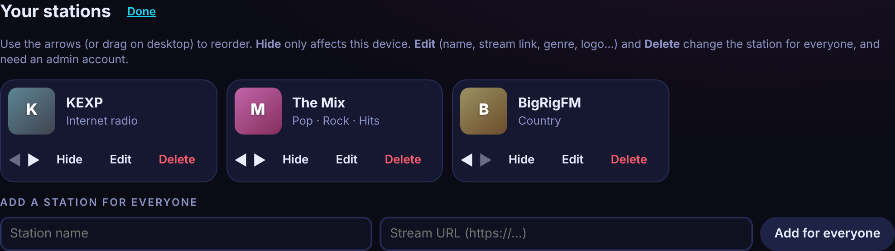

- **Reorder** with the ◀ ▶ arrows, or drag a station onto another on desktop.
- **Hide** removes a station from the row on this device only. Hidden stations are listed under the row
  while editing, each with **Show** to bring it back.
- **Delete** (Navidrome stations only) removes the station from the Navidrome server for everyone. Navidrome
  only lets admin accounts do this; if your account isn't an admin you'll get an error, and you can hide it instead.
- Tap **Done** when you're finished.

Your **Favorites** (stations you hearted, and streams you added by URL) have ▲ ▼ arrows to reorder them,
and the heart removes one.

> **Developer notes.** `src/views/Radio.tsx`. Hidden stations and the order are `hiddenStations` and
> `stationOrder` in the settings store, keyed `<sourceId>:<stationId>` because ids are only unique per
> server. Stations the order doesn't know yet go at the end. Delete calls `deleteStation` on the source
> (`deleteInternetRadioStation` in `sources/navidrome.ts`); Navidrome enforces the admin check. When the
> Wavelength Hub arrives (see [USERS-AND-ADMIN.md](USERS-AND-ADMIN.md)) the hidden list and order are
> meant to sync per user; today they're per device.

## Song titles on radio

While a station plays, the player shows the song it's on instead of just the station's name, wherever the
station tells us:

1. **The station's now-playing page** (SUB/WAVE, AzuraCast, Icecast's status page), which can also bring
   cover art.
2. **The title inside the stream.** Most Shoutcast and Icecast stations send the current song inside the
   audio stream itself, even when they have no now-playing page. The desktop and Android apps read it
   straight from the station. In a **browser**, the page isn't allowed to, so it asks your **Wavelength Hub**
   instead: sign in to a Hub to get titles there.

The title is checked every 15 seconds, so a new song can take that long to appear.

**Still only the station name?** Then the station doesn't send song titles at all. That's common for DJ mix
and "sessions" stations, which play one long mix rather than separate songs. Nothing in the stream says
what's playing, so the only way to name the song is to recognise the audio, like Shazam does.

> **Developer notes.** `watchNowPlaying` in `store/player.ts` tries the now-playing page, then
> `streamTitle()` in `sources/radio.ts`, and keeps using whichever gave a title first. The ICY parser is
> `lib/icy.ts` (apps) and `hub/src/radio.ts` (Hub, `GET /api/radio/now-playing`); `hub/test/radio.test.ts`
> checks they agree. HLS (`.m3u8`) streams carry no ICY titles and are skipped. A title equal to the
> station's own name is ignored.

### Get the song you hear

When a station's title reads like "Artist - Song", **Now Playing** shows a button for it. If the song is in
your library, it says **Queue from library** and plays it after the station. If not, it says **Get this song**,
which sends it to deemix (or yt-dlp when Deezer doesn't have it) or, without Autodownload, requests it, like
**Get** in Discover.

### Stations for you

Above the directory, **Radio → Stations for you** lists popular stations in the three genres you have the most
music in (from your Navidrome library's genre counts, so tidy genres help). It shows when you're not searching.

## Profiles with a Wavelength Hub

If your household runs a [Wavelength Hub](HUB.md), everyone gets their own profile. Without one, nothing
changes: Wavelength works on its own, as before.

### Signing in

**Settings → Account**: type the Hub's address (e.g. `https://hub.example.com`) and press **Connect**.

- **Sign in with a code** is the easy way, and the only comfortable one on a TV. Wavelength shows a code and
  a QR code. Scan it with your phone (or open the address shown and type the code), sign in there with single
  sign-on (tinyauth) or your Hub password, and press **Allow**. The TV signs itself in a moment later.
- **Sign in with a password** signs in with your Hub username and password directly.
- **I have an invite** makes your account from an invite link an admin sent you, and signs this device in.
- On a brand-new Hub, the Account tab offers **Set up this Hub** instead: that creates the first admin (you).

Once you're signed in, your settings, your Wavelength playlists and your play history follow you to every
device, and stay yours on a shared one: when someone else signs in there, they see their own playlists and
history, and yours come back when you sign in again. The playlists already on a device become the first
person's to sign in on it.

**In a browser:** open your Hub's address (e.g. `https://hub.example.com`) in any browser and you get
Wavelength itself, already pointed at that Hub: sign in and go. Offline downloads and yt-dlp on the device
need the app; everything else works. See [HUB.md → In a browser](HUB.md#in-a-browser) for what your music
servers need.

**Own Navidrome accounts (admins):** under **Settings → Server → Navidrome accounts**, add your Navidrome
address and its admin login once. Then **Make account** gives anyone their own Navidrome account (named
after their Hub username, with a long random password), or **Use their login** saves one they already have.
Their devices get it in Settings → Sources when they sign in, so favorites, play counts and playlists are
each person's own. The admin login stays on the Hub; it also starts the scans after downloads. Kids' devices
never get their Navidrome password: they reach Navidrome through the Hub, which plays them nothing explicit
or flagged. Turn on **Send everyone through the Hub** to do the same for everybody (the Hub has to be able
to reach Navidrome, and music then travels through it).

**Listening now (admins):** **Settings → Server** lists who is playing what, on which device. Devices report
it every minute while playing; the Hub only keeps it in memory.

**Settings → Server** (admins) shows how the Hub is doing: version, how long it's been running, free space
on the music and data disks (and whether the music folder is writable), yt-dlp's version, how many people
and devices there are and how many requests are waiting. **Download backup** saves a copy of the Hub's
database; keep the Hub's `secret.key` with it. **Restore a backup…** puts one back: the Hub checks it,
restarts, and keeps the database it replaced on the server just in case.

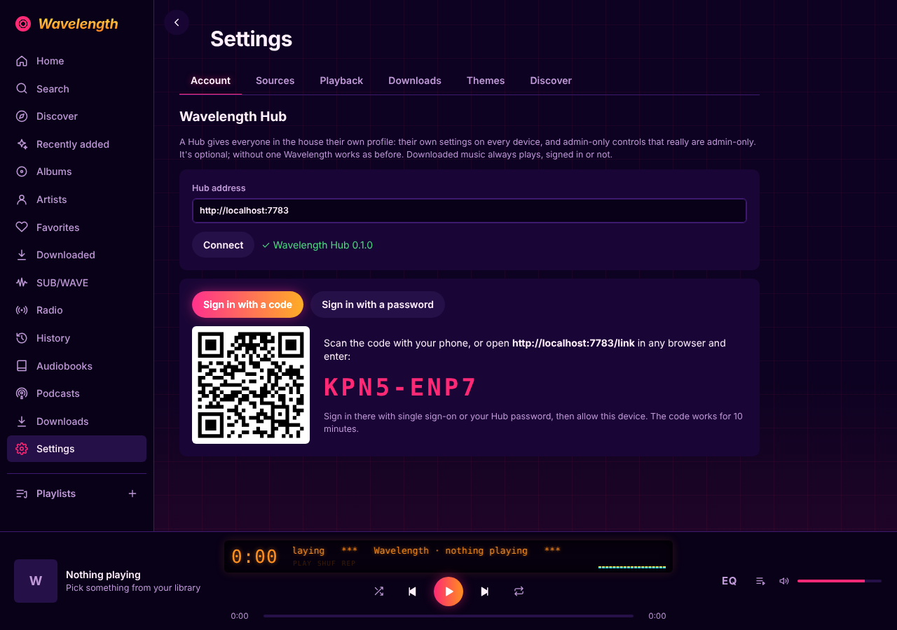

### What follows you between devices

Once you're signed in, your **theme** (and Seasonal / Random daily), **equalizer**, **volume levelling and crossfade**, **Now Playing scene** and **critter**,
**radio stations** (favorites, hidden and order), **Discover chart picks** and **playlist covers** sync to your profile. Change the
skin on the TV and your phone has it next time it checks in (at start, when the window gets focus, and every
few minutes; **Sync now** does it at once). Each setting syncs on its own, so changing the EQ on one device and
the skin on another never overwrite each other. Changes made with no connection are kept and sent later.

Server logins your admin keeps on the Hub arrive too: Plex, Audiobookshelf and SUB/WAVE show up in
Settings → Sources marked **from your Hub**, and people allowed to download can use the Hub's deemix and
yt-dlp from Downloads (on Android too). Your own Navidrome login arrives too once an admin has set one up for you; downloaded music stays on each device. **Downloaded music always
plays**, signed in or not, with or without the Hub.

### Server logins on the Hub (admins)

- **Settings → Sources → Move to Hub** puts a Plex, Audiobookshelf or SUB/WAVE server (and its login) on the
  Hub. It keeps its place in the list and its downloads on this device. Servers you add while signed in go
  to the Hub straight away.
- **Edit** a Hub server to change it for everyone, and to pick **who can use it**: Everyone, Admins only, or
  People I choose. **Own login** gives someone their own Plex token or Audiobookshelf key.
- **Settings → Downloads → Move to Hub** hands deemix (with its ARL) and yt-dlp to the Hub. From then on the
  Hub does the downloading: deemix with the ARL it keeps, and yt-dlp straight into a folder inside its music
  folder (pick the folder there; no network-share login). It works from any device, phones and TVs included.
  Change the settings there and press **Save to Hub**.
- SUB/WAVE DJ controls, the schedule and shows go through the Hub too, which keeps the SUB/WAVE admin login.
  No device is sent that login or the deemix ARL, not even yours.
- Members and kids never get SUB/WAVE admin controls. Downloads are for admins and people with
  **Autodownload**; everyone else sees "Your Hub admin looks after downloads".

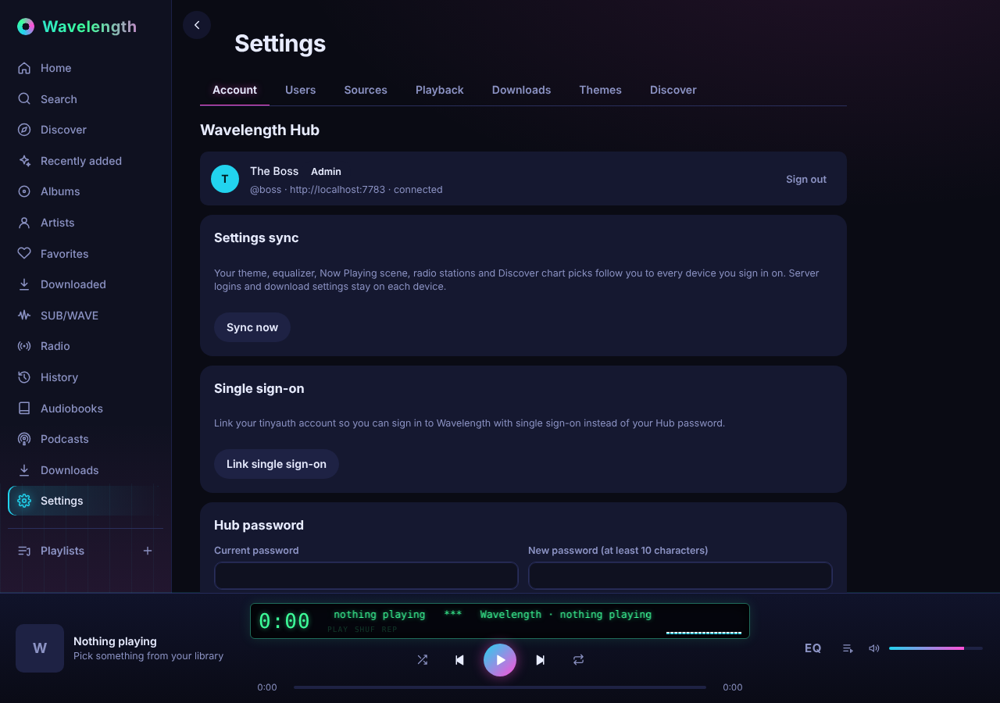

### Linking single sign-on to your account

If you've been signing in with a Hub password and want to use tinyauth instead, link the two once. Either:

- **From the app:** Settings → Account → **Link single sign-on**. Open the link it shows (or scan its QR code)
  in a browser, sign in to tinyauth, press **Link**, then press **Done** in the app.
- **From the browser:** start **Sign in with a code** and choose single sign-on. If tinyauth knows you but no
  Wavelength account is linked yet, the page asks for your Wavelength username and Hub password once, links
  them, and carries on signing in the device.

After that, single sign-on is enough; your Hub password keeps working too. **Unlink** is in the same place
(only if you have a Hub password, so you can't lock yourself out).

### Your devices

Settings → Account lists every device signed in to your profile. **Sign out** next to one (a lost phone, an old
TV) and it's signed out at once.

### Two-step sign-in

Settings → Account → **Two-step sign-in** adds a code from an authenticator app (Google Authenticator, 1Password,
Aegis…) to signing in with your Hub password. Scan the QR code, type the 6-digit code to turn it on, and keep the
10 **recovery codes** it shows somewhere safe: each one works once in place of a code if you lose your phone.
From then on, signing in with a password (in the app, or on `/link` in a browser) asks for the code too.
Single sign-on through tinyauth is left to tinyauth. Turning it off takes your password and a code. An admin can
**Reset 2-step** for someone who lost both their phone and their recovery codes, and the Users tab marks admins
without it.

### More than one person on a device

A TV or a shared tablet can keep everyone signed in. Settings → Account → **People on this device → + Add
someone** signs in another person, and their name then switches to them in a tap, with their own settings,
playlists, requests and Inbox. **Ask for a PIN before switching to me** keeps the others out of your profile by
accident (it's checked on this device only). Leaving a kid profile takes the grown-up PIN. **✕** signs someone
out of this device.

### Who's listening? (families)

On a Hub with families (an admin sets them up under **Settings → Users → Families**), the button with your initial at
the top of the sidebar (top right of **Library** on phones) shows everyone in your family. Tap someone, type their
**switching PIN**, and Wavelength is theirs: their settings, playlists, history and requests. They don't need to
have signed in on this device before. Set yours under **Settings → Account → Switching PIN**; without one, nobody can
switch to you. Grown-ups can switch to their family's kids without a PIN; kids always need one.

A family's **manager** gets **Settings → My family**: depending on what the Hub admin allows for the family, they add
people to it, look after its kids (parents, bedtimes, limits and the family's own grown-up PIN) and set its own keys. The Hub
admin sees and decides everything; nobody else sees family settings.

### Shared keys (admins)

**Settings → Users → Families → Shared keys** keeps keys on the Hub so nobody types them into a device: the AI DJ's
keys, tour dates, Last.fm, fanart.tv and the Discord application ID. Set them for the whole Hub, or for one family
(that family's own wins for its people). The Hub's Discord application ID wins over one typed on a device, so
**Settings → Playback → Discord status** only needs switching on.

### Managing people (admins)

Admins get a **Users** tab:

- **Add someone**: username, display name, role, and a Hub password and/or their tinyauth username.
- **Invite someone**: pick a role (and Autodownload for a member) and get a link and QR code to send. They
  open it in a browser, or paste it under **Settings → Account → I have an invite** (or as the Hub address),
  and choose their own username and password. Each link works once and stops working after the days you pick.
- **Role**: Admin, Member or Kid. Changes apply straight away, no re-login.
- **Autodownload** (members only): lets them download without your approval. Without it, their **Get** buttons say **Request** and you approve in the Inbox. Kids can never have it.
- **Set password**, **SSO** (link or unlink their tinyauth username), **Turn off** (signs out all their devices), **Delete**.
- **Parents** (on a kid's row): the grown-ups whose approval that kid's requests need, besides the admins. A
  parent sees the kid's requests in **Inbox → To approve** and can approve or reject them (Soulseek picks and
  clearing the list stay with admins), and gets the kid's **weekly report** each Monday: songs, minutes, days
  and top artists. Kids without parents have their report sent to the admins.
- **Reset 2-step**: turns off someone's two-step sign-in.
- **Signed-in devices**: everyone's devices, with **Sign out**.
- **Activity**: recent sign-ins and admin changes.

The Hub refuses every one of these actions from a non-admin, so hiding the tab isn't what protects them.

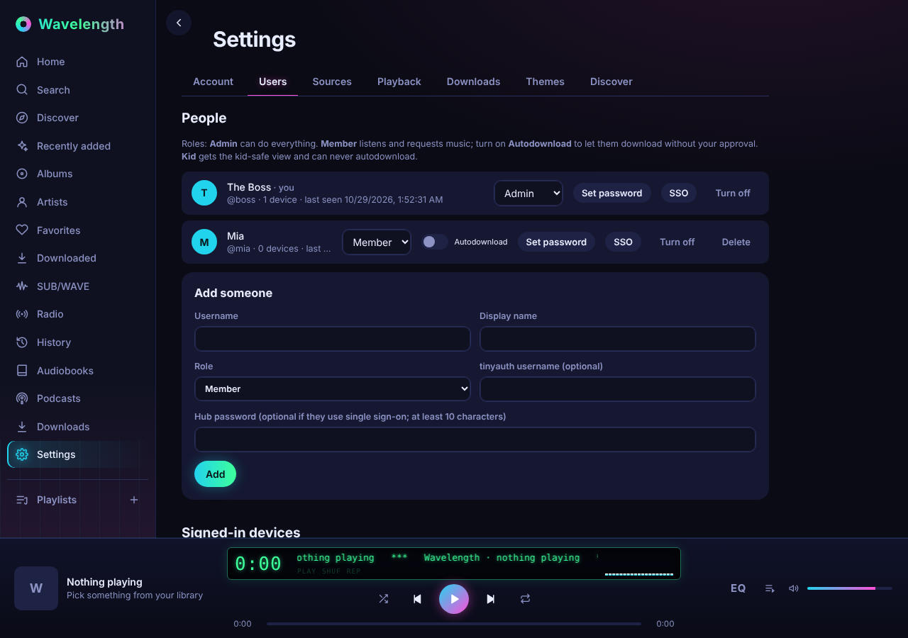

### Requesting music

Signed in to a Hub without **Autodownload**, the **Get** buttons in Downloads, Discover and Release Radar say
**Request** instead. Search Deezer in **Downloads** as usual, or paste a YouTube, SoundCloud or Bandcamp link
under **Not on Deezer?**. Your requests and their answers are in **Inbox → My requests** (and in the side
panel of Downloads): *Waiting*, *Downloading*, *Adding to your library*, *Ready*, *Already in the library*,
*Not this time* (with the admin's reason) or *Download failed*. You can cancel one that's still waiting.
When it's **Ready**, the Inbox badge lights up and **Play** finds it in your library and plays it.

**Notifications:** while Wavelength is in the background, a request that's ready or was turned down, something
shared with you, and (admins) a new request also pop up as a system notification. Turn them off for one
device under **Settings → Account → Notifications**. On Android they come while the app is open or playing in
the background; in a browser, allow notifications for the page when asked.

**While Wavelength is closed:** once an admin has set up push notifications (**Settings → Server → Push
notifications**: `https://ntfy.sh`, or your own ntfy server), **Settings → Account → Notifications → When
Wavelength is closed → Turn on** gives you a private topic. Install the free **ntfy** app, then tap **Subscribe in
ntfy** (or scan the code), and **Send a test**. Everything the Hub would notify you about then also arrives through
ntfy, on Android, iPhone or a computer. **New topic** cuts off anyone else who subscribed to the old one.

**Admins:** add a Navidrome admin login under **Settings → Server → Library updates** and the Hub asks
Navidrome to scan as soon as a download finishes (requests and your own downloads), so new music shows up
in a minute instead of at Navidrome's next scheduled scan. **Scan now** starts one by hand.

**Admins** see a number on **Inbox** when something waits. **Inbox → To approve** lists who asked for what,
with their note:

- **Approve**: the Hub downloads it, Deezer links with deemix and anything else with yt-dlp, straight into
  the music folder. If the download can't start it shows *Download failed* with the reason and **Retry**.
- **Already have**: nothing to download; they're told it's in the library.
- **Reject**: asks for a reason, which they see.
- **Soulseek…** (when your Hub has slskd): searches Soulseek for it; **Use this** on a folder downloads that
  and approves the request. It shows *Ready* once the files are in and Navidrome has scanned.

Admins and people with Autodownload skip the queue: their **Get** downloads straight away.

### Soulseek

With slskd added to your Hub (**Settings → Downloads → Soulseek**, admins: slskd's address and an API key),
**Downloads** gets a **Soulseek** tab for admins and people with Autodownload. Search for an artist and album;
results come in over a few seconds, grouped by folder (usually one album each), with the best matches from
people with a free slot first. Each shows how many songs, the format (FLAC or MP3 and its bitrate), the size
and whether you'd have to wait. Tap a folder to see its songs, **Download** to get it. **In slskd** below shows
how downloads are going. slskd saves into its own downloads folder, so point that at a folder inside your
music library (e.g. `/music/slskd`) and Navidrome picks the music up.

### Kid profiles

Someone with the **Kid** role gets a simpler Wavelength: a shorter menu with bigger buttons, **Ask for music**
instead of Downloads, and **Me** instead of Settings. Admins set each kid's **bedtime** and **minutes a day**
under **Settings → Users → Kid profiles**, along with one **grown-up PIN** for the household.

- At bedtime, or once today's minutes are used up, the music stops and a "Time for bed" screen covers the
  app. Minutes add up across all the kid's devices, and bedtime uses the device's clock, so it works offline.
- **A grown-up can unlock** on that screen: the PIN gives 30 more minutes.
- **Me** shows how long they've listened today. **Sign out** (to switch profile) needs the PIN.

### Kid-safe music

On a **Kid** profile, Wavelength hides anything marked explicit and anything an admin hid from kids: in
albums, artists, search, playlists, favorites, Discover, Release Radar and Deezer browsing. The player won't
play it either, even from a shared playlist. Explicit and clean songs and albums carry an **E** or **C**
badge for everyone; that comes from your files' tags (Navidrome reads them) or from Deezer.

**Admins** get a **Kids** button on every song row, album and artist: **Hide this … from kids**, or **OK for
kids** for something marked explicit that's fine. It applies on every kid's device. **Settings → Users →
Kid-safe music** lists everything flagged, with **Remove**.

A song or album is marked for **the version you're looking at**. On an album page with the **Explicit** /
**Clean** switch, flip to the version first: **OK for kids** on the clean version doesn't let the explicit one
through, and hiding the explicit one doesn't hide the clean one. **Hide every version of this … from kids**
covers both. A song tagged explicit in its file stays hidden even inside a "(Clean)" album, unless you let that
song through.

> **After updating to 0.17.2:** earlier versions saved **OK for kids** under the explicit album's name even when
> you set it on the clean version, and song marks applied to both versions. When the Hub updates, every **OK
> for kids** on a song or album moves to the clean version, so explicit music is hidden again. If you really
> meant to let an explicit song or album through, mark it again. **Hide** marks on songs keep covering every
> version. The audit log records the change (`kids.flagsRepaired`).

**Files without the explicit tag, and Plex.** Under **Settings → Users → Kid-safe music**, **Check my
library** looks each album up on Deezer and records on your Hub which albums and songs are explicit. Your
files aren't changed. It takes a few minutes for a big library, can be stopped, and **Check new albums** later
only looks up albums it hasn't seen. Albums Deezer doesn't have stay as they are, so flag those by hand if
needed. When Deezer has a clean version of an explicit album, the album page shows **Get clean version**
(**Request clean version** for people without Autodownload).

**Getting the clean versions in one go.** **Inbox → Clean versions** lists every explicit album the library
check found a clean version of (the summary under **Library check** links to it). Each row has a **play**
button that previews the clean album's 30-second clips, and **Download** (or **Request**). Tick albums, or
**Select all**, and press **Download selected**, or **Download all** for the lot. Each row shows where it is:
**Queued**, **Downloading 40%**, **Downloaded**, **Failed** (with **Retry**), or **In your library** when you
already have a clean copy. Albums already in your library or already sent are skipped, and Wavelength remembers
what it sent on this device, so you won't download one twice. The tab shows up once the check has found at
least one clean version, for anyone who can download or request music (not on kid profiles).

**Where clean versions go.** Deezer gives a clean album the same name as the explicit one, so deemix would
normally save it to the same folder and skip every song as already there. When your Hub runs deemix, Wavelength
saves each clean version to its own folder instead, named like the explicit one with **(Clean)** on the end
(*Rihanna - Loud (Clean)*), and your explicit copy stays where it is. To do that, the Hub waits until deemix
has nothing else to do (the row says **Waiting for deemix**), adds " (Clean)" to deemix's album folder name
while that one album starts, then puts deemix's setting back. With a music folder on the Hub, the songs' album
tag gets " (Clean)" too, so Navidrome shows the two versions as separate albums, the album page gets its
Explicit / Clean switch, and kid profiles play the clean one. **Get clean version** on an album page works the
same way. If deemix runs on your device instead of the Hub, clean versions go wherever deemix's own settings
put them.

So that new downloads carry the tag, open deemix, go to **Settings → Tags** and tick **Explicit lyrics**.

**Which Deezer album counts as the clean version.** The library check only offers a Deezer album that Deezer
marks as edited, or whose songs are all not explicit and include the edited versions of the explicit album's
explicit songs. Up to 0.17.1 it took any album with the same name that Deezer didn't call explicit, so some
"clean versions" weren't clean. In **Inbox → Clean versions**, admins can press **Check clean versions** to
fix that: it checks every clean version on offer on Deezer and drops the ones that aren't (they leave the list),
then goes through the clean copies already in your library and lists any to look at, either because songs in
them are tagged explicit or because they came from one of those wrong albums. Tick them (or **Select all**) and
**Delete selected** (to the Hub's trash for 30 days; the explicit albums stay) or **Hide selected from kids**.

**Explicit and clean versions.** When your library has both versions of an album (for example *Loud* and
*Loud (Clean)*; it's the name that says which is the clean version, not the files' tags), its page has an **Explicit** / **Clean** switch, and **Get
clean version** goes away. Under **Settings → Playback → Explicit and clean versions**, **Prefer clean** or
**Prefer explicit** shows only that version in album lists and opens albums on it (**Show both** is the
default). It follows you to your other devices. Kid profiles always get the clean version.

Flags match by artist and title, so a song is hidden however a kid reaches it. Kids' devices reach Navidrome
through the Hub without ever getting the Navidrome password, and the Hub refuses to stream them anything
explicit or flagged, so another app wouldn't get around it either.

### Fixing tags (admins)

On a Navidrome album's page, **Edit tags** shows the album's tags as they are in the files: album, album
artist, year and genre for the whole album, and disc, number, title and artist per song. Type over anything,
or press **Find on Deezer and MusicBrainz** and **Use this** on the right match to fill everything in, then
check it and **Save**. Your Hub writes the tags into the files (the audio isn't touched) and Navidrome rescans
a minute later. **Undo** puts them back; older saves can be undone under **Settings → Server → Tag edits**.

The artist, album artist and genre boxes suggest the names already in your library as you type, so you can
pick the existing spelling instead of making a new one.

**Edit artist**, on an artist's page, changes an artist in every song on all their albums. **Credited as** is
how the files name them now, **Change to** is the new name. To merge two spellings ("Beatles" and "The
Beatles"), open one and change it to the other. It can also set one genre for all their songs. With **Also
where they're credited with others** on, "Artist feat. Someone" and "Someone & Artist" change too. Every song
that will change is listed first, by album; untick an album to leave it alone. **Undo** works as for albums.
Some taggers join several artists into one credit with a semicolon, so the library shows an artist like
"Lil Baby;Jeremih". Open that artist's **Edit artist**: it finds the songs with that credit (even when they're on
someone else's album) and starts **Change to** as the first artist, with buttons for "Lil Baby", "Lil Baby feat.
Jeremih" and "Lil Baby & Jeremih". To split joined credits across the whole library instead, use **Library care →
Unmatched songs** (see [Library care](#library-care)).
To merge several artists at once, or to merge albums, use **Select → Merge** on Albums or Artists (see
[Merging albums and artists](#merging-albums-and-artists-admins)).

Your Hub needs your music at `/music`, read-write, and the Navidrome admin login (Settings → Server).

### Tidying genres (admins)

New music often comes in with messy genres: one album says "Hip Hop", the next "Rap/Hip Hop", another "Trap". Your
Hub keeps one genre per kind of music instead, with the sub-genre next to it: **Rap; Hip-Hop** for rap, **Rap;
Hip-Hop; Trap** for trap, **Electronic** for EDM, **Electronic; Deep House** for deep house, and so on. Browse then
shows Trap inside Rap / Hip-Hop.

- **New downloads** get the tidy genre before they show up in your library. Turn this off under **Settings →
  Server → Genres** if you'd rather not.
- **Review library genres** (same place) lists the albums already in your library whose genre isn't tidy, with
  what it would become. Change the suggestion if you like, then **Apply** one album, tick some and **Apply
  selected**, or **Apply all**. **Undo** puts them back (also later, under **Tag edits**). **Keep** leaves an album
  as it is.
- **Genres without a rule** are ones your Hub doesn't know yet, like "Afrobeats" or "Christmas". Type or pick what
  each becomes and **Save rule**, or **Keep** it as a genre of its own. With **Sub-genre** ticked (the default) it
  stays next to the genre, so "Afrobeats" → Pop gives **Pop; Afrobeats**; untick it to just make it Pop. New
  downloads follow the rule from then on.
- **Rules** shows each genre with its sub-genres and other spellings. × on a sub-genre stops keeping it (it just
  becomes the genre); × on a spelling stops changing it. Add your own, or **Reset to defaults**.
- Albums tidied before sub-genres existed only say **Rap; Hip-Hop** or **Electronic**: the sub-genre was dropped back
  then. Set one by hand in the review's box (for example "Electronic; Techno") or in **Edit info**.

Once a week the Hub looks over the library's genres by itself. When it finds albums or genres that need
tidying that it hasn't told you about, admins get one **Genres to tidy** notification; clicking it opens the
review.

It needs the same setup as fixing tags: your music at `/music`, read-write, and the Navidrome admin login.

### Deleting an album (admins)

**Delete album** on a Navidrome album's page removes it from your server. The files aren't deleted straight
away: they move to a hidden folder in your music library that Navidrome skips, and **Settings → Server →
Deleted albums** has **Put back** for 30 days. After that, or with **Remove now**, they're gone for good.

### Changing cover art (admins)

Admins can give any album or artist a better picture, for everyone on your Hub. Open the album or artist and
press **Change cover** (albums) or **Change picture** (artists).

- Wavelength looks it up on **Deezer**, **Apple Music** and **MusicBrainz's Cover Art Archive** (and
  **fanart.tv**, if your Hub has a fanart.tv key). Each result says where it's from. Click one to use it.
- Not the right album? Change the artist or album in the search boxes and press **Search**. The picture is
  still saved for the album you opened.
- **Upload a picture** from your computer or phone, or paste an image link and press **Use link**.
- **Use the server's picture** goes back to the art from Navidrome or Plex.

The new picture shows everywhere in Wavelength on every device, the browser included: album and artist
pages, the grids, song lists, the player, Now Playing and your phone's lock screen. Your music files aren't
changed, so other apps keep showing the old art.

### Sharing with each other

**Share** sends something to one person on your Hub, or to **Everyone**, with an optional note. It's on
playlists (yours and Navidrome/Plex ones), albums, artists, radio stations, every song's row, and **Favorites
→ Share favorites**.

What you're sent is in **Inbox → Shared with you**, with who sent it. **Play** finds the songs in *your*
library (by title and artist, since everyone's servers and logins differ) and plays them; **Save as playlist**
keeps them as a Wavelength playlist, and it tells you how many it couldn't find. A station plays straight
away, and an artist opens a search. **✕** takes it off your list. **You shared** lists what you've sent, with
**Unshare**.

### Public links

With **Public share links** on (**Settings → Features**, never for kid profiles), **Share** on a playlist, album,
song or artist also has **Anyone with the link**: **Copy a link for a week** or **Copy a link that lasts**. The
link opens a page in any browser with the cover, the song list, your note, and buttons to find each song on
YouTube Music, Spotify, Apple Music or Deezer. No music, files or logins go out, only names. It works for people
who can reach your Hub's address (`WAVELENGTH_PUBLIC_URL`), so the Hub has to be reachable from the internet for
friends outside the house. **Settings → Account → Your public links** shows how often each was opened, and
**Take down** removes one. Turning the feature off hides them all.

### Household playlists

**Playlists → Household** holds playlists the whole house adds to ("Saturday cleaning", "Road trip"). **Start
it** with a name and everyone (except kid profiles) is told. On one, **+ What's playing** and **+ From my
playlist…** add songs, and **Add to household…** on any of your playlists adds all of it. Each song shows who
added it. **Play** finds the songs in *your* library, like a share does, and lists the ones you don't have. Anyone
can reorder; a song can be taken off by whoever added it, whoever started the playlist, or an admin, and only
those last two can rename or delete it.

### Your month in music

On the 1st of each month the Hub sends everyone a short "Your October in music" notification (minutes, songs,
most-played artist). Tap it to open **Rewind**.

> **Developer notes.** Requests: `hub/src/routes/requests.ts`; sharing: `hub/src/routes/shares.ts`; the app
> side is `src/lib/inbox.ts` (badge counts, `requestMusic`, share snapshots; cover links carrying a login are
> left out), `src/components/ShareButton.tsx` and `src/views/Inbox.tsx`.

> **Developer notes.** `src/views/HubSettings.tsx` (Account and Users tabs), `src/sources/hub.ts` (typed API
> client), `src/store/hub.ts` (signed-in profile, persisted as `tonearm.hub`; `useCan(perm)` is true for
> everything when no Hub is signed in), `src/lib/hubSync.ts` (settings sync: per-key last-writer-wins with
> change times in `tonearm.hubStamps`, pushed 2 s after a change). Add a setting to sync by adding its
> `useSettings` key to `SYNCED`. The Hub side is documented in [HUB.md](HUB.md).

## Listening with the screen off (Android)

Music keeps playing when you lock your phone or switch to another app, and moves on to the next song as
usual. While something is playing, Wavelength shows a playback notification with previous, play/pause and
next; the same controls appear on the lock screen, in your car and on Bluetooth headphones. Unplugging
headphones (or a Bluetooth headset disconnecting) pauses the music instead of switching to the speaker.

If the music still stops a few minutes after you lock the phone, the phone's battery saver is closing
Wavelength. Open **Settings → Apps → Wavelength → Battery** and choose **Unrestricted** (on Samsung, also take
Wavelength off the **Sleeping apps** and **Deep sleeping apps** lists). Keep Wavelength's notifications
allowed: Android needs the playback notification to keep a music app running. Swiping the notification away
pauses the music.

### Android Auto

Plug the phone into the car (or use wireless Android Auto) and Wavelength shows up with the other music apps:
**Playlists** (yours and your server's), **Recently added**, **Favorites** (with **Liked songs**) and **Radio**,
with covers. Pick something to play it; the car's search box and "Hey Google, play *something* on Wavelength"
work too. Kid profiles only see what's allowed for kids. Wavelength needs to be open on the phone (it can be
in the background); if it isn't, the car says so and Wavelength tries to open itself.

### Home-screen widget

Long-press the home screen → **Widgets** → **Wavelength**: the song that's playing with its cover, and previous,
play/pause and next. With nothing playing, tapping it opens Wavelength.

> **For developers:** see `src-tauri/gen/android` in [ARCHITECTURE.md](ARCHITECTURE.md) §5 (`PlaybackHost`,
> `MediaPlaybackService`, `PlaybackPolicy`). Android Auto: `MediaPlaybackService` is a
> `MediaBrowserServiceCompat`; `MediaBridge.browse` asks the page (`src/lib/carBrowse.ts`) for each folder, and
> `ArtProvider` serves the covers as `content://` links. Who may browse: `CarAccess.kt`. The widget is
> `NowPlayingWidget.kt`. The Android workflow (`.github/workflows/android.yml`) builds one ABI and runs the Kotlin
> unit tests on every pull request that touches `src-tauri`.

## Updates

The Windows, Mac and Android apps and the Linux AppImage check GitHub for a newer Wavelength on launch and every 6 hours. When there is
one, a bar appears at the top of the page: **Install update**, **What's new** (opens **Settings → Updates**
with the release notes) or **✕** to hide it until the next launch.

**Settings → Updates** shows the version you're on, when it last checked, and the newer release if there is
one. **Check now** checks straight away.

- **Windows (installed with the setup exe):** **Install update** downloads the new setup exe and runs it with
  just a progress bar. It closes Wavelength, installs over it and opens it again.
- **Windows (portable `Wavelength.exe`):** the new `Wavelength.exe` replaces the old one in the same folder
  and restarts. The folder has to be writable (not `C:\Program Files`).
- **Mac:** the new Wavelength.app replaces the old one where it is (usually Applications) and opens again. The
  folder has to be writable by you, which Applications is for the account that installed Wavelength.
- **Linux (AppImage):** the new AppImage replaces the old file and restarts. A **.deb** install is updated the
  usual way: download the new .deb from the releases page and open it.
- **Android, Android TV:** the APK downloads, then Android's own install prompt appears; tap **Install** (or
  **Update**). The first time, Android asks you to allow **Install unknown apps** for Wavelength: the button
  says **Allow installs from Wavelength** and opens that switch; turn it on, come back and tap **Install
  update** again. Your settings, downloads and sign-ins are kept.

Options:

- **Check for updates automatically** (on by default). Off: only **Check now** checks.
- **Include pre-releases** (off by default). Pre-releases are test builds published before a release; turn
  this on to get them early.

Nothing is installed without you pressing **Install update**. A release published in the last half hour may
not show yet: its files are still being built.

**The first update-capable version has to be installed by hand** (download it from the
[releases page](https://github.com/Spacegoose02/wavelength/releases) as before). Older versions don't know
how to check. Every version after that can update itself.

> **Developer notes.** `src/lib/updates.ts` (store `useUpdates`, `pickUpdate`, `startUpdateChecks`, called in
> `App.tsx`), `src/components/Updates.tsx` (banner and the Updates tab), `src-tauri/src/update.rs` and
> `src-tauri/gen/android/.../UpdateBridge.kt`. The options are `updates` in the settings store (per device, not
> synced through the Hub). Releases come from the GitHub API through Rust (`update_releases`; GitHub wants a
> User-Agent). The newest non-draft release with a plain `vX.Y.Z` tag that's newer than the app's version and
> has a file for this install wins: `_x64-setup.exe` for installed Windows, `Wavelength.exe` for portable
> (decided by whether `uninstall.exe` sits next to the exe), `-android.apk` on Android. Downloads only accept
> URLs under this repo's `releases/download/`, go to `<app cache>/updates/`, and are cleared on the next launch.
> Windows runs the NSIS installer with `/P /R` (passive, restart afterwards). Android checks
> `canRequestPackageInstalls()` before downloading (granting it can restart the app) and opens the APK through
> the existing `FileProvider` with `ACTION_VIEW`; Android itself refuses an APK signed with another key. Dev
> builds (`npm run tauri dev`) never check.
